# [NE-271] 製作第三章守門人頭目戰

> 狀態：進行中

## 內文

### 需求
第三章夾層診所的門禁大廳要有守門人（JANUS）頭目戰。守門人是約六十歲的用盡者，被外接的門禁工作架困住：證件有效，工作架卻一直把拒絕通行當命令。玩家只能打工作架的外部部件（盾架、掃描臂、背上的通訊器），人物本身是保護區，戰鬥結束時他活著、坐回櫃檯。核心機制是「遺忘迴圈」：有效部件受擊時，守門人有時忘了流程，重複上一招，重複的那一招仍有完整預兆。

招式、提示與結果見 `design/13-story-v2/SCRIPT_CH03.md` 的 C10～C12，故事端的接點見 `design/13-story-v2/CH03_IMPLEMENTATION.md`。

### 來源
2026-10-11 故事主線 Session 落地第三章（ST-21）時拆出；頭目戰設計原則見 NE-253（每個頭目有獨立機制）。敵人與頭目屬於戰鬥 Session。外觀用既有的守門人角色（`art/characters/janus`）。

### 驗收條件
- [x] 盾擊約 1.0 秒抬盾並有地面扇區預告，可閃可擋；有效盾擊撲空三次後盾架裂開，次數存檔保留
- [x] 掃描臂約 0.8 秒橫線預告，可蹲或跳；蓄力時打橙色臂鎖會中斷，也可以繞背射擊外接臂鎖
- [x] 通訊器燈閃約 0.8 秒後呼叫增援，最多兩台巡檢器、同屏含頭目最多三個；打壞通訊器後不再增援
- [x] 遺忘迴圈：有效受擊約三成機率重複上一招，頭上出現問號，連續重播不超過兩次
- [x] 血條名為「門禁裝置穩定度」，子彈與近戰打到人物沒有傷害；穩定度歸零後要拔維修插銷才算停機，停機時啟動機關頻道 `ch3_janus_down`（門禁大廳關卡會寫入停機旗標，之後由故事端播扶椅與結算）
- [x] 戰鬥中的短句與首次敗北提示播故事端的 `ch3_c11_bark_sorry`、`ch3_c11_bark_repeat`、`ch3_c11_defeat_hint`
- [x] 重試時已裂開的盾、已打壞的通訊器與剩餘穩定度保留，不重抽已破的部件
- [ ] 鍵鼠與手把都能打完；普通難度不靠刷錢可通過，附實際戰鬥的連續畫面

### 外觀需求（交給角色美術 Session）
人物沿用守門人骨架；外接工作架目前是程式畫的暫代，換圖時只改資料。需要的零件與尺寸（遊戲尺寸，人物約 58 像素高、主角 44）：背後立柱與兩道箍帶、前方盾架（約 8×34，完整與裂開兩張）、盾鎖（約 6×6，盾架上緣）、前肩掃描臂（臂長約 22、臂鎖約 9×7、發射頭約 6×6）、背上通訊器（約 10×14 加天線；正常、呼叫閃燈、壞掉三張）、維修插銷（約 4×6）。姿勢：抬盾、推盾、撲空踉蹌、掃描蓄力、被打斷後退一步、手按通訊器、停機（站在架內垂手呼吸）。目前借用的動作：抬盾借盾衛犬的架盾、蓄力借重裝機槍手的架槍、呼叫借凜的講電話，換成守門人自己的動作時只改打法資料。

### 測試流程
1. 從門禁大廳的安全前室進入戰鬥，打到停機，確認守門人活著並坐回櫃檯
2. 在盾架裂開後死亡一次再重試，確認部件與穩定度保留

---

# 跟其他票的關係

- Blocks：ST-21、NE-231
- Blocked by：無
- Related：NE-253、NE-272、NE-97

---

# Commit-1

## 內文

**問題**：第三章門禁大廳只有預留的戰區，守門人還不能打；頭目框架也只認得看門狗那幾種招式。

**改動**：先查了五款作品的實際畫面（截圖附在下方，取捨寫在頭目設計文件第 6 節），定下守門人自己的機制：他是被門禁工作架困住的老人，人物是保護區，子彈與近戰打到他只會被擋下並冒灰色火花；能打的是工作架的外部零件。盾擊抬盾約 1 秒、地上亮出前方扇區，閃開或格擋都算撲空，撲空時盾上的鎖露出來可以打，撲空三次盾架裂開、正面也打得動。掃描臂約 0.8 秒畫出一條橫線，低線跳、高線蹲；蓄力時近戰打肩上的橙色臂鎖一下就打斷（第一次他會說「不好意思，我重新核對」），正面開槍有傷害但打不斷，要繞到背後才行。背上的通訊器閃 0.8 秒叫來一台抽水巡檢器，最多兩台、含他同屏三個，通訊器只有從背後打得到，打六下就壞、不再增援。工作架很重，轉身要 0.8 秒：撲空或被打斷後繞到背後，就是打通訊器和臂鎖的空檔（柱後的短上臺可以跳過去）。遺忘迴圈：每一招第一次被打中零件時有三成機率讓下一招重播上一招，頭上出現問號、通訊器旁顯示「程式重播」，重播一樣完整蓄力，連續最多兩次，第一次重播時凜提醒「他會重複，先看蓄力」。穩定度降到一半時掃描放大、蓄力慢一拍。穩定度歸零不是死亡：工作架停住，他頭上出現「拔維修插銷」的提示，到他背後按互動才停機，送出 `ch3_janus_down`，門禁大廳寫入停機旗標，工作架淡出、櫃檯旁坐著的守門人接手（之後是故事端的扶椅與結算）。盾裂、通訊器、剩餘穩定度存在故事旗標，死亡重試與續玩都保留，重試時已經停住的工作架直接等你拔插銷；第一次輸給他之後，再見面時播一次敗北提示。

頭目框架只加了很小的擴充點（已先單獨併進 main：資料宣告自訂招式種類、指定血條名稱），守門人的招式寫在他自己的子類別，看門狗不受影響。另加一個可重用的「一招只算一次」的攻擊判定，用來分辨盾擊打中還是撲空。

**驗收**：第三章敵人測試加了守門人：資料讀取無錯、預兆時間與兩種掃描高度（低線 8、高線 37，主角蹲下 30、站著 44）、看過登場劇情才醒、血條名稱、打人物與完整盾架都被擋下且穩定度不變、撲空三次裂盾並存檔、打中玩家不算撲空、正面子彈打不斷而近戰與背後子彈打得斷、第一次打斷播道歉、增援上限與通訊器只能從背後打壞、遺忘迴圈的機率（400 次約三成）與連續上限、第一次重播播凜的提醒、輸過一次後再見面播敗北提示、歸零停住不死且要站在背後才拔得到、拔了才送出頻道並淡出、重試還原盾裂與通訊器與剩餘穩定度（不會跟持久世界的損血重複扣）、在門禁大廳實際拔插銷會寫入停機旗標。Forward+（軟體 Vulkan）實際畫面看過每招的預兆、重播問號、裂盾與繞背、停機提示，以及一段不干預的連續畫面；第一次拍時發現臂鎖的發光圓點在泛光下把他的臉蓋白，改成部件本身變亮加細外框，臂鎖也移到前肩、離開臉。

**還沒驗**（待本機原生驗收）：實體手把與鍵鼠各從安全前室打到停機一次、普通難度不刷錢通過、原生顯示卡畫面。要拍的場景：盾擊扇區、低線與高線掃描、裂盾後正面輸出、繞背打通訊器、重播問號、拔插銷提示、停機後坐回櫃檯。外接工作架是程式畫的暫代（需求寫在上方）。

### 測試結果

| 項目 | 結果 |
|---|---|
| 第三章敵人套件（含守門人） | 144 / 144 通過 |
| 受影響範圍（39 個套件） | 88,080 項；首輪 3 項新失敗（每種敵人要有掉錢數值、看得到的頭要在受擊框裡）已修，重跑相關套件（第三章敵人、所有敵人生成、成長、經濟、音效、章節名單）0 失敗 |
| 經濟守門（NE-231） | 通過 |

分支：`feature/awesome-wozniak-gdkpap`，提交：https://github.com/deadline314/Nest-Egg/commit/0ce1c4d1（框架掛鉤先行：https://github.com/deadline314/Nest-Egg/commit/2f9e5153）

### 參考截圖（各作品實際畫面）

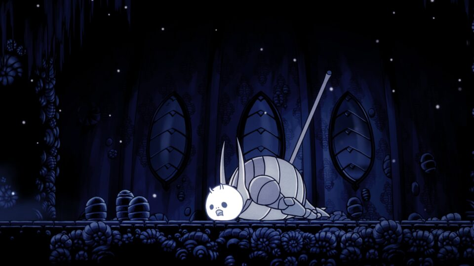
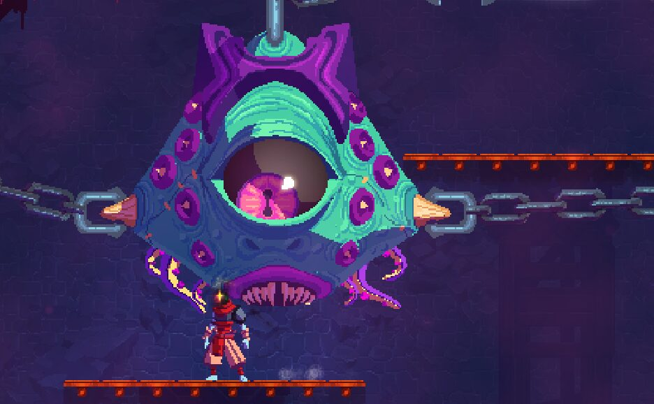
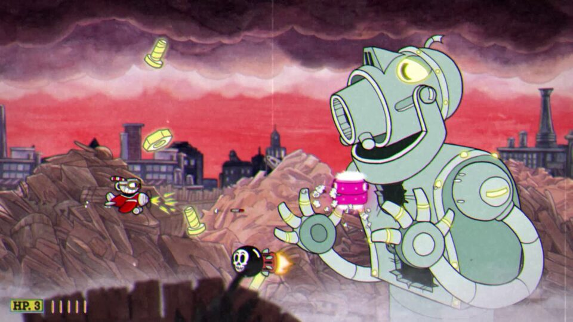
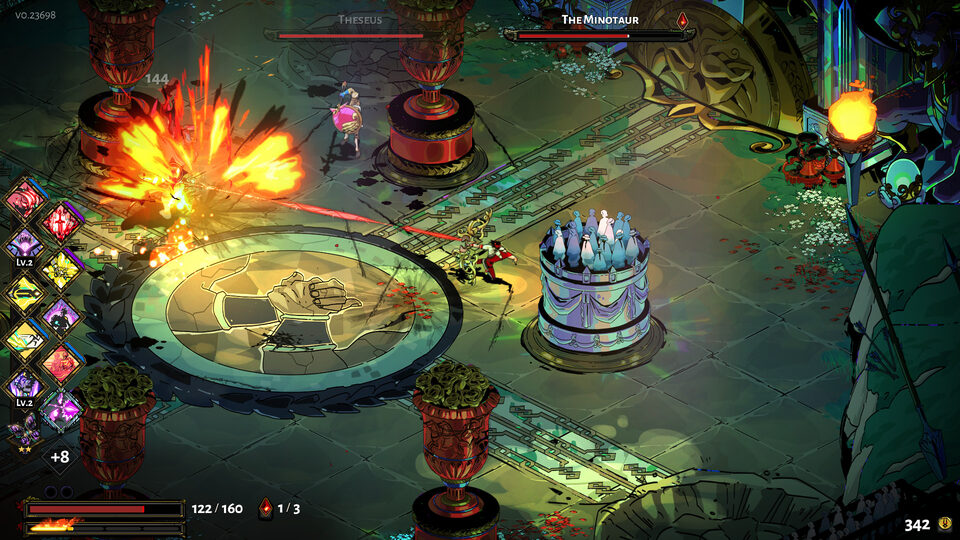
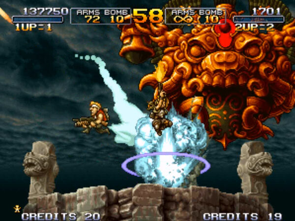

### 截圖

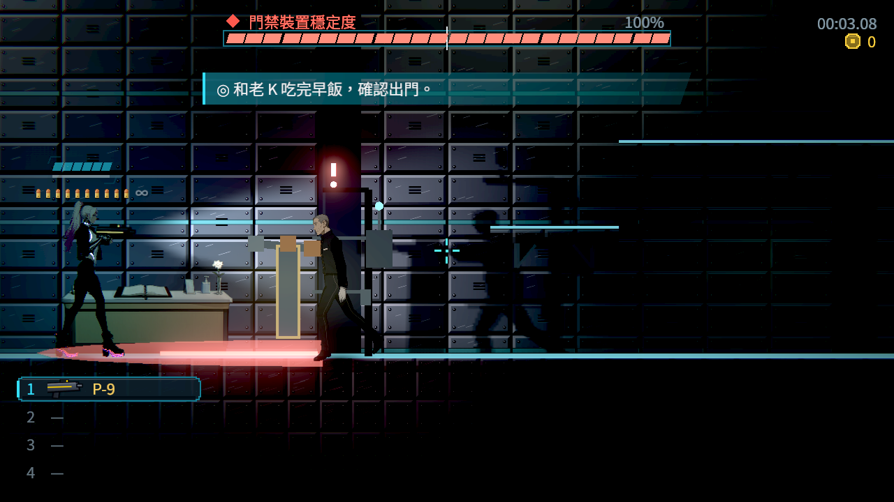
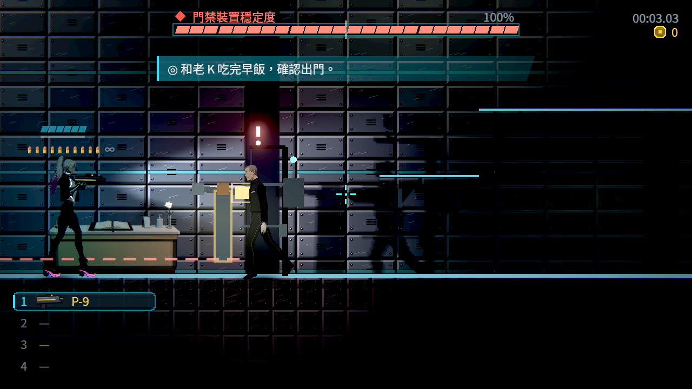

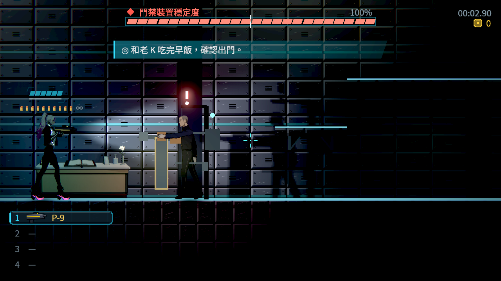
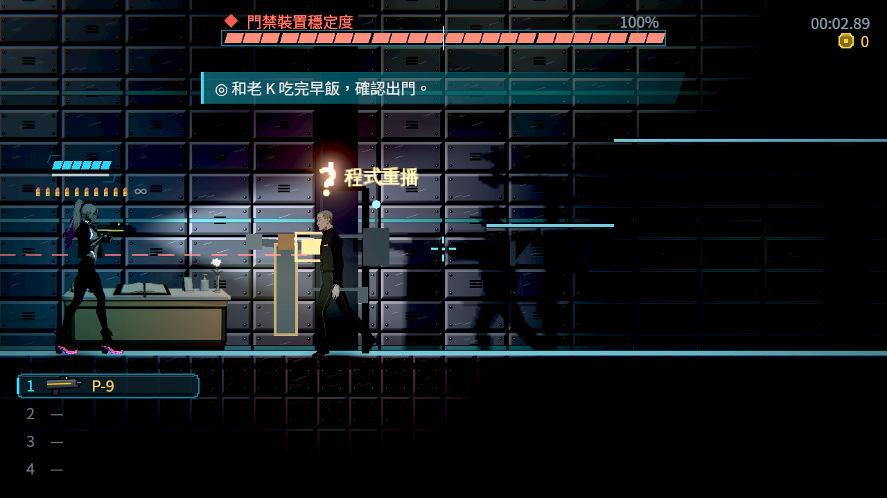
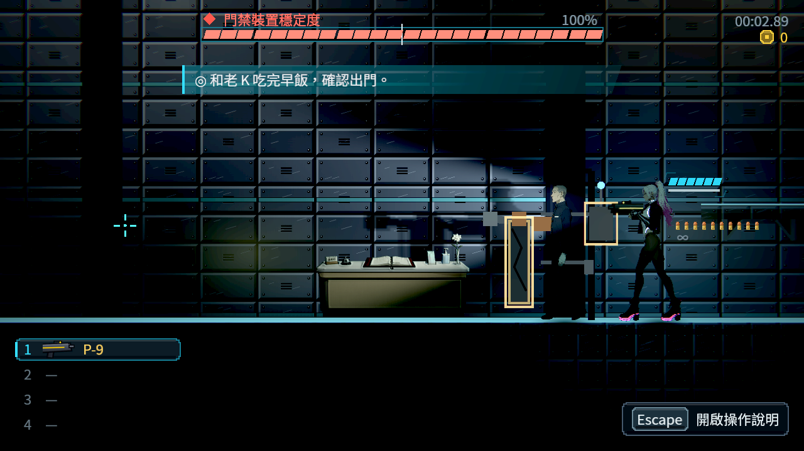
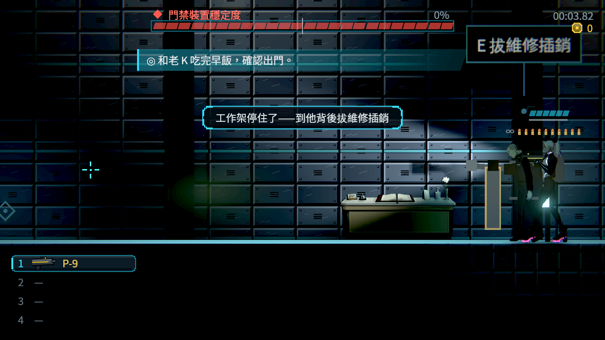
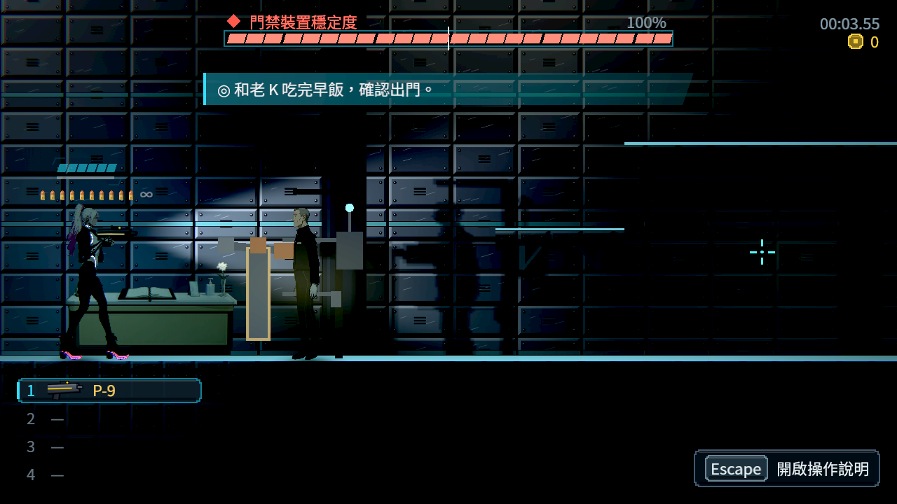
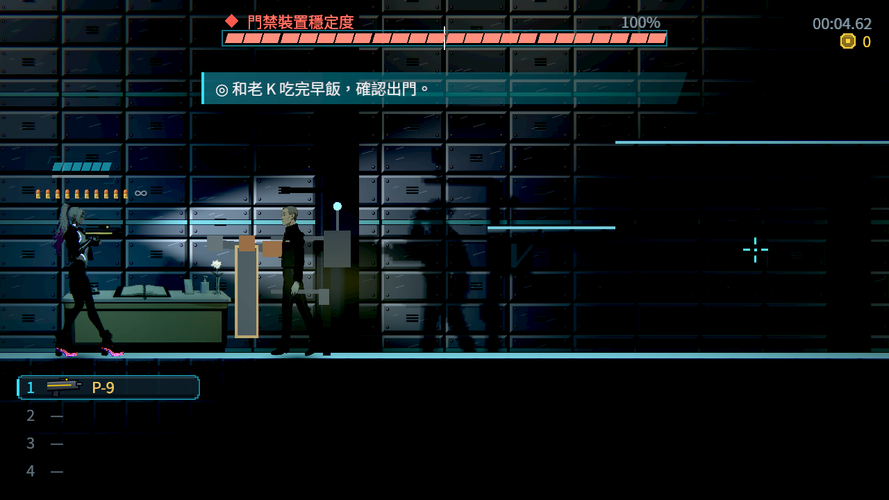
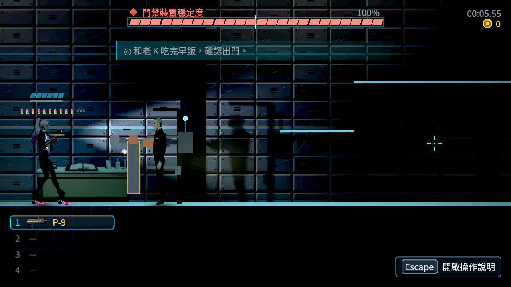
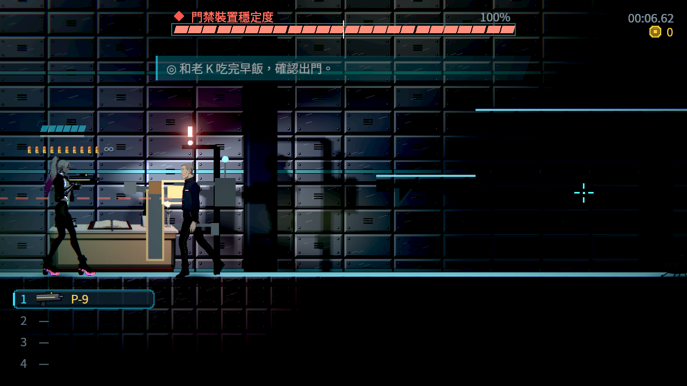
