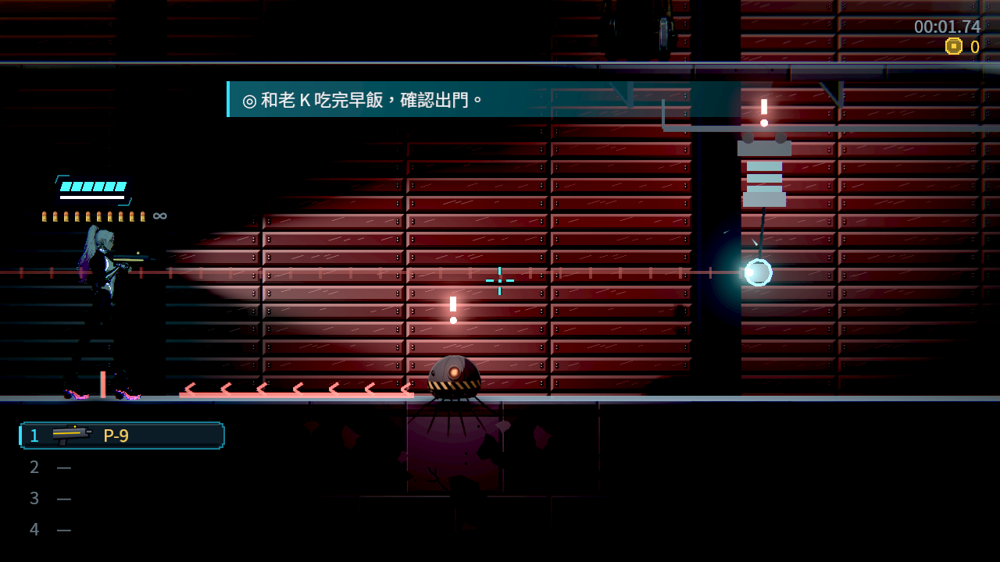
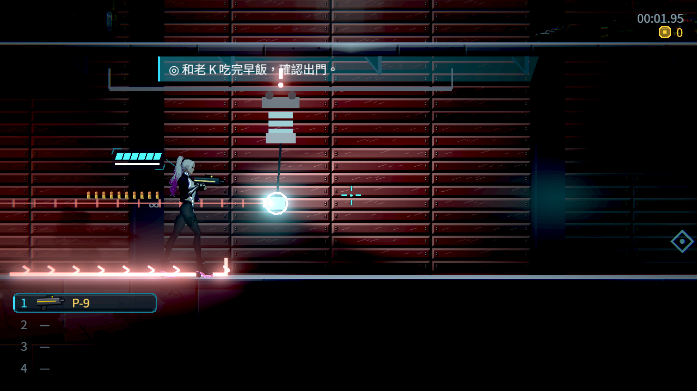
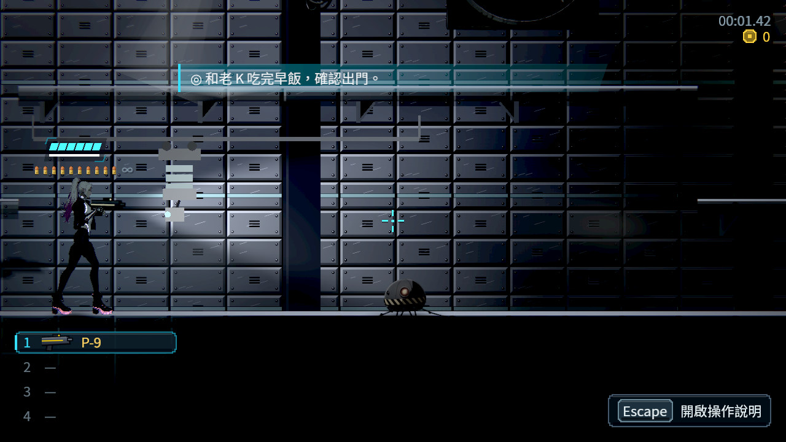

# [NE-272] 配置第三章泵室與夾層的兩種巡檢器

> 狀態：審查中

## 內文

### 需求
第三章的機房要有兩種本章才出現的機械敵人：「抽水巡檢器」（原本的泵室保全，短距離地面衝撞）與「絕緣巡檢器」（小型吊軌脈衝機，充電後打單束脈衝）。兩種的造型要看得出功能不同，不是把前章的人形敵人換色，也不是把水裡的病人當雜兵。遭遇放在故事端預留的戰鬥區：泵室下槽兩場短戰（都能沿乾燥上橋繞過）、夾層維修帶一場（能從照護步道繞過），以及守門人戰的增援。每場同屏最多三個，診所、門禁前室、玻璃邊緣與樣品房不放敵人。

地圖與戰鬥區位置由 ST-21 的區域產生器提供，見 `design/13-story-v2/CH03_IMPLEMENTATION.md`。

### 2026-10-12 角色美術組：開始畫之前要確認的事
票上寫了兩種機械敵人的攻擊方式與預兆時間，但外形、尺寸與移動方式還不夠畫。下列各項請戰鬥組或故事組在這裡回覆；沒有回覆的項目不動工。括號內是沒有意見時會採用的做法。

1. 兩種敵人在資料裡的名稱。（`pump_inspector`、`rail_inspector`）
2. 抽水巡檢器「原本的泵室保全」指的是機器，不是人？怎麼移動：輪子、履帶還是四足。（履帶式矮機器，不是人形）
3. 抽水巡檢器的判定框寬高，以及衝撞時是整台往前衝還是伸出撞頭。外形會照判定框畫，不反過來改判定。
4. 絕緣巡檢器掛在天花板的軌道上移動？軌道本身屬於場景（BG）還是跟著敵人一起畫。本體的判定框寬高，以及脈衝從哪裡打出來。（軌道歸場景，本體吊在軌道下、發射口在機身下方）
5. 各需要哪些狀態：待機、移動、預兆、攻擊、受擊、損毀。損毀後留在原地還是掉下來。
6. 「地面亮 0.7 秒」「充電 0.8 秒」的亮光是特效，還是機身上的燈也要跟著變？（機身上留一小處指示燈，其餘歸特效）

### 來源
2026-10-11 故事主線 Session 落地第三章（ST-21）時拆出；劇本 `design/13-story-v2/SCRIPT_CH03.md` 的 C02、C03、C11 與第 8 節素材表。敵人擺放屬於戰鬥 Session。

### 驗收條件
- [x] 抽水巡檢器衝撞前地面亮約 0.7 秒；絕緣巡檢器充電約 0.8 秒後打單束，玩家可擋、蹲或跳
- [x] 泵室與夾層的遭遇都放在預留的戰鬥區，玩家可以照劇本從上橋或照護步道繞過，不鎖主線
- [x] 每場同屏最多三個、近戰與遠距各一；安全區沒有敵人
- [x] 名單與數量符合每章敵人名單（NE-97 的規則），用資料整批調整
- [x] 外觀由角色 Session 交付前，暫代外觀列在票上

### 外觀需求（交給角色美術 Session）
目前的暫代：抽水巡檢器借用舊 Demo 自爆蟲的零件外觀（放大 1.6 倍）；絕緣巡檢器是程式畫的吊軌滑車。換圖時只改敵人資料的外觀欄位。
- 抽水巡檢器：低矮貼地的排水機，約寬 26、高 20 像素（遊戲尺寸，主角高 44）。前方有吸水嘴、底部輪或履帶，看得出是「沿地面推進」的機器，不是生物、不是人形。需要的狀態：巡邏、蓄力（機身壓低、吸水嘴對準前方）、衝撞、煞停喘息（排氣、機身後仰）。
- 絕緣巡檢器：掛在吊軌下的小滑車，約寬 18、高 22 像素，下方垂一條纜線與探頭（探頭約 8×6，會上下伸縮 0～60 像素）。滑車上要有成串的絕緣子，探頭充電時發青光。需要的狀態：待機、沿軌滑動、放下探頭充電、放電後收回。探頭要是獨立零件（它是可以打的部位）。

### 測試流程
1. 從廣場貨梯走到門禁大廳，分別走戰鬥路線與繞道路線
2. 確認每場遭遇的敵人數量與種類

---

# 跟其他票的關係

- Blocks：ST-21、NE-231
- Blocked by：無
- Related：NE-271、NE-97

---

# Commit-1

## 內文

**問題**：第三章的泵室與夾層只標了戰鬥區，沒有敵人；劇本要的兩種機房巡檢器也還不存在。

**改動**：新增兩種只屬於第三章的機械敵人。抽水巡檢器貼地巡邏，發現同一層的玩家就先在地上亮出衝撞路線（約 0.7 秒，紅色箭頭往前爬），沿亮線衝到底就停、煞停時是反擊空檔；路線碰到牆或地面斷掉就縮短，不會衝下平台。絕緣巡檢器掛在吊軌下滑到玩家附近，放下探頭到玩家胸口高度充電約 0.8 秒，最後 0.3 秒高度鎖定、水平預兆線變亮加刻度，然後打出一束水平脈衝：蹲下、跳起或舉盾都能躲。玩家站在吊軌上方（上橋、照護步道）兩種都打不到，所以劇本的繞道真的繞得過。擺放：泵室下槽第一場只有一台抽水巡檢器（先學會看地上的亮線），第二場一近戰一遠距；夾層維修帶一近戰一遠距；診所、門禁前室、玻璃邊緣與樣品房沒有敵人。數量寫在第三章產生器的一張遭遇表，整批調整改表重跑即可。第三章的關卡與兩種敵人也登記進章節名單，跨章互斥檢查開始涵蓋第三章。兩種敵人都有自己的敗北攻略卡與受擊特效。

**驗收**：新增第三章敵人測試：預兆時間、亮線停在掩體牆前且衝撞不超過亮線、玩家在上方平台時不出招、蹲下躲過脈衝而站著會被打中、吊軌上方安全、兩種死因各自解鎖攻略卡、三種難度都打得倒；第三章九張地圖逐一數敵人：只在戰鬥區、每場最多三個且近戰遠距各最多一個、第一次出現左側五格淨空、安全區為零。實際地圖的 Forward+ 截圖（軟體 Vulkan）看得到兩種預兆。截圖只看預兆與版面，沒有判斷效能；外觀是暫代，需求寫在上方。

### 測試結果

| 項目 | 結果 |
|---|---|
| 第三章敵人套件 | 79 / 79 通過 |
| 受影響範圍（新增測試套件，挑選工具要求全跑，6 程序） | 93,334 項；首輪 2 項新失敗（兩種新敵人缺音效設定）已補，重跑音效、章節名單、第三章敵人等 5 套件 29,641 項 0 失敗 |
| 產生器 | 第三章九張地圖可通行檢查通過，未動到的地圖重產後不變 |

分支：`feature/awesome-wozniak-gdkpap`，提交：https://github.com/deadline314/Nest-Egg/commit/0f66990f

### 截圖

---

# Commit-2（三張票一起檢查後的修正）

## 內文

**問題**：三張票合起來看時發現，抽水巡檢器沒看到玩家時會一直往前巡邏，直到碰牆或平台邊緣才回頭，可能走出戰鬥區、晃進電話亭或門禁前室這些安全區；守門人叫來的增援出生點也太靠近門禁前室。

**改動**：抽水巡檢器只在出生點左右 80 像素內巡邏（被引來時照常追）；守門人的增援改從大廳裡側進場（左 200、右 220 像素），巡邏範圍不會碰到前室與護理通道口。

**驗收**：新增測試：沒看到玩家時巡邏不超出出生點 80 像素。受影響範圍 31 個套件 51,346 項 0 失敗；整組互相影響的套件（章節名單、第三章敵人與劇本、經濟、所有敵人生成、攻擊令牌、遭遇、音效、成長）31,320 項 0 失敗。這次只動行為範圍，沒有畫面改變，所以沒有新截圖。

### 測試結果

| 項目 | 結果 |
|---|---|
| 第三章敵人套件 | 145 / 145 通過 |
| 受影響範圍 | 51,346 項 0 失敗 |

分支：`feature/awesome-wozniak-gdkpap`，提交：https://github.com/deadline314/Nest-Egg/commit/b649a7c2
