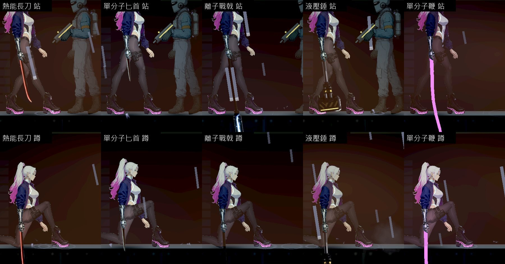

# [NE-273] 近戰武器待機與蹲下時不插進地板

> 狀態：待辦

## 內文

### 需求
主角拿著近戰武器站著不動時，武器沿著垂下的前臂筆直朝下。離子戰戟與單分子鞭比手到地面的距離還長，尖端會穿過地板，露在地面以下；蹲下時五把武器都會穿過地板。原本手上的武器是幾條細線時就是這樣，NE-260 換成有圖的武器之後更明顯。要讓武器在不出招的時候有一個合理的拿法（例如斜著拿、扛著、刃尖朝前或朝後），任何姿勢下都不低於腳下的地面。

出招時武器的方向、距離與判定不在這張票的範圍（那是招式資料）。

### 來源
2026-10-11，NE-260 驗收時用原生截圖看站、蹲、空中、衝刺四種姿勢發現。握法屬於主角動作，NE-260 只換圖與光，沒有動。

### 驗收條件
- [ ] 五把近戰武器在站著不動、走、跑、蹲、蹲走時，整把武器都在腳下的地面以上
- [ ] 空中與衝刺落地的那幾格，武器也不穿過地面
- [ ] 不出招時武器的拿法每把看得出差別或至少合理（長桿不拖地、鞭子的線不是一根直棍）
- [ ] 握把仍然對得上手，不離手、不穿過軀幹
- [ ] 出招的每一段，武器的方向、打得到的距離與修前相同（既有的近戰測試全過，不改測試）
- [ ] 原生截圖：五把武器 × 站、蹲、空中、衝刺，修前修後並排

### 測試流程
1. `godot --path . res://tools/melee_art_probe.tscn -- --out=<絕對資料夾>` 拍五把武器的四種姿勢
2. 逐張確認武器沒有低於地面
3. 跑既有的近戰測試

現況（上排站著、下排蹲下；由左到右：熱能長刀、單分子匕首、離子戰戟、液壓錘、單分子鞭）：

---

# 跟其他票的關係

- Blocks：無
- Blocked by：無
- Related：NE-260、NE-236、NE-117

---
