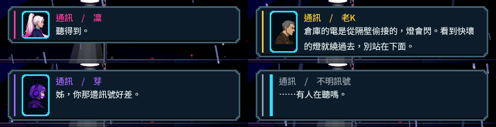
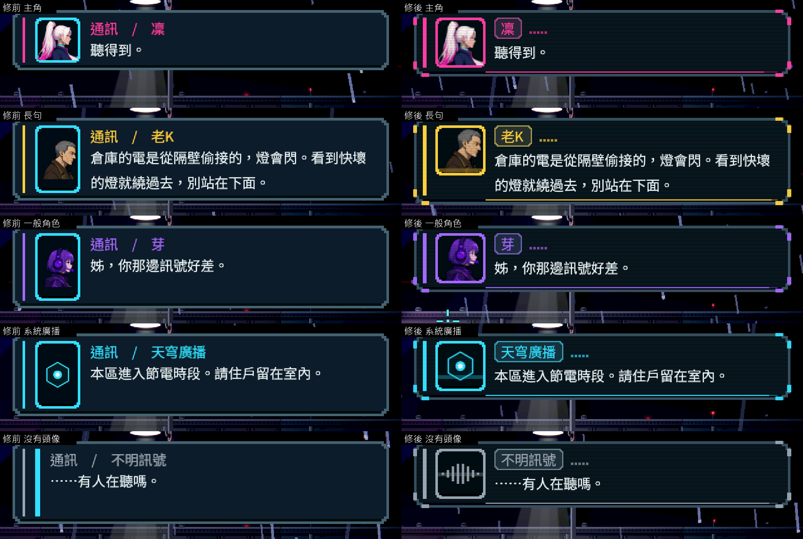
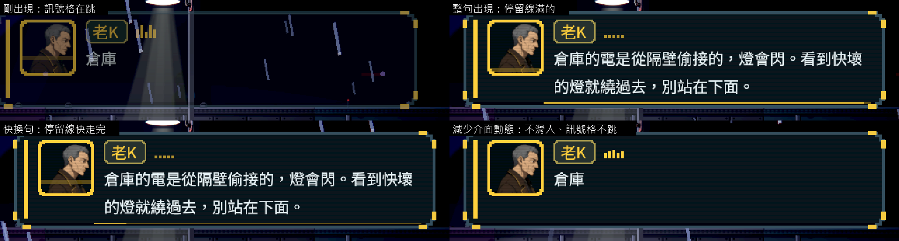
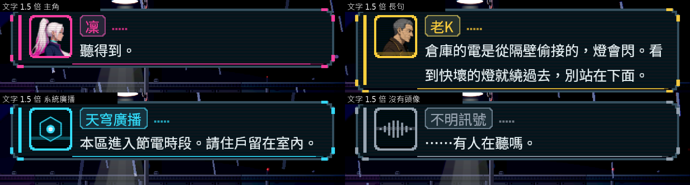
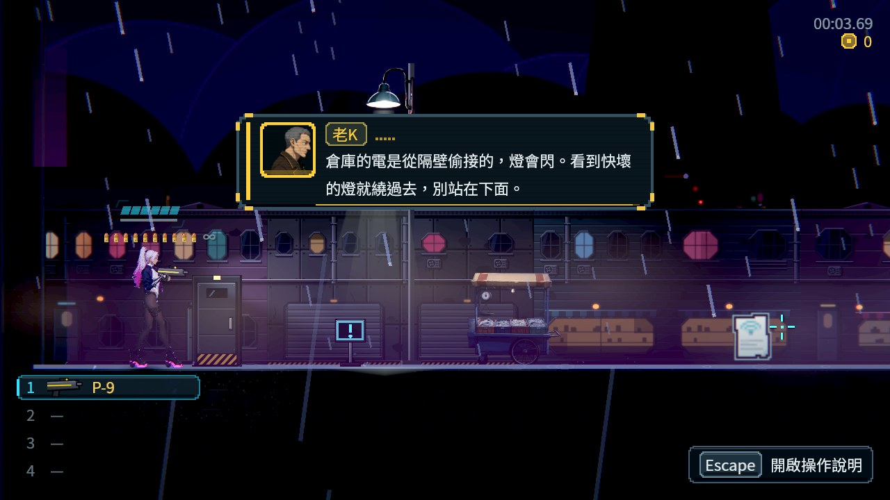

# [NE-274] 讓通訊對話框好看並拿掉種類字樣

> 狀態：審查中

## 內文

### 需求
遊戲進行中跳出來的通訊對話框（左上角、不暫停的那一種）看起來太簡略：一個小頭像、一行「通訊　/　凜」、一行字。使用者要它好看一點，並參考別的遊戲怎麼做。名牌前面的「通訊　/」也不要，資訊太多了。

驗收時另外發現同一個對話框的三個毛病，一起處理：出現過兩行的長句之後，後面只有一行的句子對話框還是維持兩行的高度；頭像框會跟著句子變高而拉長，頭像只占中間一小塊；沒有頭像的講者會留下一條細細的空框。

### 來源
2026-10-11，使用者附了「通訊　/　凜：聽得到。」的截圖：「這種對話框幫我優化一下，還是很簡略，看人家是怎麼做好看的類型。然後那個『通訊/』也不要，有點多了」。

### 驗收條件
- [x] 名牌只寫講者的名字，不再有「通訊　/」「交談　/」「閱讀　/」字樣；通訊仍然一眼看得出是通訊（不靠那兩個字）
- [x] 講者的顏色不只用在名字：頭像框、面板的重點色跟著講者換，同一個人永遠同一個顏色；不只靠顏色辨認（名字與頭像都在）
- [x] 頭像是固定大小的方格，句子變成兩行時不跟著拉長；沒有頭像的講者不留空框
- [x] 看得出這一句還會停多久才換下一句
- [x] 兩行的長句之後接一行的短句，對話框縮回一行的高度
- [x] 對話框不超出畫面、字不被裁掉；內文與底色的對比至少 4.5:1；文字放大到 1.5 倍時也成立
- [x] 設定的「減少介面動態」打開時，對話框裡沒有會動的裝飾
- [x] 通訊的排隊、停留時間、不暫停遊戲、被過場或暫停蓋住時收起來的行為和修改前相同（既有的對話測試全過；只改寫死「名牌要有通訊兩個字」的那三條斷言）
- [x] 原生截圖：五種講者（主角、一般角色、長句、系統廣播、沒有頭像）修前修後並排，另附文字放大與減少動態各一組

### 測試流程
1. `godot --path . res://tools/dialogue_box_capture.tscn -- --out=<絕對資料夾>` 拍五種講者，各拍剛出現、整句出現、快換句三張
2. 加 `--text-scale=1.5`、`--reduce-motion` 各跑一次
3. 跑受影響的測試

### 參考
- [遊戲對話框的組成與尺寸（名牌是連在框上的小標籤、頭像在左、短句用窄框、角色固定顏色搭配名字與頭像、內文不上色、對比 4.5:1）](https://www.abratabia.com/game-ui-design/dialogue-ui.php)
- [Cyberpunk 2077 的通話：浮在畫面上的小視窗，有頭像、名字與逐字稿，不打斷遊戲（玩家重製的說明）](https://sne1k.itch.io/cyberpunk-2077)
- [Signalis 的收訊器：有訊號在傳的時候指示格會亮](https://signalis.wiki.gg/wiki/Receiver)

現況：

---

# 跟其他票的關係

- Blocks：無
- Blocked by：無
- Related：NE-228、NE-246

---

# Commit-1

## 內文

通訊對話框只有一個小頭像、一行「通訊　/　凜」和一行字；頭像框永遠是青色，句子變兩行時頭像框跟著拉長、頭像只占中間一塊；沒有頭像的講者留下一條空框；出現過兩行的長句之後，後面的短句還是維持兩行的高度；兩行的句子在字出到第二行時整個框會跳高一下。

現在名牌只寫講者的名字，做成連在內文上方的小標籤；「這是通訊」改用名牌旁的訊號格表示——講話時跳動、講完降到底——不再寫字（交談與閱讀的名牌也一起拿掉種類字樣）。講者的顏色用在左邊的直條、頭像框、面板的四個角標、名牌的邊與訊號格，換人講話整個框的重點色跟著換；內文維持一般的文字色。頭像是固定的方格、填滿不留邊，上面有很淡的掃描線；沒有頭像的講者畫一段波形。底部多一條細線，表示這一句還會停多久才換下一句。框一出現就是這一句需要的高度，長句之後接短句會縮回去。「減少介面動態」打開時不滑入，訊號格與掃描線都不動。通訊的排隊、停留時間與不暫停遊戲的行為沒有改。

驗收（Arc B580，原生，第一章街道）：五種講者——主角、兩行的長句、一般角色、系統廣播、沒有頭像——各拍剛出現、整句出現、快換句三張，修前修後並排；文字放大 1.5 倍與減少介面動態各再拍一輪。三輪共 15 個對話框都在畫面內、字沒有被裁，內文與底色的對比 16.4～16.7（門檻 4.5）。

既有的對話測試裡有三條斷言寫死「名牌要以『通訊』『閱讀』開頭」，這正是這次改掉的需求，所以改成「名牌只有講者的名字」；其餘斷言沒有動。故事組的分支上有一個還沒合併的提交（NE-246，重要通訊凍結世界）也改了同一個檔案與同樣這三條斷言，這裡用了和它一模一樣的文字，試合併沒有衝突。

### 測試結果

| 項目 | 結果 |
|---|---|
| 受影響的測試（`run_tests_changed.sh`，乾淨的 main 加這一個提交） | 23,844 項檢查；平行跑時有 4 項和本票無關的計時測試失敗（電話亭互動兩項、敵人轉身的光、音量閃避），機器同時有人在用；那四個套件單獨重跑全過（7,201 項、失敗 0） |
| 原生截圖與量測（`tools/dialogue_box_capture.tscn`，一般、文字 1.5 倍、減少動態） | 15 個對話框：超出畫面 0、字被裁 0、對比 16.4 以上 |
| 和故事分支試合併 | 沒有衝突 |
| 原生 log | 無 ERROR |

分支 `feature/lighting-assets`，提交見[遠端 main 上本票的提交](https://github.com/deadline314/Nest-Egg/commits/main/pm/Nest-Egg/%5BNE-274%5D%E8%AE%93%E9%80%9A%E8%A8%8A%E5%B0%8D%E8%A9%B1%E6%A1%86%E5%A5%BD%E7%9C%8B%E4%B8%A6%E6%8B%BF%E6%8E%89%E7%A8%AE%E9%A1%9E%E5%AD%97%E6%A8%A3.md)。

### 截圖

修前（左）與修後（右）：

一句話從出現到換句，以及減少介面動態：

文字放大 1.5 倍：

在遊戲畫面裡的大小：

