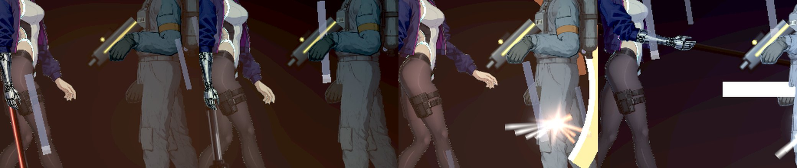
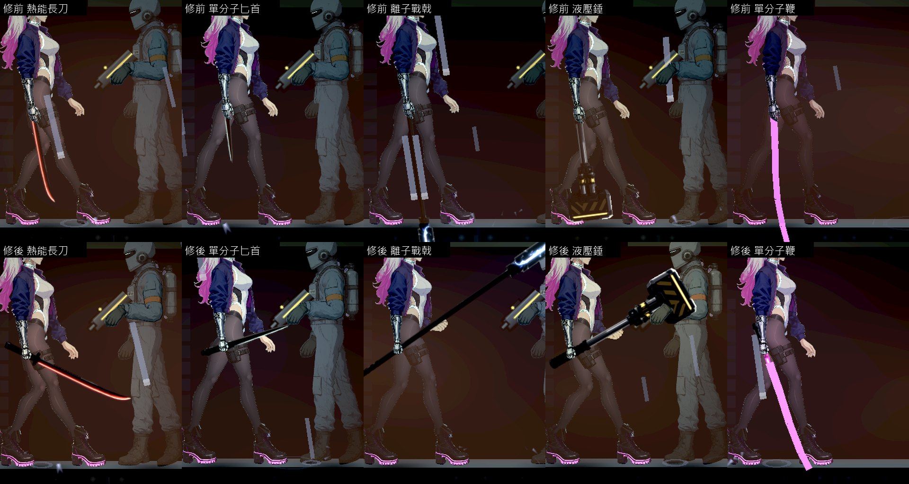
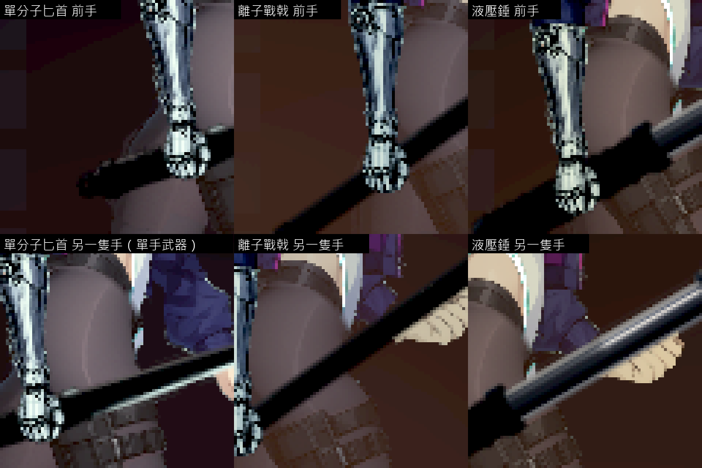
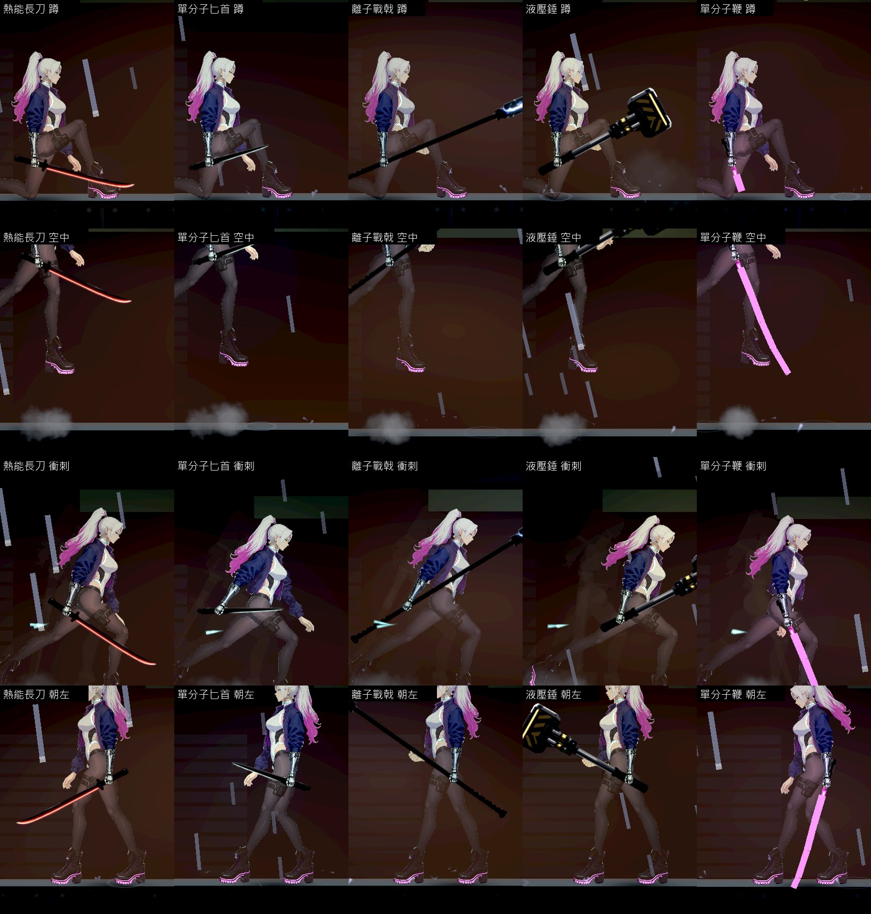
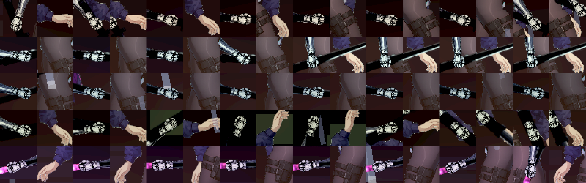

# [NE-275] 讓近戰武器握在手裡並且揮起來不僵硬

> 狀態：審查中

## 內文

### 需求
近戰武器現在是「黏」在手上的：手是張開的，握把從手掌旁邊穿過去，手指沒有包住握把；武器永遠筆直地沿著前臂延伸，像手臂多長出來一截。站著不動時武器垂直朝下，長的武器會插進地板（NE-273）。揮動時武器和前臂是同一根棍子，一起轉、一起停，沒有手腕、沒有重量，看起來很僵硬。

使用者要武器有被「握住」的感覺、揮起來不僵硬；需要的話可以補畫對應的角色零件。

這張票只處理看得到的握法與揮動的樣子。每一招打得到的距離、判定、時間、傷害與連段規則不改；20 個近戰招式的手臂動作資料是戰鬥組與角色組的，這裡不重排，只在它上面加手腕與武器自己的動態。

### 來源
2026-10-11，使用者：「武器綁定在手上的時候都沒有『握住』的感覺，然後揮動起來也都很僵硬，可以幫我處理嗎？有需要的話應該可以繪製相對應立繪來補足」。

### 驗收條件
- [x] 拿著近戰武器時手是握拳的，手指蓋在握把上、握把從拳頭裡穿過；五把武器、朝左朝右都成立
- [x] 握把對在掌心（握點），不是手腕；站、走、跑、蹲、跳、衝刺與每一招的每一格，握把都不離開拳頭
- [x] 不出招時每把武器有自己的拿法（不是筆直朝下）；任何姿勢下整把武器都在腳下的地面以上（NE-273 的驗收一併滿足）
- [x] 揮動時武器不是和前臂同時轉、同時停：預備時刀尖落在手的後面，出招時甩過去，收招時多走一點再回來；重的武器（錘、戟）拖得比輕的（匕首）明顯
- [x] 雙手武器（戟、錘）不出招時另一隻手也握在桿上；做不到的姿勢如實列出，不用假的手遮
- [x] 手臂與手的接合不因為這次修改變差：腕部沒有新的縫、缺角或多一隻手（用既有的接點稽核與逐格截圖看）
- [x] 刃光仍然跟著刀身；每一招打得到的距離、時間、傷害與連段和修前相同（既有的近戰測試全過，不改測試）
- [x] 設定的「減少閃光／減少動態」不受影響；每影格耗時不比修前多（成對交替量測）
- [x] 原生截圖：五把武器的待機、走、蹲、空中、衝刺與每一招的連續影格，修前修後並排，放大到看得清楚手指

### 測試流程
1. `godot --path . res://tools/melee_art_probe.tscn -- --out=<絕對資料夾>` 拍五把武器的各種姿勢與每一招
2. 拍每一招的連續影格（每 2 個影格一張），看武器相對前臂的角度變化
3. 跑接點稽核與既有的近戰測試、受影響的測試

### 參考
- [跟隨與重疊動作：鬆鬆連著的部分在主動作停下後還會繼續動；不同部位依質量與位置以不同的速度移動、不在同一格到位](https://blog.cg-wire.com/follow-through-overlapping-action)
- [跟隨與重疊動作是避免動作僵硬的原則：拖在後面的部分因為重量落後幾格再追上](https://rebusfarm.net/blog/follow-through-and-overlapping-action-the-animation-principle-that-prevents-stiff-motion)
- [對一段揮劍動畫的講評：要讓人看到劍的跟隨動作，那是力道的來源](https://polycount.com/discussion/comment/2507079)
- 專案自己的整理：`rig-animation` 技能的「握持附件的固定契約」（手腕支點和掌心握點分開；近戰把物件掛到實際掌心）與「業界做法速查」（預備 2～4 格、跟隨由彈簧做、命中姿勢多停幾格）

現況（由左到右：熱能長刀待機、液壓錘待機、長刀第一段、戰戟刺擊）——手是張開的，武器沿著前臂筆直延伸：

---

# 跟其他票的關係

- Blocks：無
- Blocked by：無
- Related：NE-260、NE-273、NE-222、NE-237、NE-270

---

# Commit-1

## 內文

近戰武器是「黏」在手上的：手是張開的；武器畫在比身體還低的一層，握把和刀身都被身體蓋住，看起來像插在身體後面；方向永遠筆直沿著前臂，站著時垂直朝下、長的武器插進地板；揮動時和前臂是同一根棍子。

現在拿著近戰武器時前手換成握拳的手（角色原本就有、拿槍時用的那一張），握把對在掌心的握點上。武器改排在手臂前面、握拳的手指後面，所以整把武器在身體前面，拳頭蓋在握把上。不出招時每把武器有自己的拿法：長刀刀尖朝前斜下、匕首平舉朝前、戰戟與錘斜舉在身前、鞭的握把朝下；戰戟與錘是雙手武器，另一隻手也握拳握在桿上。武器的兩端（含錘頭的厚度）不會低於腳下的地面，蹲下時會自己抬起來。揮動時武器的方向仍然以前臂為準，但用一個有阻尼的彈簧去追：手臂突然加速時刀尖落在後面，停下時多甩過去一點再回來；重的武器追得慢、拖得多，輕的幾乎立刻跟上。出招那一刻武器已經到位，招式打得到的距離、判定、時間與傷害都沒有動，20 個招式的手臂動作資料也沒有動。

驗收（Arc B580，原生）：五把武器拍了待機、蹲、空中、衝刺、朝左，以及每把第一招的 8 張連續影格；另外把 40 張連續影格裡兩隻手的位置各放大 4 倍排成一張（下面最後一張圖），逐格看過：拳頭都接在前臂上、握把都從拳頭後面穿過，沒有看到手和前臂分開或多一隻手。自動檢查逐把確認：前手是握拳的手、握把在掌心（誤差 0.01 像素內）、和前手同一層且比前手早畫、不出招時不是沿著前臂、站著與蹲下時整把在地面以上、站著不動時武器不抖、揮動時和前臂的夾角會變、每一格握把都在掌心、收招後回到原本的拿法；戰戟與錘站著時另一隻手的掌心在桿上（誤差 2.5 像素內）。每影格耗時修前修後交替各量兩次：修前 6.48～6.76 毫秒、修後 6.38～6.43 毫秒，沒有變慢。

如實列出做不到與還沒做的：
- 另一隻手握桿只在「不出招」而且手搆得到的時候成立（站著確定握得到）。出招的整段，另一隻手照招式原本的動作走，不在桿上——要讓它出招時也握著，得重排那幾招的手臂動作，屬於招式的重做（見 NE-277）。
- 另一隻手在桿子的後面（它是遠側的手），看得到拳頭、看不到包住桿子的手指。
- 鞭子的細線這一張票只處理「不穿過地面」（垂下來畫到地面為止），它仍然是一條直線；「從頭到尾都是軟的」另開 NE-276。
- 逐格放大看的是每把的第一招（共 40 格）；其餘的招式只看過出招那一刻的截圖，沒有逐格看。

動到其他組的檔案：骨架的輸入多了「握著近戰武器」與「另一隻手握的點」，骨架的握拳判斷與動畫器的後手各多一個分支（拿槍、空手、撥號與持盾的行為不變）。

### 測試結果

| 項目 | 結果 |
|---|---|
| 受影響的測試（`run_tests_changed.sh`，乾淨的 main 加這一個提交） | 84,395 項檢查（含接點稽核與既有的近戰測試），新失敗只有 1 項已知對負載敏感的計時測試（音量閃避），單獨重跑通過 |
| 原生截圖與量測（`tools/melee_art_probe.tscn`） | 五把：0 項不合格（刃光、曝光、減少閃光的檢查照舊通過） |
| 每影格耗時（修前修後交替各兩次） | 修前 6.48、6.76 毫秒；修後 6.38、6.43 毫秒 |
| 原生 log | 無 ERROR |

分支 `feature/lighting-assets`，提交見[遠端 main 上本票的提交](https://github.com/deadline314/Nest-Egg/commits/main/pm/Nest-Egg/%5BNE-275%5D%E8%AE%93%E8%BF%91%E6%88%B0%E6%AD%A6%E5%99%A8%E6%8F%A1%E5%9C%A8%E6%89%8B%E8%A3%A1%E4%B8%A6%E4%B8%94%E6%8F%AE%E8%B5%B7%E4%BE%86%E4%B8%8D%E5%83%B5%E7%A1%AC.md)。

### 截圖

站著不動，上排修前、下排修後（武器在身體前面、手握拳、各有拿法、雙手武器兩手都握）：

放大看手（上排前手：握把從拳頭後面穿過；下排戰戟與錘的另一隻手握在桿上）：

蹲、空中、衝刺、朝左：

每把第一招的連續影格（每 3 個物理影格一張）：

同一批連續影格裡兩隻手的位置放大 4 倍（每把一列；每一格左邊是前手、右邊是另一隻手）：

