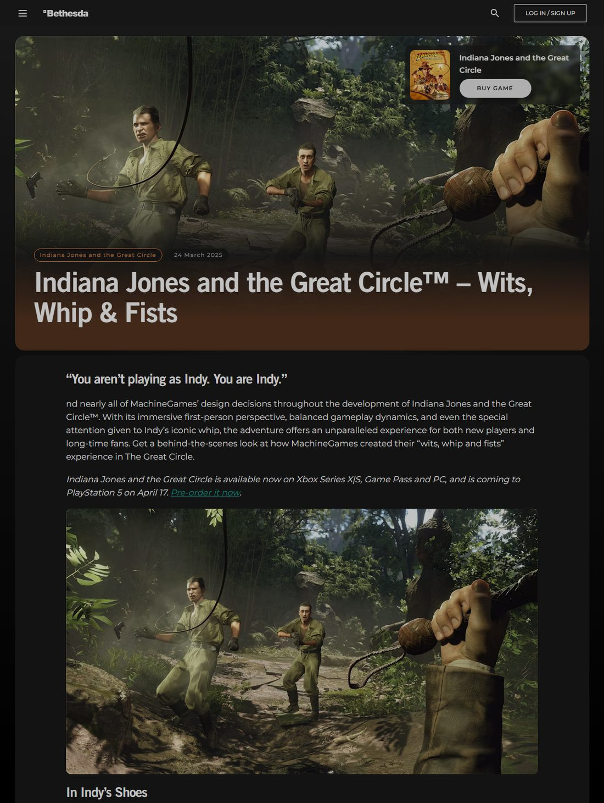
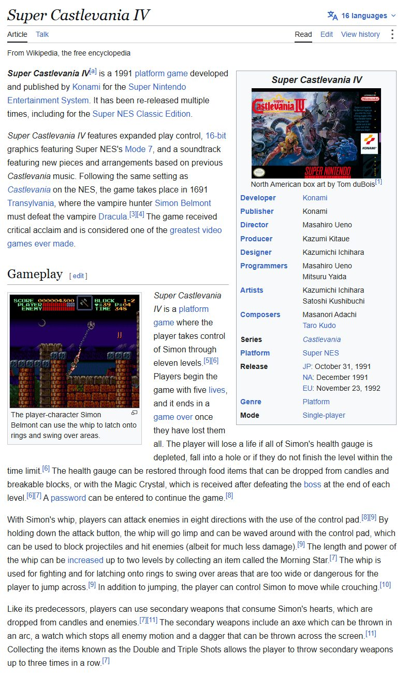
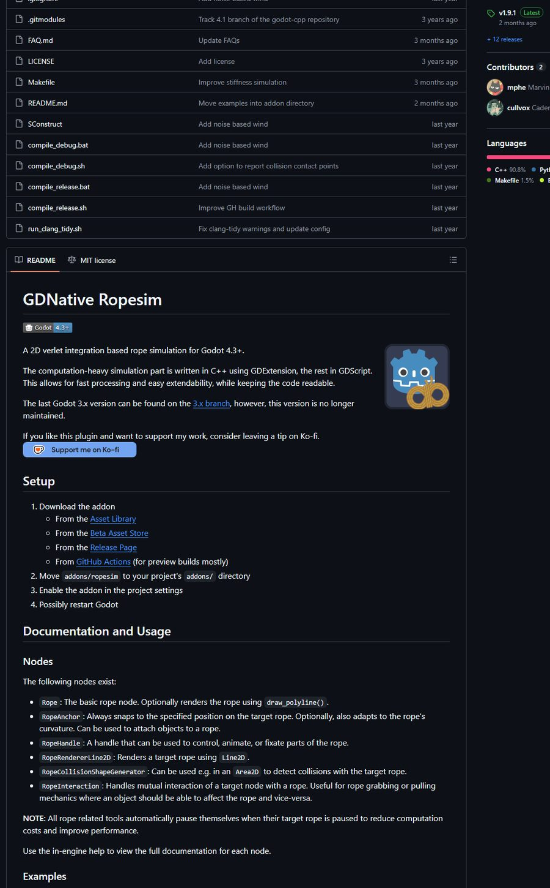
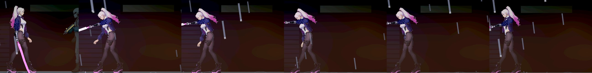
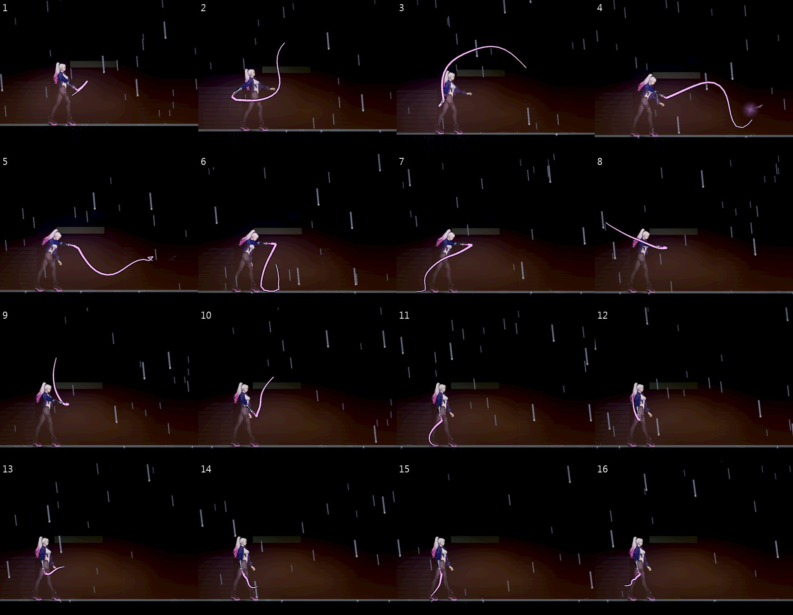
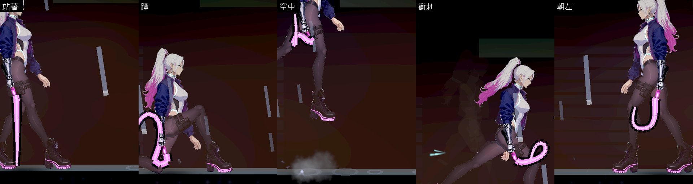

# [NE-276] 讓鞭子從頭到尾都是軟的

> 狀態：審查中

## 內文

### 需求
單分子鞭不像鞭子。main 上它是一條永遠筆直的發光線，拿著時像一根棍子垂著，甩出去也是一根棍子。戰鬥組在雲端分支上做的版本（NE-270，尚未併入 main）平常是軟的，但出招的那一格整條鞭身被一口氣排成直線、之後再變軟——使用者看了覺得非常不合理：鞭子應該永遠是軟的。

要做到：鞭身從拿出來到收起來都是同一條軟的繩子，沒有任何一格是被排成直線的；甩出去時看得到一道彎從握把傳到鞭梢，鞭梢打到最遠點之後帶著慣性落下。招式打得到的距離、判定、時間與傷害不改。

### 來源
2026-10-12，使用者：「那個像鞭子的武器，為什麼不是永遠保持柔軟的狀態，而是會突然變直再變軟，非常不合理，幫我多看看其他人是怎麼做的，還有業界最佳實例是怎麼處理的，除了文字最好也要看截圖……記得要把截圖留在票裡面」「至少 5 個不同來源，不要全部都同一個遊戲或是同一個公司」「不一定要照抄，可以取他們的特點，做一個屬於自己的」。

### 驗收條件
- [x] 鞭身只有一種狀態：一條一直在模擬的繩子，握把釘在掌心；出招時不切換成另一種畫法或排法
- [x] 整招（前搖、出招、收招）與之後 1 秒逐格量「握把到鞭梢的直線距離 ÷ 鞭身長度」：沒有任何一格達到 0.99（不會變成一把尺）；鞭梢到位的每一格，鞭身離那條直線最遠的一節至少是鞭身長度的 4%（是弧，不是排出來的直線）
- [x] 出招那一刻鞭梢在招式最遠點附近（差距在招式距離的 15% 以內），看得出是鞭梢打到的
- [x] 甩出去的過程看得到彎從握把往鞭梢傳：甩到一半時，靠握把的那幾節已經朝前，靠鞭梢的那幾節還在後面
- [x] 平常垂著：跟著身體晃、碰到地面就貼地，不鑽進地板；站、走、跑、蹲、跳、衝刺、朝左朝右都成立
- [x] 鞭身是洋紅色的發光細線，握把端粗、鞭梢細；刃光仍然跟著鞭子
- [x] 換成別的武器就收起來，再拿出來不會從舊位置彈過來；被打斷時鞭身照樣落下，不會停在半空
- [x] 招式的距離、判定、時間與傷害和修前相同（既有的近戰測試全過，不改測試）；每影格耗時不比修前多（成對交替量測）
- [x] 原生截圖：待機、蹲、朝左，以及甩擊與回甩的連續影格（每 2～3 個物理影格一張），修前修後並排

### 測試流程
1. `godot --path . res://tools/melee_art_probe.tscn -- --out=<絕對資料夾>` 拍鞭子的待機、各姿勢與連續影格
2. 自動檢查逐格量直線程度、鞭梢到位、波的傳遞、不鑽地
3. 跑既有的近戰測試與受影響的測試

### 參考（看過的內容與截圖；完整整理在 [近戰攻擊模組與軟鞭](../../design/14-combat-variety/MELEE_MODULE.md)）

1. [Indiana Jones and the Great Circle：Wits, Whip & Fists](https://bethesda.net/en-AU/news/indiana-jones-and-the-great-circle-wits-whip-and-fists)（MachineGames／Bethesda）：甩鞭要「模擬與動畫兩者一起」才對。截圖裡甩出去的鞭身是一條 S 形的曲線。

   

2. [Super Castlevania IV](https://en.wikipedia.org/wiki/Super_Castlevania_IV)（Konami）：按住攻擊鍵鞭子會垂軟，可以用方向鍵甩，能擋飛行物、碰到敵人有小傷害；還能勾住環盪過去。

   

3. [GDNative Ropesim](https://github.com/mphe/GDNative-Ropesim)（Godot 的開源繩索模擬）：Verlet 繩子加上「把手」——只控制繩子的某一部分，其餘照樣模擬。

   

4. [The Anatomy of Super Castlevania IV](https://www.quaddicted.com/webarchive/www.anatomyofgames.com_20170315/index.html%3Fp=12696.html)（Jeremy Parish 的分析，圖片在存檔裡已失效，只有文字）：垂著的鞭子成了一道屏障。

現況（main）：鞭身是一條筆直的線。

---

# 跟其他票的關係

- Blocks：無
- Blocked by：無
- Related：NE-270、NE-275、NE-277、NE-260

---

# Commit-1

## 內文

單分子鞭在 main 上是一條永遠筆直的發光線；戰鬥組分支上的版本平常是軟的，但出招的那一格整條鞭身被排成直線、之後再變軟。兩種都不像鞭子。

現在鞭身只有一種狀態：一條一直在模擬的繩子，握把那一端釘在握把的出線口。出招時不換畫法也不換模擬方式，只是多了一個「鞭梢要去哪」的目標點——它從垂著的位置往後、繞過頭頂、到招式的最遠點，鞭梢被有限的力拉著跟過去，整條鞭身由繩子自己帶動：先往後帶，一道大弧越過頭頂甩出去，鞭梢到最遠點時中段還垂著弧度，收招後帶著慣性落下、線慢慢收回握把。線被拉緊時會自己再放出來一點，所以鞭身永遠留著弧度，不會繃成一把尺。平常只放出短短一段垂著，會跟著身體晃、拖在地上，不鑽進地板。原本疊在上面的那條畫出來的波浪軌跡拿掉了，鞭身自己就是軌跡。招式的距離、判定、時間與傷害沒有動。

驗收（Arc B580，原生）：甩擊連拍 24 張（每 2 個物理影格一張，下面放前 16 張），另拍站、蹲、空中、衝刺、朝左。自動檢查逐格量：整招加上之後一秒，「握把到鞭梢的直線距離 ÷ 鞭身長度」最高 0.965（1.0 才是一把尺）；鞭梢到位的每一格，鞭身離那條直線最遠的一節至少是鞭身長度的 8.3%；出招期間鞭梢離招式最遠點最近 1.3 像素（招式距離 100）；甩到一半時握把那端已經朝前、鞭梢還在後面；整招沒有節點低於地面、握把端一直接在手上；被打斷照樣落下；換成槍收起來，換了位置再拿出來在手邊重新垂好。每影格耗時修前修後交替各量兩次：修前 6.57、7.16 毫秒，修後 6.37、6.99 毫秒，沒有變慢。主角頭部的全白比例 0.4%（鞭身會甩過頭頂，所以把它的發光上限與芯的亮度壓低了，否則會到 3.2%）。

驗收條件改過一條，說明原因：原本寫「相鄰兩格的差不超過 0.15（不會一格跳直）」。實作後發現這個量法不對——這一招的前搖只有十個影格，鞭身要在這段時間從垂著甩到最遠，比值本來就會很快變大（實測招式期間一格最多變直 0.19），放線、收線也會讓比值變動；它量到的是招式快不快，不是「有沒有哪一格是排出來的」。所以改成直接量形狀：鞭梢到位的每一格，鞭身都要是弧形（離直線最遠的一節至少 4%，實測 8.3%）。0.19 這個數字留在這裡備查。

和別人不一樣、屬於我們自己的地方：線是從握把放出來、會自己收放的（單分子鞭的設定），所以平常只有短短一段、甩的時候才放長；被拉緊會再放線。參考裡「按住把鞭子留在外面甩」「纏住、拉過來」這兩個玩法還沒做，放在 NE-277。

### 測試結果

| 項目 | 結果 |
|---|---|
| 受影響的測試（`run_tests_changed.sh`，乾淨的 main 加這一個提交） | 12,069 項檢查（含既有的近戰測試），新失敗只有 1 項已知對負載敏感的計時測試（12 個爆炸同時發生的耗時），單獨重跑通過 |
| 原生截圖與量測（`tools/melee_art_probe.tscn`） | 五把：0 項不合格 |
| 每影格耗時（拿著鞭子，修前修後交替各兩次） | 修前 6.57、7.16 毫秒；修後 6.37、6.99 毫秒 |
| 原生 log | 無 ERROR |

分支 `feature/lighting-assets`，提交見[遠端 main 上本票的提交](https://github.com/deadline314/Nest-Egg/commits/main/pm/Nest-Egg/%5BNE-276%5D%E8%AE%93%E9%9E%AD%E5%AD%90%E5%BE%9E%E9%A0%AD%E5%88%B0%E5%B0%BE%E9%83%BD%E6%98%AF%E8%BB%9F%E7%9A%84.md)。

### 截圖

甩擊的連續影格（每 2 個物理影格一張，由左到右、由上到下）：往後帶 → 過頭頂的大弧 → 鞭梢到最遠點（中段仍有弧度）→ 落下、收回：

站著、蹲、空中、衝刺、朝左：

