# [NE-277] 建立完整且獨立的近戰攻擊模組

> 狀態：進行中

## 內文

### 需求
近戰現在只有基礎的揮動：一招就是一段手臂姿勢的內插，武器跟著前臂、身體幾乎不動、另一隻手不參與；五把武器的招式長得很像，差別主要在軌跡的顏色與形狀。使用者要的是完整且獨立的近戰攻擊模組。

要做到（設計與依據在 [近戰攻擊模組與軟鞭](../../design/14-combat-variety/MELEE_MODULE.md)）：
- 一招是一個自己帶齊所有東西的單位（資料）：預兆、出手、跟隨、收招的關鍵姿勢，身體怎麼動，武器走的路徑，另一隻手在哪，判定（可以多段），命中回饋，可取消點。
- 武器帶著手：先決定武器的路徑，兩隻手去握；雙手武器出招時兩隻手都在桿上。
- 每把武器有自己的一套招式與一個「按住」的招式，不是同一套換皮。
- 近戰模組自己管招式的播放、判定與回饋，不混在槍械瞄準與手臂的程式裡；之後加新武器以資料為主。

### 來源
2026-10-12，使用者：「現在只有基礎的揮動，沒有完整且獨立的近戰攻擊模組……幫我多看看其他人是怎麼做的，還有業界最佳實例是怎麼處理的，除了文字最好也要看截圖……記得要把截圖留在票裡面」「至少 5 個不同來源」「不一定要照抄，可以取他們的特點，做一個屬於自己的，但如果不參考別人的東西，我們永遠都在原地打轉」。

### 驗收條件
- [x] 招式是資料：每一招有四段的關鍵姿勢（4～6 個）、身體的位移、武器的路徑、另一隻手的位置、判定（含多段的持續與間隔）、命中回饋、可取消點；資料檢查擋住缺欄與不合理的數字
- [x] 既有的每一招搬到新的格式後，打得到的距離、時間、傷害與連段行為和修前相同（既有的近戰測試全過，不改測試）
- [x] 出招時武器走的是這一招自己的路徑，兩隻手握在武器上（雙手武器兩隻手都在桿上），每一格握把都在掌心
- [x] 每一招看得到預兆、出手、跟隨、收招四段：身體有動作（踏步、轉身或壓低），不是只有手臂在動
- [ ] 五把武器各有自己的一套：把五把的同一段招式並排，閉著眼睛換掉顏色也分得出是哪一把
- [x] 每把武器有一個「按住」的招式（長刀：衝刺斬；匕首：連刺；戰戟：戒備；錘：蓄力砸地；鞭：把鞭子留在外面甩），有說明文字
- [x] 可見武器與實際命中窗一致：傷害出現時刃、錘頭或鞭身已到達對應目標，首傷格不能仍停在遠離目標的姿勢
- [ ] 命中回饋分層：命中的第一格雙方停頓、敵人依招式的輕重有不同的反應、聲音有低頻與高頻兩層；「減少閃光／減少動態」生效
- [x] 近戰模組獨立：槍械的瞄準與手臂程式裡沒有近戰的分支；新增一把近戰武器不必改模組的程式（用一把測試武器證明）
- [ ] 手臂與手的接合沒有變差（接點稽核、逐格放大看）；每影格耗時不比修前多
- [x] 原生截圖：五把武器每一招的連續影格，修前修後並排；每把一段原生錄影或逐格圖

### 測試流程
1. 資料檢查與既有的近戰測試
2. `tools/melee_art_probe.tscn` 拍每一招的連續影格與兩隻手的特寫
3. 實際玩：五把武器各打一輪（含按住的招式），對著輕、重、有盾的敵人
4. 跑受影響的測試

### 參考（看過的內容與截圖）

1. [Art Design Deep Dive: Using a 3D pipeline for 2D animation in Dead Cells](https://www.gamedeveloper.com/production/art-design-deep-dive-using-a-3d-pipeline-for-2d-animation-in-i-dead-cells-i-)（Motion Twin）：攻擊動畫是姿勢到姿勢，用最少的關鍵姿勢把動作與時間做對，補間不加在關鍵姿勢中間；特效給出移動感與力道；移動關鍵格就能快速調手感。

   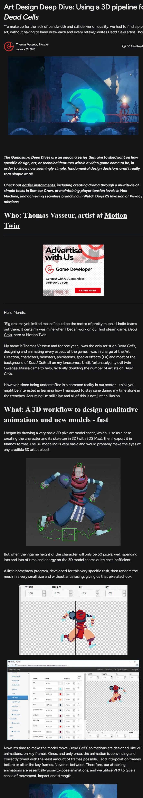

2. [Game developers explain what makes God of War (2018)'s combat tick](https://blog.playstation.com/?p=370399)（PlayStation Blog；Naughty Dog、Capcom、Techland 等多家設計師）：大的揮擊弧與有力的跟隨、誇張的敵人反應、命中第一格雙方一起停、聲音低頻加高頻；先預兆再釋放；每把武器有自己的參數；重武器靠走位。

   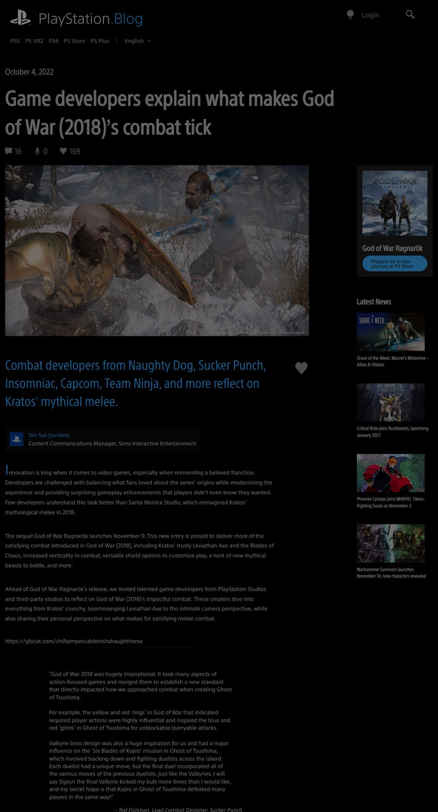

3. [Dustloop：Using Frame Data](https://www.dustloop.com/w/Using_Frame_Data)（格鬥遊戲社群）：一招分成發生、持續、硬直；多段攻擊寫成持續與間隔；有的招在硬直前幾格可以取消。（純文字頁，沒有截圖）
4. [Follow-Through & Overlapping Action](https://blog.cg-wire.com/follow-through-overlapping-action)（CG-Wire）：不同部位不在同一格到位，鬆鬆連著的部分在主動作停下後繼續動。（純文字）
5. [Indiana Jones and the Great Circle：Wits, Whip & Fists](https://bethesda.net/en-AU/news/indiana-jones-and-the-great-circle-wits-whip-and-fists)（MachineGames）與 [Super Castlevania IV](https://en.wikipedia.org/wiki/Super_Castlevania_IV)（Konami）：武器自己的玩法（鞭子按住垂軟可以甩、可以勾、可以纏）。截圖在 NE-276。

現況（NE-275 之後的每把第一招；手臂在動、身體幾乎不動、另一隻手不在武器上）：

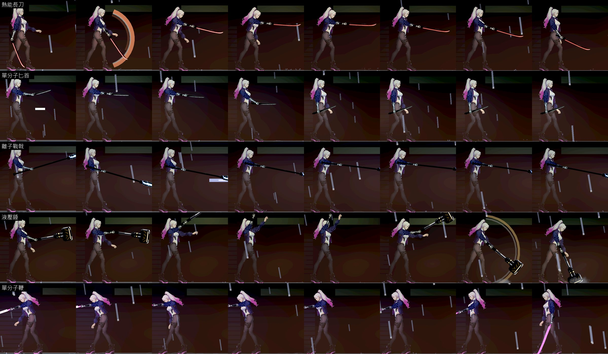

---

# 跟其他票的關係

- Blocks：無
- Blocked by：NE-285、NE-288、NE-289
- Related：NE-237、NE-270、NE-275、NE-276、NE-261、NE-117、NE-284

---

# Commit-1（近戰模組、完整招式資料、武器帶著手、身體動作、多段判定、按住招式、分層命中聲）

## 內文

**問題**：近戰的播放、判定與回饋都寫在主角的程式裡；一招只有時間、距離、傷害與一個共用的手臂姿勢，武器跟著前臂、身體幾乎不動（量到出招時骨盆只動 1～2 像素），雙手武器出招時另一隻手離開桿子；錘的三招看起來是同一個動作；沒有按住的招式；命中聲只有一層。

**改動**：
- 近戰變成一個獨立的模組：按鍵（含提早按的緩衝）、連段、三段時間、可取消點、判定、命中回饋與按住招式都在模組裡；主角的槍械、瞄準與衝刺只問模組「在不在出招、能不能取消、面向要不要鎖」。新增一把近戰武器只要寫資料：用一把只有資料的測試長矛（兩段連段，第二段是三連刺，外加按住蓄力）證明，不必改模組。
- 每一招自己帶齊：四段時間（新增跟隨段）、多段判定（每一段同一個目標可以再被打一次）、身體動作（踏步、壓低、轉身）、武器的路徑（4～6 個關鍵點，前手的掌心追著它）、單手或雙手、敵人反應的輕重與低高頻兩層命中聲。資料檢查會指出缺哪個欄位、哪一招、哪個數字不合理；既有的每一招搬過來時時間、距離、傷害與連段都沒動（每一招都是「出招開始一段、持續整個出招」）。
- 武器帶著手：前手追武器路徑；雙手武器（錘、戰戟）出招的每一格，後手等武器這一格的位置定了才去握桿，長柄的後手可以沿桿子滑（刺擊時握在桿尾），手臂搆不到的點不會硬拉。
- 五把武器各有一套動作（同樣的時間與傷害下重新編排）：長刀斜砍、反斬、踏步下劈與突刺；匕首兩記短刺、橫劃與後跳回斬；戰戟雙手平刺、上撩橫掃、迴旋交叉掃；錘舉過頭下砸、由下往上撈、重砸；鞭子的握把從肩後甩出、回甩（鞭身仍是一直在模擬的軟繩）。
- 每把武器一個按住招式（按下＝第一招，第一招打完還按著就接上），說明加在武器的一行說明裡：長刀「按住蓄力，放開衝刺斬」、匕首「按住連續快刺」（一次四段）、戰戟「按住把戟頭頂在前面電擊」（每 0.25 秒判定、最多 2 秒）、錘「按住蓄力，放開砸地震開」（蓄滿加傷）、鞭「按住讓鞭子留在外面甩」（跟著準星、每 0.2 秒判定）。
- 命中聲分兩層：原本的命中聲是高頻層，下面加一層低頻悶擊（輕：撞擊尾音；重：落地悶響加撞擊尾音，都是音效庫裡已登記授權的錄音，99% 能量在 200 Hz 以下）；揮空不播，頓幀一招只有一次。
- 動作姿勢的關鍵格在每個動畫器裡整理一次就快取，出招時不再每格重新配置（量到算一個姿勢從 0.054 毫秒降到 0.005 毫秒），抵掉新增的手臂 IK。
- 設計文件補上實作後的欄位表、每把武器的一套與量法（[近戰攻擊模組與軟鞭](../../design/14-combat-variety/MELEE_MODULE.md) 第四節）。

**驗收**：
- 逐格量測（`tools/melee_module_probe.tscn`，16 招）：前手掌心離路徑要的握點每一格都是 0 像素；雙手的 6 招每一格後手都握在桿上（0 格脫手、離桿上的點 0 像素）；出招時骨盆的最大前後位移從 1～2 像素變成 3～15 像素。
- 接點稽核（`tools/melee_joint_audit.tscn`，修前在乾淨的 main 上跑同一支）：修前 0 項、修後 0 項超出限制；最大值有變大但都在限制內（單格角度跳動 0.53→1.37，限制 1.98；關節變窄 0.22→0.75，限制 0.75；手肘反折沒有，-0.08）。這一條仍要本機放大看接合，所以「接合沒有變差」先不勾。
- 每影格耗時：雲端的軟體環境雜訊約 ±15%，同一招在修前修後交替量三次（骨架動畫加後手 IK，長刀 299～369 對 301～316 微秒、錘 369～457 對 318～381 微秒），分不出差異；要在本機原生量。
- 第一招灰階並排（下圖）：五把的武器輪廓與動作路線都不同（長刀舉過頭斜砍、匕首平刺、戰戟雙手平刺、錘舉過頭砸地、鞭從肩後甩出）；是否「閉著眼睛也分得出」請使用者看過再勾。
- 命中聲兩層已接上並量過頻率，但沒有人聽過；「減少閃光／減少動態」下揮空不假裝命中、命中仍讀得出（既有檢查全過）。這一條待本機試聽後再勾。

待本機原生驗收：五把武器每一招與按住招式的原生連續影格（左右兩個面向）、雙手武器出招時兩隻手的特寫、每影格耗時（開與關交替量）、命中聲兩層的試聽、實體手把按住與連按。

### 測試結果

| 項目 | 結果 |
|---|---|
| 近戰套件（含新增的完整格式、只有資料的測試武器、五把按住招式、鍵鼠與手把一致） | 128 項，0 失敗 |
| 近戰相關 6 套件（近戰武器、音效、聲音舞台、武器情境、聲音實驗室） | 29,103 項，0 失敗 |
| 受影響範圍（併入最新 main 後，`tools/run_tests_changed.sh`） | 82 個套件、93,479 項，0 失敗 |
| 逐格量測／接點稽核 | 0 項失敗／0 項超出限制 |

### 截圖

Forward+（軟體 Vulkan），每張上半是修前、下半是修後；一列一招（連段、升級尾招、修後多一列按住招式），一欄一個招式進度（0、0.2、0.38 前搖；0.48、0.58 出招；0.7、0.82 跟隨；0.95 收招）。

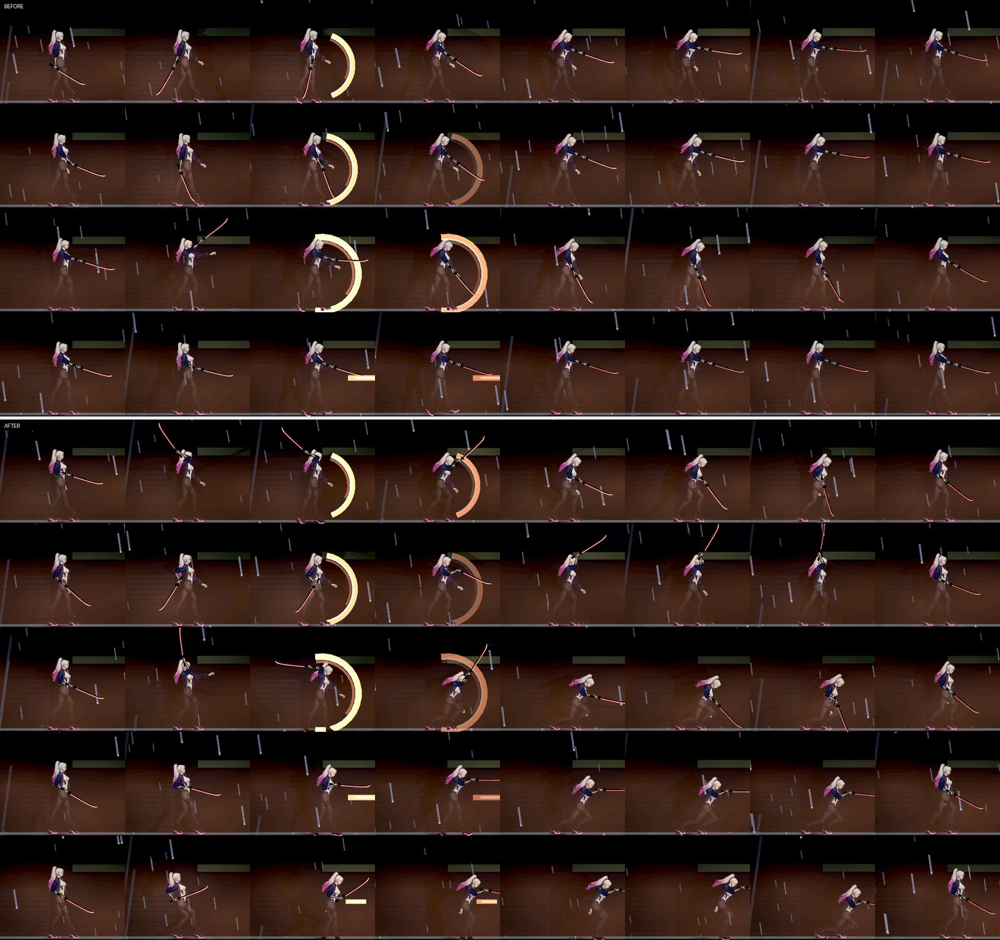

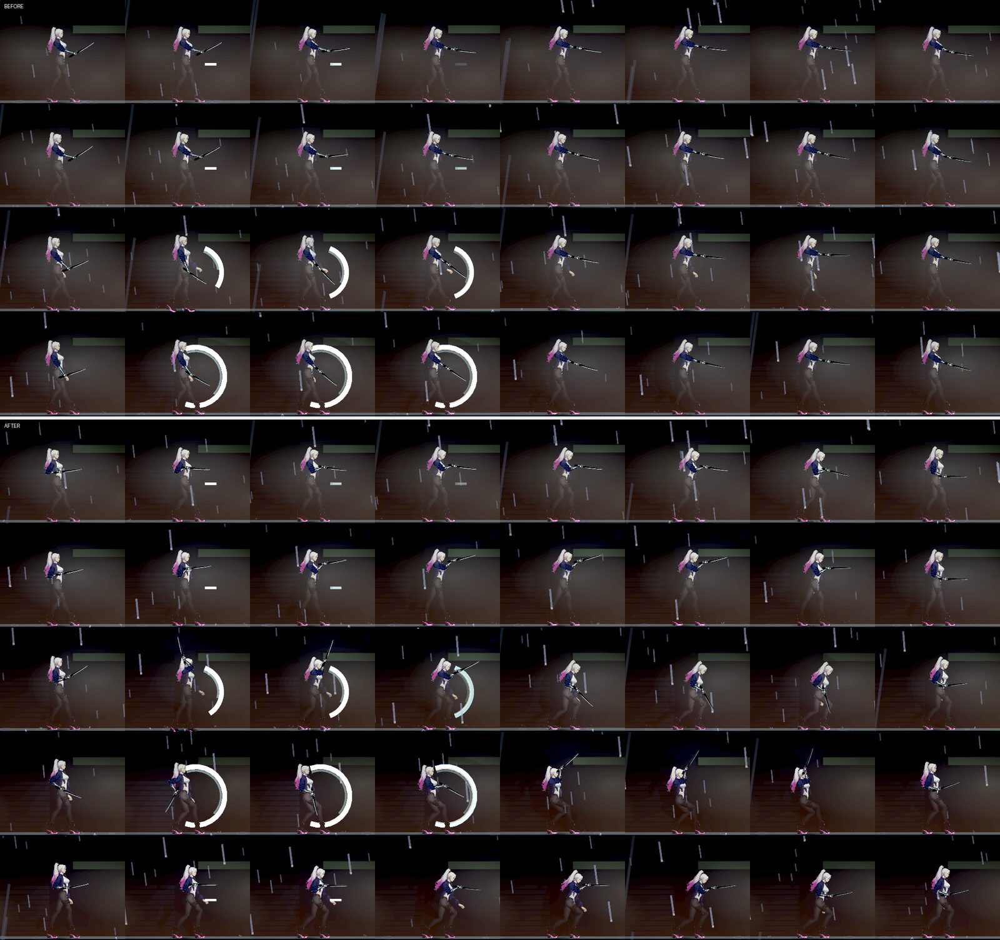

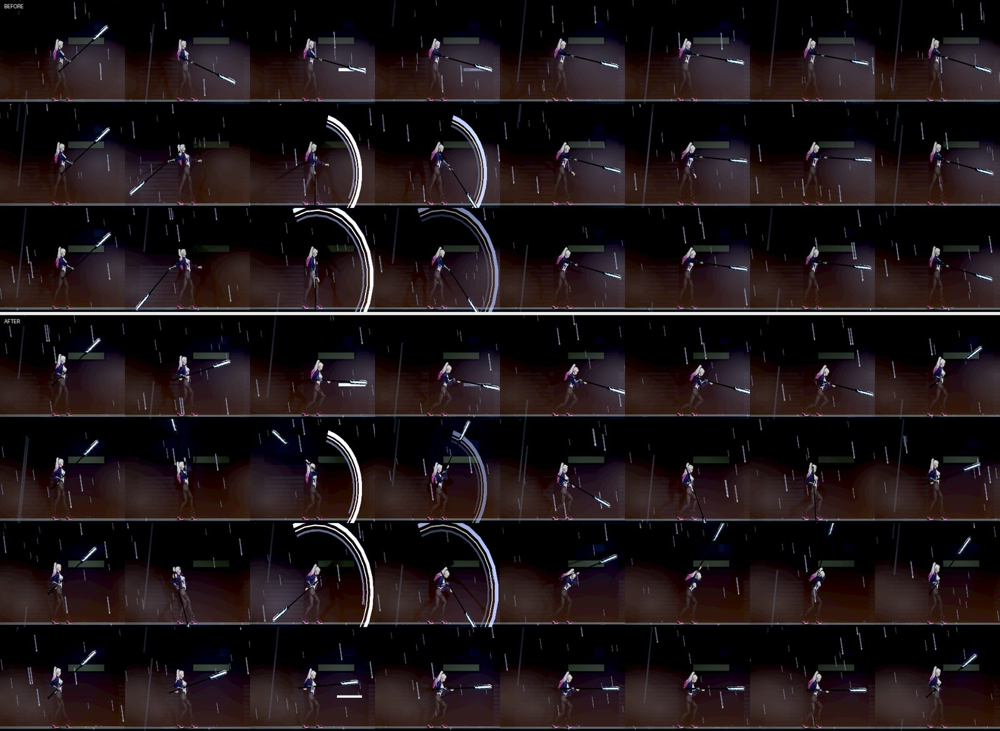

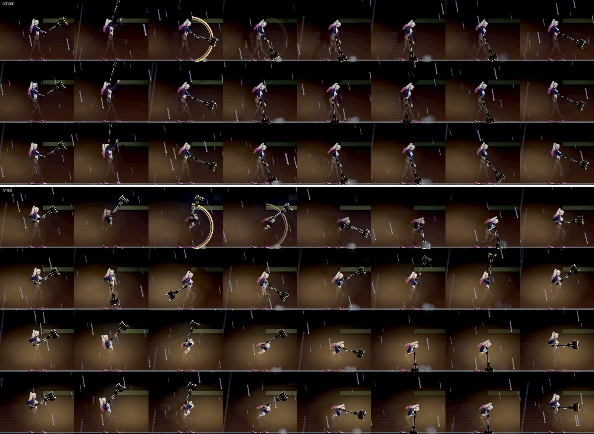

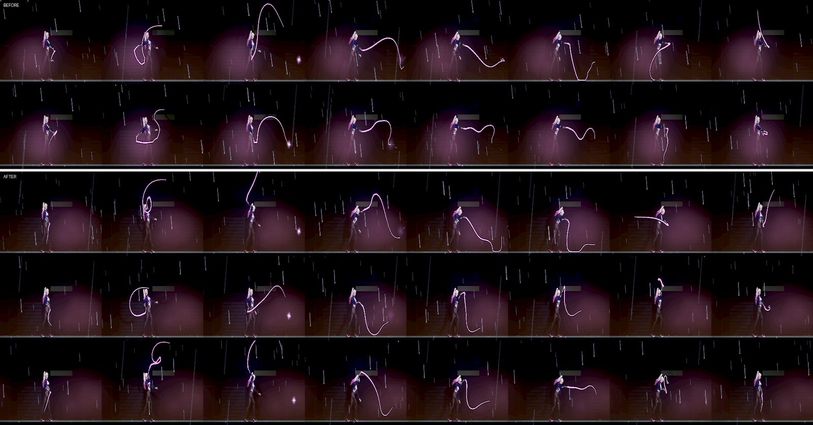

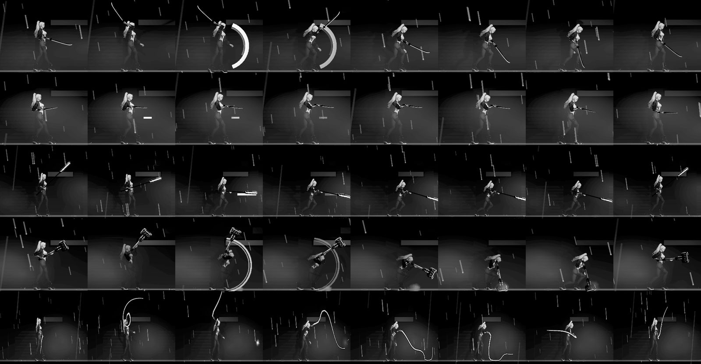

分支：`feature/affectionate-feynman-dfv3cp`，提交：https://github.com/deadline314/Nest-Egg/commit/55da2933

# Commit-2（連續握位、接地交接、首格雙方停頓與原生證據）

## 內文

實際連續影格重現三個問題：戰戟後手會在長柄兩側突然換位；長刀蓄力轉前衝、前衝回待機時，膝部閃跳並下穿地面；匕首的輕刺只暫停主角，敵人仍繼續運動。

現在後手在同一側可達的握桿區連續滑動，收招回待機保持連續。待機與走跑共用連續接地交接，長刀原本的踏步強度、前衝、時間、射程與傷害維持。第一個真正造成傷害的輕刺也同步停住雙方，保留輕受傷、不加畏縮或暈眩；後續接觸不重凍攻擊者。

五把武器雙向的全部招式與真正按住／放開，共保存 42 列、2,590 個物理步及 5,222 張原生圖。每格保留實際骨角、握點與角色／武器、手部裁切；放大查看長刀兩處轉折與戟後手換邊的修前修後原圖。稽核會拒絕零格、缺指標、超標、未真正按住及裁掉鞭身的畫面，原門檻不放寬。

命中矩陣保存 36 個實際接觸、首傷格雙方停頓、原受傷輕重與解析後低／高聲層；原始混音及 36 個不改增益的切片可直接播放。首傷格原生圖仍重現錘頭、鞭梢尚未到位時已出現傷害，本輪「可見武器與實際命中窗一致」判定未通過，不以數值與錄音通過取代此條件。

### 測試結果

| 項目 | 結果 |
|---|---|
| 正式受影響範圍 | 70 組、71,186 檢查，0 新失敗／0 已知失敗，exit 0；本票 10 份產品／測試來源與固定候選逐 byte 相同，收據見 NE-284 |
| 走跑專項 | 125 檢查、0 失敗；正反向交接與故意壞交接回歸保留原判斷 |
| 全招式 CPU／獨立交接控制 | 42 列、524 檢查／0 失敗；另 4 正常接受、4 故意丟失接地目標均拒絕，原始骨角與腳位獨立重算通過 |
| 五武器雙向原生 | 42 列、2,590 步、5,222 PNG，8,368 檢查／0 失敗；八項適用關節指標與接地腳位重驗通過 |
| 命中 CPU／原生／錄音 | 36 個案例，324／362 檢查均 0 失敗；48 kHz 雙聲道 16-bit PCM、46.517333 秒，36 切片與原 PCM byte 區間一致 |
| 可見武器與首傷格時序 | 錘與鞭未通過，原生失敗圖保留 |
| 驗證器負控制 | 10 個 Python 測試方法及缺欄、假成功、非有限值、缺輸入與裁切等子案例通過 |

70 組測試保留既有過濾器允許的退出診斷，無 SCRIPT ERROR，不能寫成零 ERROR／零洩漏。各次原生探針的嚴格日誌則無 ERROR／SCRIPT ERROR／退出洩漏。固定來源、全部命令與原 byte ZIP、舊 CRLF／錯誤取樣輪及判定界線見 [本輪附件](attachments/NE-277-native-2026-11-11/README.md)；正式測試見 [NE-284 原始綠收據](attachments/NE-284-process-phase-2026-11-11/affected-green-raw.zip)。

### 截圖與錄音

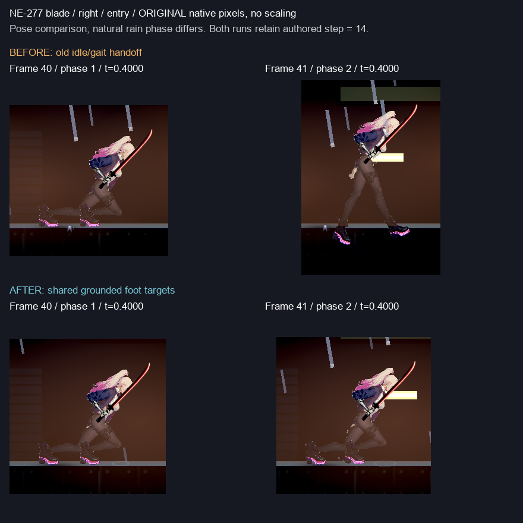

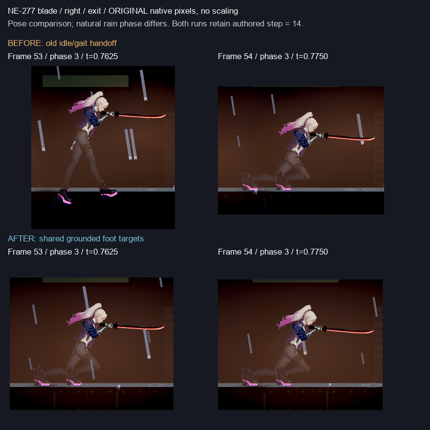

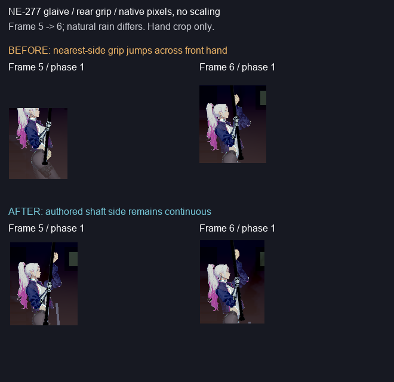

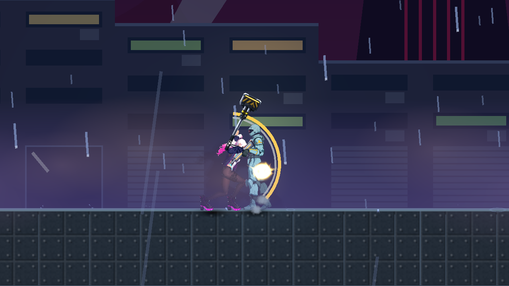

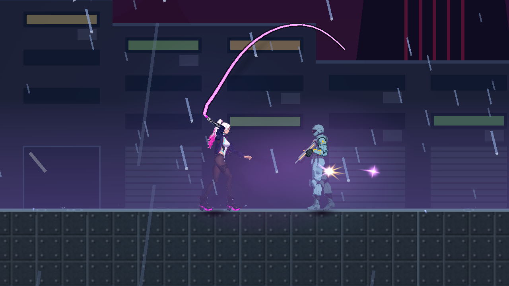

[完整原始混音](attachments/NE-277-native-2026-11-11/audio/master.wav)／[36 個切片與波形](attachments/NE-277-native-2026-11-11/audio-derived.zip)。

# Commit-3（傷害只在看得到的刃、錘頭或鞭身真的碰到目標時發生）

## 內文

**問題**：上一輪原生首傷格重現錘頭、鞭梢還離目標很遠就已經出傷害。原因有兩個：判定在這一格的姿勢更新之前就做了；判定用的是一個大矩形，武器的柄或還沒到位的鞭身都能算命中。

**改動**：
- 判定等主角這一格的骨架、武器、軟鞭與後手都更新完才做，雙方停頓也在這之後才凍住畫面；原本的判定窗、射程、近身死角、傷害與連段規則都不變，收招不會多一格命中。
- 大矩形只負責挑候選目標；真正算不算打到，看武器圖本身不透明的部分（保留鏤空）或鞭子實際的繩身，並把前一格到這一格掃過的範圍也算進去，快速揮過的刃不會漏打。每把武器可以在資料裡標出「哪一段算數」：長刀與匕首只算刃、戰戟只算戟頭、錘只算錘頭，柄碰到不算。
- 先確定真的碰到哪個部位再算部位傷害：沒碰到的弱點不會搶走身體的命中，真的碰到的盾仍然擋住後面的傷害。
- 揮空聲等這一招的判定窗走完、確定沒打到才播，不會先響揮空再補命中聲。
- 按住招式在任何位置放開都從當下的姿勢接收招，不會跳回固定姿勢。
- 為了讓原本的射程門檻在新判定下仍打得到，戰戟戒備、長刀兩招與匕首第二刺的伸手距離與握持角度做了局部修正；傷害、時間與射程數字不變。

**驗收**：五把武器雙向全部招式與按住／放開共 42 列、2,724 連續物理步，9,069 項最終接觸檢查 0 失敗；早判與晚判的負控都被拒絕。錘的首傷格錘頭已壓在敵人小腿上、鞭的首傷格繩身已橫過胸口（下圖）。每把武器的出手段修前修後並排圖已逐張看過。每影格耗時仍待在沒有其他 GPU 工作時於本機原生量測，該條不勾；「五把分得出」與「命中聲兩層」仍待使用者看過、聽過。

### 測試結果

| 項目 | 結果 |
|---|---|
| 受影響範圍（`tools/run_tests_changed.sh`，與 NE-267 進行中改動同樹） | 77 組、97,396 項；近戰相關全過，其餘失敗屬 NE-267 客人簿劇情，見該票 |
| 平行負載下兩項時間量測（12 個爆炸的每格耗時、鞭子命中聲實驗室） | 單獨重跑通過；負載下的波動，非本票邏輯 |
| 接觸逐格稽核 | 42 列、9,069 項，0 失敗 |

### 截圖

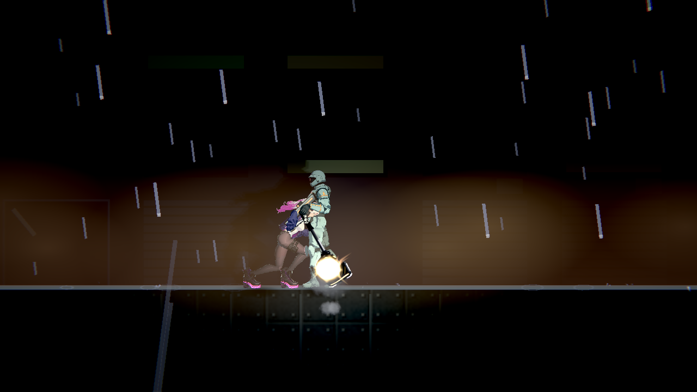

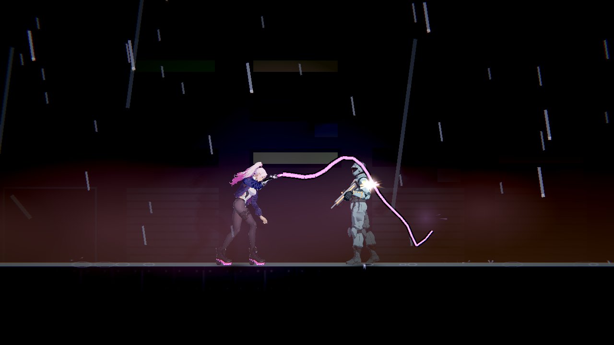

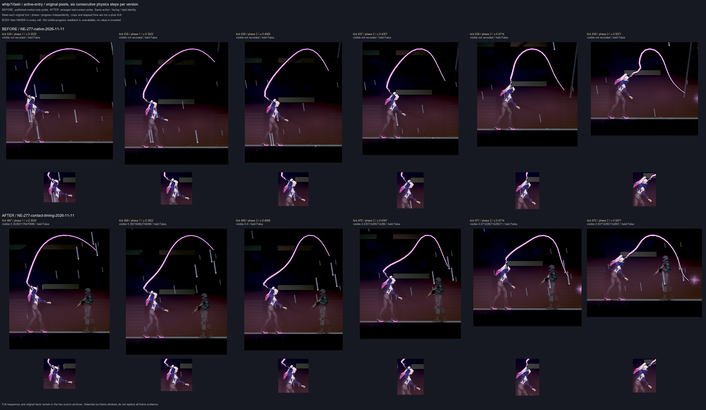

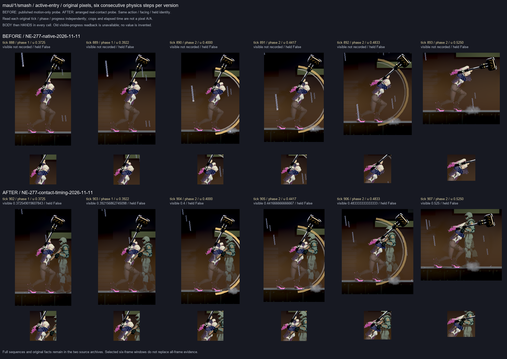

[驗證紀錄、重算命令與外部原件索引](attachments/NE-277-contact-timing-2026-11-11/README.md)

# Commit-4（聲音實驗室的鞭子靶不再偶爾揮空）

## 內文

**問題**：改成「看得到的武器真的碰到才算命中」後，聲音實驗室的「鞭子一般命中」在平行測試時偶爾只響揮空聲。鞭子的招式跟著準星揮，實驗室按下出招時，虛擬手把的瞄準有時還沒轉到右邊（瞄準輔助用實際經過的時間判斷轉向速度，機器忙時結果不同），鞭子就甩向靶的上方。

**改動**：實驗室的近戰情境先等瞄準真的朝右再出手（最多等一秒）；遊戲本身的判定、瞄準與輔助都沒改。

**驗收**：與其他九個大型套件一起平行跑兩輪（各約 5,300 項），鞭子命中聲都通過。

---

# Commit-5（重用近戰前後格的接觸資料）

## 內文

每格有效揮擊需要保留上一格和當格的武器輪廓。原本先逐點複製，再寫入新座標。現在輪流使用既有兩份陣列，換武器、轉身、重新開始揮擊及收起鞭子仍依原規則處理。首次取樣只使用當下的姿勢，防止把上一招掃進新招的判定。命中段、傷害和武器外觀沿用原資料。

### 測試結果

- 五把實際武器共 1,600 筆同輸入的前後格資料及 6,400 筆接觸查詢，兩版完全相同。涵蓋翻面、範圍變動、中斷後重啟，以及鞭身尚未放出。四組交替、每筆批次 5,000 次的接觸資料更新中位數如下。量測範圍是接觸座標更新。

| 武器 | 修前（µs） | 修後（µs） |
|---|---:|---:|
| 熱能長刀 | 5.95 | 3.75 |
| 匕首 | 3.72 | 2.33 |
| 離子戰戟 | 10.18 | 5.59 |
| 液壓錘 | 7.54 | 3.34 |
| 軟鞭 | 15.08 | 10.11 |

- RX 9070 XT Forward+ 原生畫面，液壓錘、軟鞭各自左右揮擊。兩個獨立版本各 260 格，首次命中影格、傷害和音效事件一致。兩場軟鞭的起手位置略有差異，接觸點最大相差 0.104 世界像素。在同一程序把實際遊戲姿勢同時交給兩版再比，196 筆前後格和 76 次實際接觸查詢全部相同。
- 重新出招的回歸檢查確認不會沿舊招掃到目標。受影響的 Godot 測試 22 組、45,532 項全過，0 腳本錯誤。

[五把武器的測試、原生命中與量測](attachments/NE-277-sweep-buffers-2026-11-20/evidence.zip)

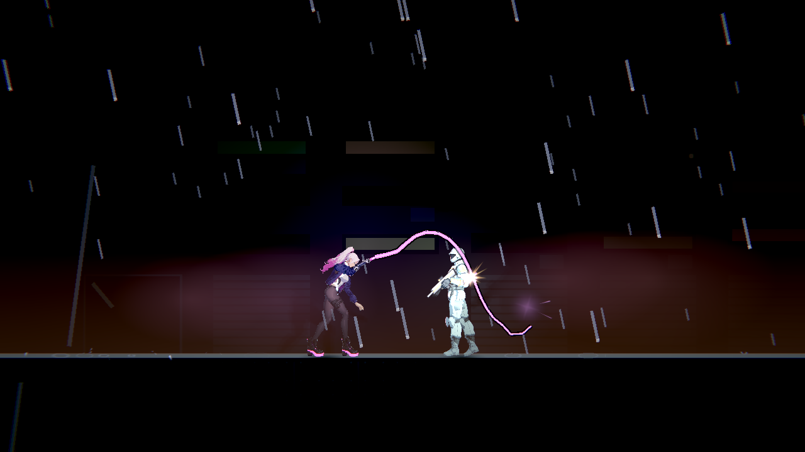

---

# Commit-6（五把近戰武器的黑白辨識）

## 內文

五把正式近戰武器各打一段第一招，並排比較起手、出手、跟隨與收招。畫面只裁切、轉灰階和打散列順序，依武器輪廓與動作先記下名稱，再和原圖順序核對。兩面向各辨識出五把。

### 測試結果

- RX 9070 XT Forward+，原生 40 張。每把武器左右取樣影格相同。熱能長刀的下劈、匕首的短刺、戰戟的長距平刺、液壓錘的砸地與鞭身的彎曲跟隨均可辨識。
- 本輪補上原生黑白對照。辨識勾選仍等使用者看過，聲音、命中回饋與整幀效能各自保留原驗收。

[40 張原彩圖、實際影格、辨識結果與原順序](attachments/NE-277-monochrome-2026-11-20/evidence.zip)

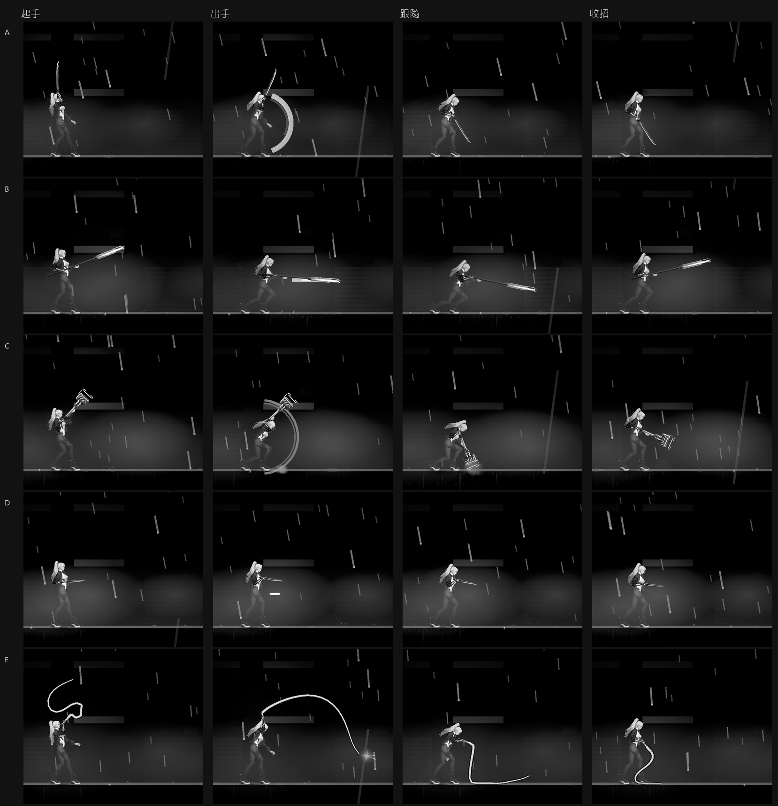

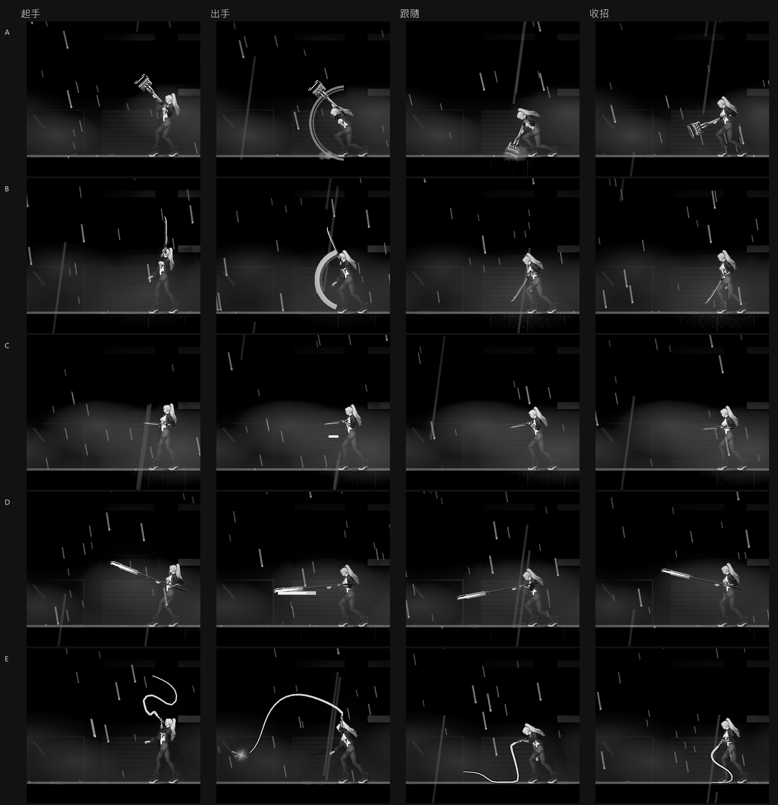

---

# Commit-7（分清戰戟命中的低頻與電擊聲）

## 內文

戰戟原本的刺擊和橫掃在兩層命中音中都以低頻為主。沿用原本的電擊素材，在加工清單替刺擊加入 180 Hz 高通、橫掃加入 340 Hz 高通。共用低頻聲持續提供命中重量；刺擊的電火花較亮，橫掃則維持較暗、較長的電擊。原始素材是 faxcorp 的 CC0 發布。 [原作者的素材頁](https://opengameart.org/content/electricity-game-sound-pack)

### 測試結果

| 命中音 | 前 250 毫秒的能量中位頻率，修前 → 修後 | 250 Hz 以下能量佔比 |
|---|---:|---:|
| 刺擊 | 46.9 → 4,945.3 Hz | 77.69% → 9.44% |
| 橫掃 | 93.8 → 281.2 Hz | 86.11% → 27.69% |

- 正式原生場景，RX 9070 XT Forward+、WASAPI 雙聲道。左右面向、兩招、一般與降低閃光／動態，各八個修前及修後案例，合計 196 項通過。錄到原始主匯流排；命中當下的低頻與電擊音也各有實際播放中的聲源。
- 傷害、反應與相對首傷影格一致，兩招各在觀察起點後第 8、18 格命中並同步停頓。兩次執行的接觸點最大相差 0.0751 世界單位。降低動態組仍抑制鏡頭震動事件。兩份聲音的容器時長仍為 0.60、0.80 秒。
- 受影響的 Godot 測試 9 組、31,220 項全過，97 秒。素材加工、原生重新匯入與快取工具檢查已附。真人試聽仍待驗收。

[兩版原始混音、逐格命中資料、頻譜與回歸](attachments/NE-277-glaive-impact-2026-11-21/evidence.zip)

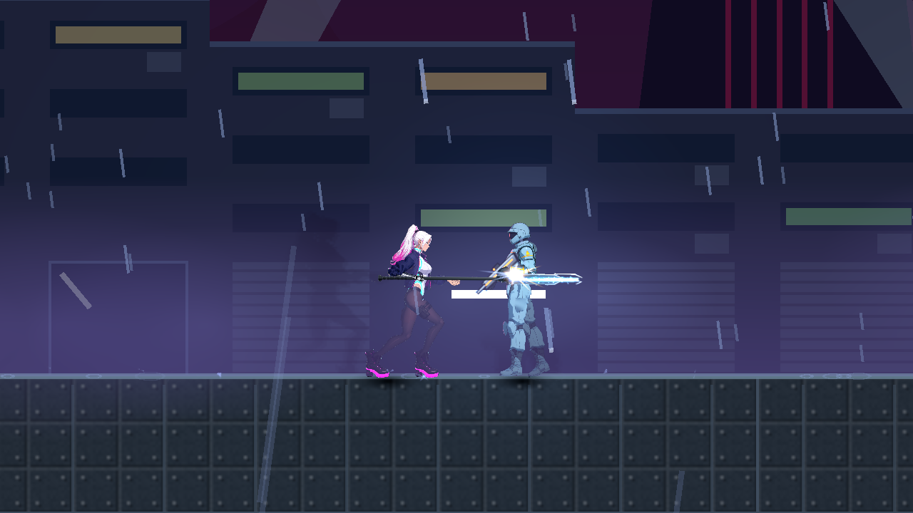

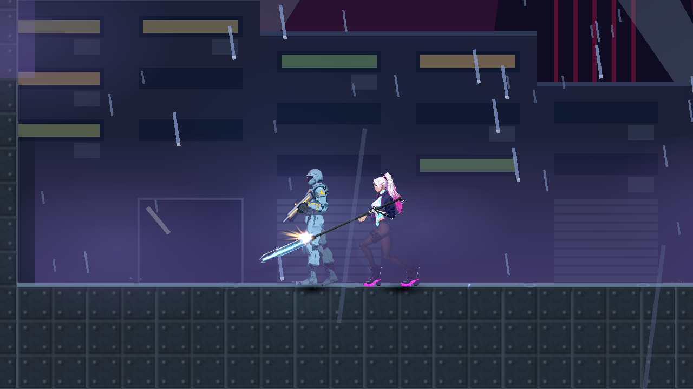

---

# Commit-8（減少閃光時壓低命中星芒）

## 內文

「減少閃光」原先會降低部分光影與鏡頭效果，但共用命中星芒和光暈仍以一般亮度處理。現在兩層粒子採用既有的 25% 設定倍率，保留接觸位置、尺寸與消退時間。一般模式的原亮度維持一致。 骨架受擊閃白也重現了相同的設定問題，仍待修正。

### 測試結果

- RX 9070 XT Forward+、WASAPI。五把武器在兩個面向用正式長按及放開流程，對照原版及新版的一般與降低設定。40 個案例、120 次實際長按命中，共 1,188 項通過。每次傷害時都有低頻及高頻聲源正在播放，首傷影格兩方均同步停頓。降低動態組無鏡頭震動事件。
- 同一設定下，兩版的命中次數、傷害、動作階段、聲源音量及粒子尺寸與壽命一致。30 次降低設定命中的 90 顆星芒初始透明度由 0.85 降至 0.2125，90 顆光暈由 0.45 降至 0.1125。十組原生首傷圖的接觸點周圍 48×48 像素，近白點合計由 10,331 降至 8,927。
- 獨立測試在原版 435 項重現一項失敗。受影響的正式回歸 69 組、96,427 項全過，869 秒。 退出時有既有的清理警告（9 個物件、5 個資源）。

[40 張原生首傷圖、粒子、逐格傷害與聲源紀錄](attachments/NE-277-reduced-impact-flare-2026-11-21/evidence.zip)

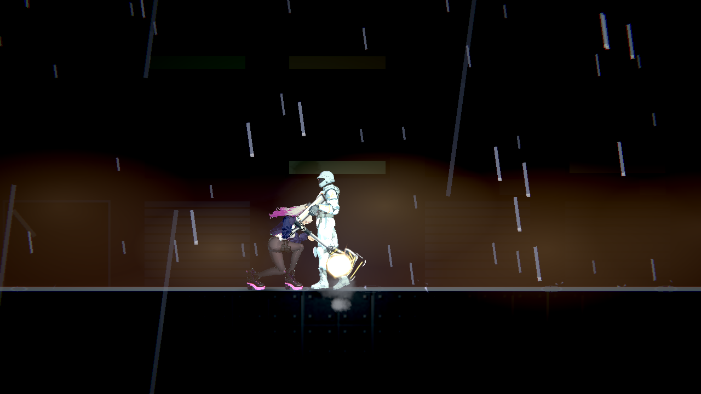

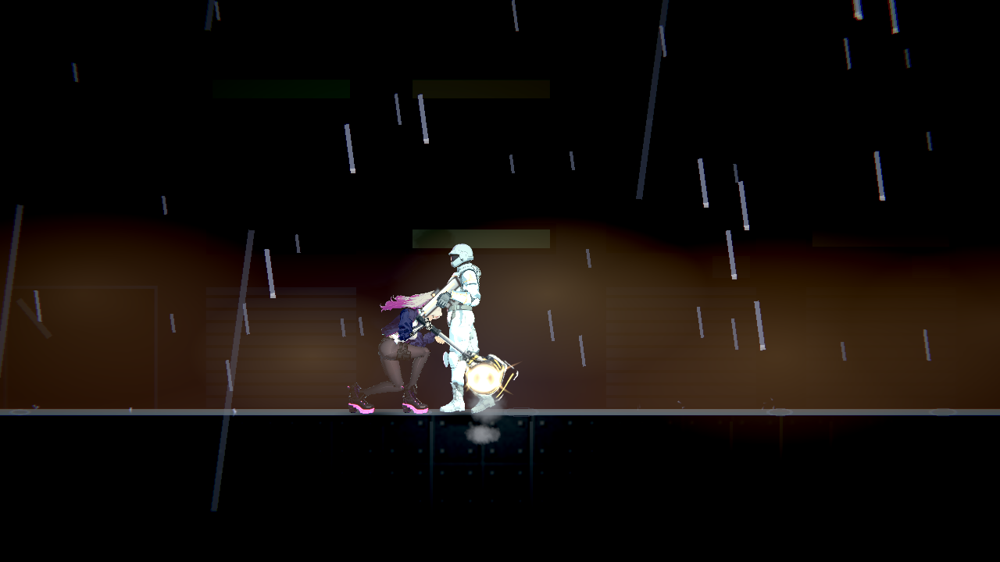

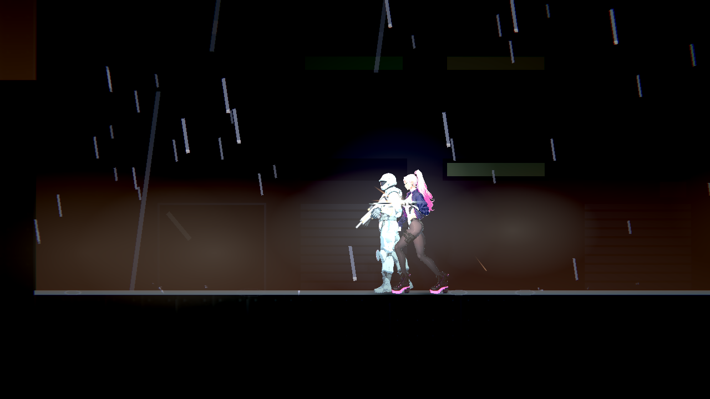

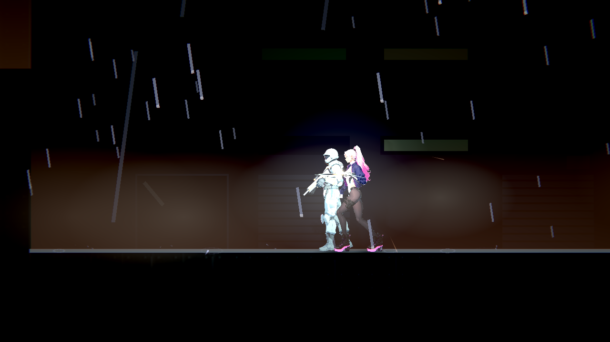
