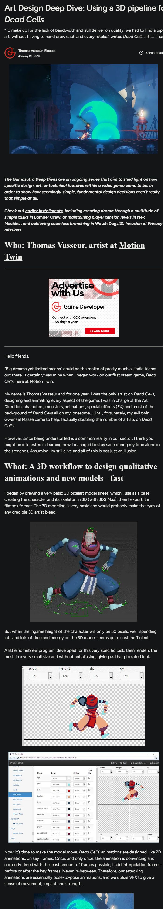
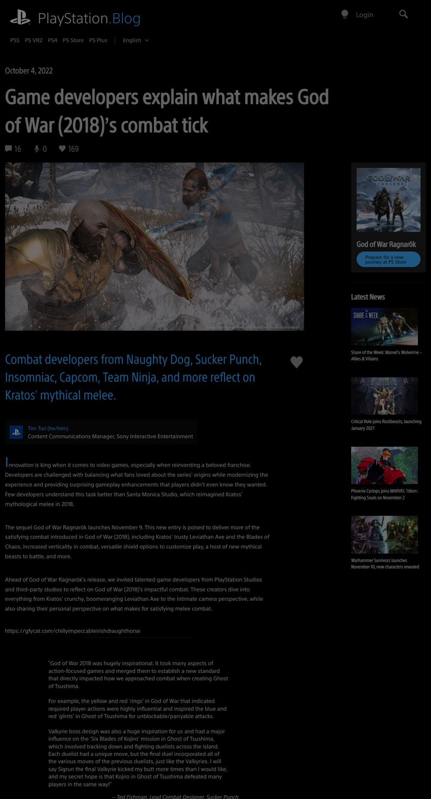
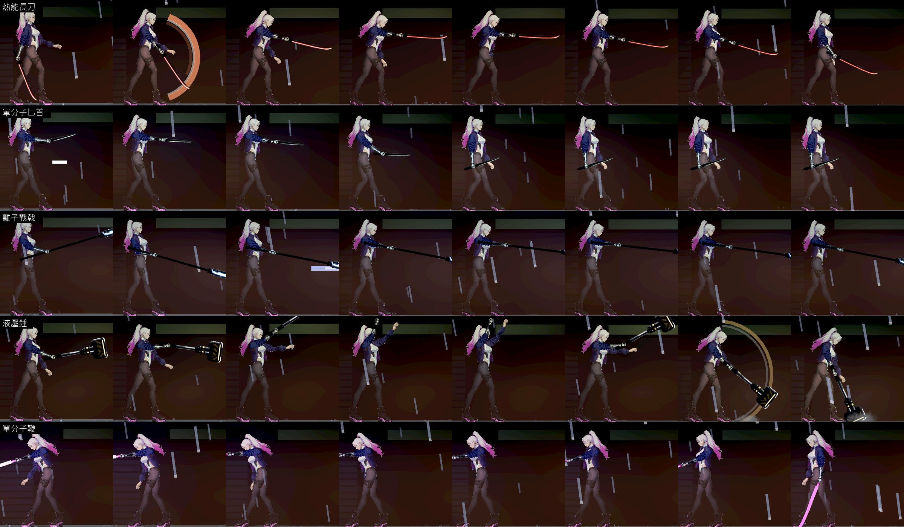
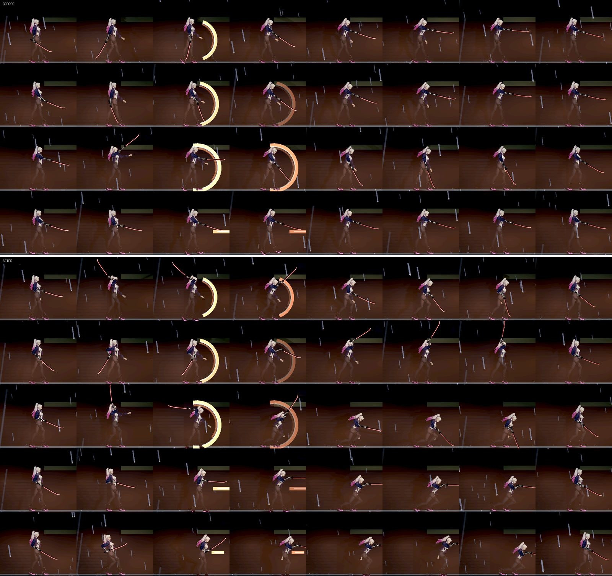
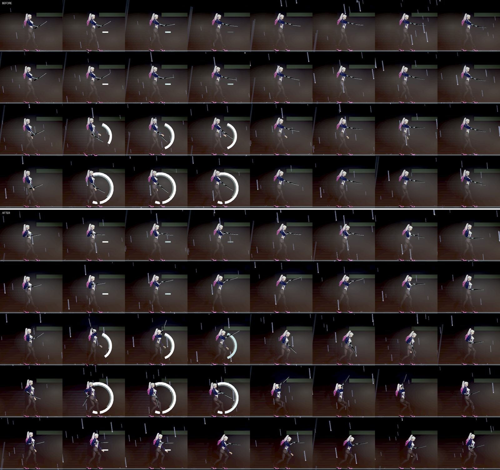
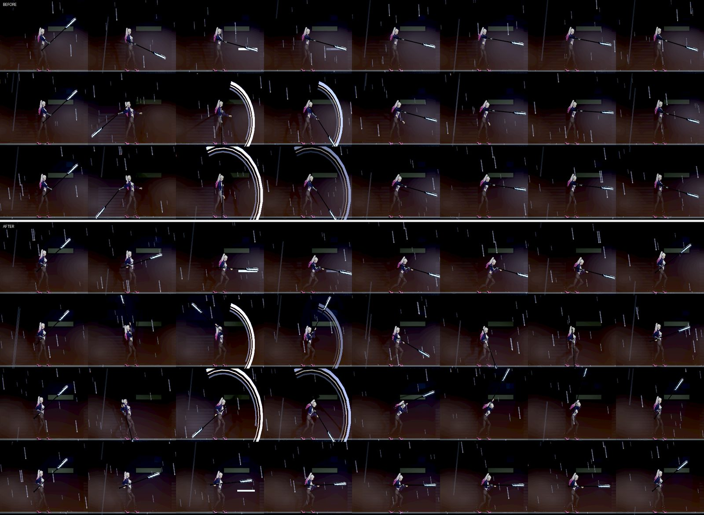
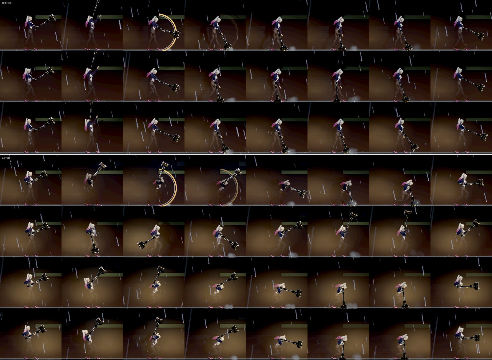
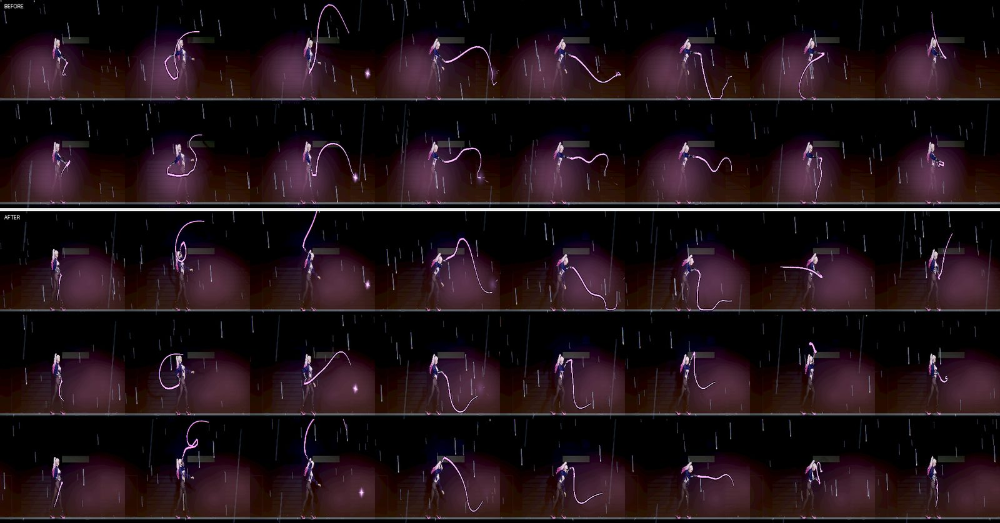
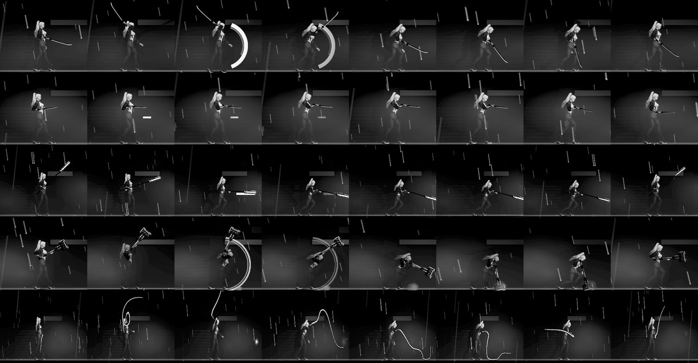

# [NE-277] 建立完整且獨立的近戰攻擊模組

> 狀態：進行中

## 內文

### 需求
近戰現在只有基礎的揮動：一招就是一段手臂姿勢的內插，武器跟著前臂、身體幾乎不動、另一隻手不參與；五把武器的招式長得很像，差別主要在軌跡的顏色與形狀。使用者要的是完整且獨立的近戰攻擊模組。

要做到（設計與依據在 [近戰攻擊模組與軟鞭](../../design/14-combat-variety/MELEE_MODULE.md)）：
- 一招是一個自己帶齊所有東西的單位（資料）：預兆、出手、跟隨、收招的關鍵姿勢，身體怎麼動，武器走的路徑，另一隻手在哪，判定（可以多段），命中回饋，可取消點。
- 武器帶著手：先決定武器的路徑，兩隻手去握；雙手武器出招時兩隻手都在桿上。
- 每把武器有自己的一套招式與一個「按住」的招式，不是同一套換皮。
- 近戰模組自己管招式的播放、判定與回饋，不混在槍械瞄準與手臂的程式裡；之後加新武器以資料為主。

### 來源
2026-10-12，使用者：「現在只有基礎的揮動，沒有完整且獨立的近戰攻擊模組……幫我多看看其他人是怎麼做的，還有業界最佳實例是怎麼處理的，除了文字最好也要看截圖……記得要把截圖留在票裡面」「至少 5 個不同來源」「不一定要照抄，可以取他們的特點，做一個屬於自己的，但如果不參考別人的東西，我們永遠都在原地打轉」。

### 驗收條件
- [x] 招式是資料：每一招有四段的關鍵姿勢（4～6 個）、身體的位移、武器的路徑、另一隻手的位置、判定（含多段的持續與間隔）、命中回饋、可取消點；資料檢查擋住缺欄與不合理的數字
- [x] 既有的每一招搬到新的格式後，打得到的距離、時間、傷害與連段行為和修前相同（既有的近戰測試全過，不改測試）
- [x] 出招時武器走的是這一招自己的路徑，兩隻手握在武器上（雙手武器兩隻手都在桿上），每一格握把都在掌心
- [x] 每一招看得到預兆、出手、跟隨、收招四段：身體有動作（踏步、轉身或壓低），不是只有手臂在動
- [ ] 五把武器各有自己的一套：把五把的同一段招式並排，閉著眼睛換掉顏色也分得出是哪一把
- [x] 每把武器有一個「按住」的招式（長刀：衝刺斬；匕首：連刺；戰戟：戒備；錘：蓄力砸地；鞭：把鞭子留在外面甩），有說明文字
- [ ] 命中回饋分層：命中的第一格雙方停頓、敵人依招式的輕重有不同的反應、聲音有低頻與高頻兩層；「減少閃光／減少動態」生效
- [x] 近戰模組獨立：槍械的瞄準與手臂程式裡沒有近戰的分支；新增一把近戰武器不必改模組的程式（用一把測試武器證明）
- [ ] 手臂與手的接合沒有變差（接點稽核、逐格放大看）；每影格耗時不比修前多
- [ ] 原生截圖：五把武器每一招的連續影格，修前修後並排；每把一段原生錄影或逐格圖

### 測試流程
1. 資料檢查與既有的近戰測試
2. `tools/melee_art_probe.tscn` 拍每一招的連續影格與兩隻手的特寫
3. 實際玩：五把武器各打一輪（含按住的招式），對著輕、重、有盾的敵人
4. 跑受影響的測試

### 參考（看過的內容與截圖）

1. [Art Design Deep Dive: Using a 3D pipeline for 2D animation in Dead Cells](https://www.gamedeveloper.com/production/art-design-deep-dive-using-a-3d-pipeline-for-2d-animation-in-i-dead-cells-i-)（Motion Twin）：攻擊動畫是姿勢到姿勢，用最少的關鍵姿勢把動作與時間做對，補間不加在關鍵姿勢中間；特效給出移動感與力道；移動關鍵格就能快速調手感。

   

2. [Game developers explain what makes God of War (2018)'s combat tick](https://blog.playstation.com/?p=370399)（PlayStation Blog；Naughty Dog、Capcom、Techland 等多家設計師）：大的揮擊弧與有力的跟隨、誇張的敵人反應、命中第一格雙方一起停、聲音低頻加高頻；先預兆再釋放；每把武器有自己的參數；重武器靠走位。

   

3. [Dustloop：Using Frame Data](https://www.dustloop.com/w/Using_Frame_Data)（格鬥遊戲社群）：一招分成發生、持續、硬直；多段攻擊寫成持續與間隔；有的招在硬直前幾格可以取消。（純文字頁，沒有截圖）
4. [Follow-Through & Overlapping Action](https://blog.cg-wire.com/follow-through-overlapping-action)（CG-Wire）：不同部位不在同一格到位，鬆鬆連著的部分在主動作停下後繼續動。（純文字）
5. [Indiana Jones and the Great Circle：Wits, Whip & Fists](https://bethesda.net/en-AU/news/indiana-jones-and-the-great-circle-wits-whip-and-fists)（MachineGames）與 [Super Castlevania IV](https://en.wikipedia.org/wiki/Super_Castlevania_IV)（Konami）：武器自己的玩法（鞭子按住垂軟可以甩、可以勾、可以纏）。截圖在 NE-276。

現況（NE-275 之後的每把第一招；手臂在動、身體幾乎不動、另一隻手不在武器上）：

---

# 跟其他票的關係

- Blocks：無
- Blocked by：無
- Related：NE-237、NE-270、NE-275、NE-276、NE-261、NE-117

---

# Commit-1（近戰模組、完整招式資料、武器帶著手、身體動作、多段判定、按住招式、分層命中聲）

## 內文

**問題**：近戰的播放、判定與回饋都寫在主角的程式裡；一招只有時間、距離、傷害與一個共用的手臂姿勢，武器跟著前臂、身體幾乎不動（量到出招時骨盆只動 1～2 像素），雙手武器出招時另一隻手離開桿子；錘的三招看起來是同一個動作；沒有按住的招式；命中聲只有一層。

**改動**：
- 近戰變成一個獨立的模組：按鍵（含提早按的緩衝）、連段、三段時間、可取消點、判定、命中回饋與按住招式都在模組裡；主角的槍械、瞄準與衝刺只問模組「在不在出招、能不能取消、面向要不要鎖」。新增一把近戰武器只要寫資料：用一把只有資料的測試長矛（兩段連段，第二段是三連刺，外加按住蓄力）證明，不必改模組。
- 每一招自己帶齊：四段時間（新增跟隨段）、多段判定（每一段同一個目標可以再被打一次）、身體動作（踏步、壓低、轉身）、武器的路徑（4～6 個關鍵點，前手的掌心追著它）、單手或雙手、敵人反應的輕重與低高頻兩層命中聲。資料檢查會指出缺哪個欄位、哪一招、哪個數字不合理；既有的每一招搬過來時時間、距離、傷害與連段都沒動（每一招都是「出招開始一段、持續整個出招」）。
- 武器帶著手：前手追武器路徑；雙手武器（錘、戰戟）出招的每一格，後手等武器這一格的位置定了才去握桿，長柄的後手可以沿桿子滑（刺擊時握在桿尾），手臂搆不到的點不會硬拉。
- 五把武器各有一套動作（同樣的時間與傷害下重新編排）：長刀斜砍、反斬、踏步下劈與突刺；匕首兩記短刺、橫劃與後跳回斬；戰戟雙手平刺、上撩橫掃、迴旋交叉掃；錘舉過頭下砸、由下往上撈、重砸；鞭子的握把從肩後甩出、回甩（鞭身仍是一直在模擬的軟繩）。
- 每把武器一個按住招式（按下＝第一招，第一招打完還按著就接上），說明加在武器的一行說明裡：長刀「按住蓄力，放開衝刺斬」、匕首「按住連續快刺」（一次四段）、戰戟「按住把戟頭頂在前面電擊」（每 0.25 秒判定、最多 2 秒）、錘「按住蓄力，放開砸地震開」（蓄滿加傷）、鞭「按住讓鞭子留在外面甩」（跟著準星、每 0.2 秒判定）。
- 命中聲分兩層：原本的命中聲是高頻層，下面加一層低頻悶擊（輕：撞擊尾音；重：落地悶響加撞擊尾音，都是音效庫裡已登記授權的錄音，99% 能量在 200 Hz 以下）；揮空不播，頓幀一招只有一次。
- 動作姿勢的關鍵格在每個動畫器裡整理一次就快取，出招時不再每格重新配置（量到算一個姿勢從 0.054 毫秒降到 0.005 毫秒），抵掉新增的手臂 IK。
- 設計文件補上實作後的欄位表、每把武器的一套與量法（[近戰攻擊模組與軟鞭](../../design/14-combat-variety/MELEE_MODULE.md) 第四節）。

**驗收**：
- 逐格量測（`tools/melee_module_probe.tscn`，16 招）：前手掌心離路徑要的握點每一格都是 0 像素；雙手的 6 招每一格後手都握在桿上（0 格脫手、離桿上的點 0 像素）；出招時骨盆的最大前後位移從 1～2 像素變成 3～15 像素。
- 接點稽核（`tools/melee_joint_audit.tscn`，修前在乾淨的 main 上跑同一支）：修前 0 項、修後 0 項超出限制；最大值有變大但都在限制內（單格角度跳動 0.53→1.37，限制 1.98；關節變窄 0.22→0.75，限制 0.75；手肘反折沒有，-0.08）。這一條仍要本機放大看接合，所以「接合沒有變差」先不勾。
- 每影格耗時：雲端的軟體環境雜訊約 ±15%，同一招在修前修後交替量三次（骨架動畫加後手 IK，長刀 299～369 對 301～316 微秒、錘 369～457 對 318～381 微秒），分不出差異；要在本機原生量。
- 第一招灰階並排（下圖）：五把的武器輪廓與動作路線都不同（長刀舉過頭斜砍、匕首平刺、戰戟雙手平刺、錘舉過頭砸地、鞭從肩後甩出）；是否「閉著眼睛也分得出」請使用者看過再勾。
- 命中聲兩層已接上並量過頻率，但沒有人聽過；「減少閃光／減少動態」下揮空不假裝命中、命中仍讀得出（既有檢查全過）。這一條待本機試聽後再勾。

待本機原生驗收：五把武器每一招與按住招式的原生連續影格（左右兩個面向）、雙手武器出招時兩隻手的特寫、每影格耗時（開與關交替量）、命中聲兩層的試聽、實體手把按住與連按。

### 測試結果

| 項目 | 結果 |
|---|---|
| 近戰套件（含新增的完整格式、只有資料的測試武器、五把按住招式、鍵鼠與手把一致） | 128 項，0 失敗 |
| 近戰相關 6 套件（近戰武器、音效、聲音舞台、武器情境、聲音實驗室） | 29,103 項，0 失敗 |
| 受影響範圍（併入最新 main 後，`tools/run_tests_changed.sh`） | 82 個套件、93,479 項，0 失敗 |
| 逐格量測／接點稽核 | 0 項失敗／0 項超出限制 |

### 截圖

Forward+（軟體 Vulkan），每張上半是修前、下半是修後；一列一招（連段、升級尾招、修後多一列按住招式），一欄一個招式進度（0、0.2、0.38 前搖；0.48、0.58 出招；0.7、0.82 跟隨；0.95 收招）。

分支：`feature/affectionate-feynman-dfv3cp`，提交：https://github.com/deadline314/Nest-Egg/commit/55da2933

