# [NE-279] 在圖鑑加入重看看過的過場

> 狀態：進行中

## 內文

### 需求
序章的驗收要求「之後可在圖鑑重看」（ST-16），目前圖鑑只有敗北卡片，看過的過場沒有地方回顧。劇情端已提供不改進度的回看：只播畫面與台詞，不寫旗標、不發結果、不接下一段、不記觀看。圖鑑要有一個「回顧」分頁，列出本輪看過、劇本標了名稱的過場（例如「序章　雨裡的燈」「第一章　初次建檔」「第一章　回家」），選一個就重看，看完或按返回回到圖鑑原本的位置。

### 來源
2026-10-11，故事 Session 處理 ST-16 時，回看的劇情接點完成，圖鑑畫面屬介面組，交接開票。

### 設計與參考
2026-10-17 先讀 User-guide；[回顧介面設計與圖例](../../design/20-campaign-experience/CODEX_REPLAY.md)。固定驗證基準：`6efbc3ec700c1529ce5d0190bd7d138b6b649322`。

以下為他作研究圖，不是 Nest Egg 的驗收畫面；只借介面層級與操作，不取用遊戲素材。完整來源、實際觀察與其他六例見上方設計及[來源帳本](attachments/NE-279-references/sources.json)。

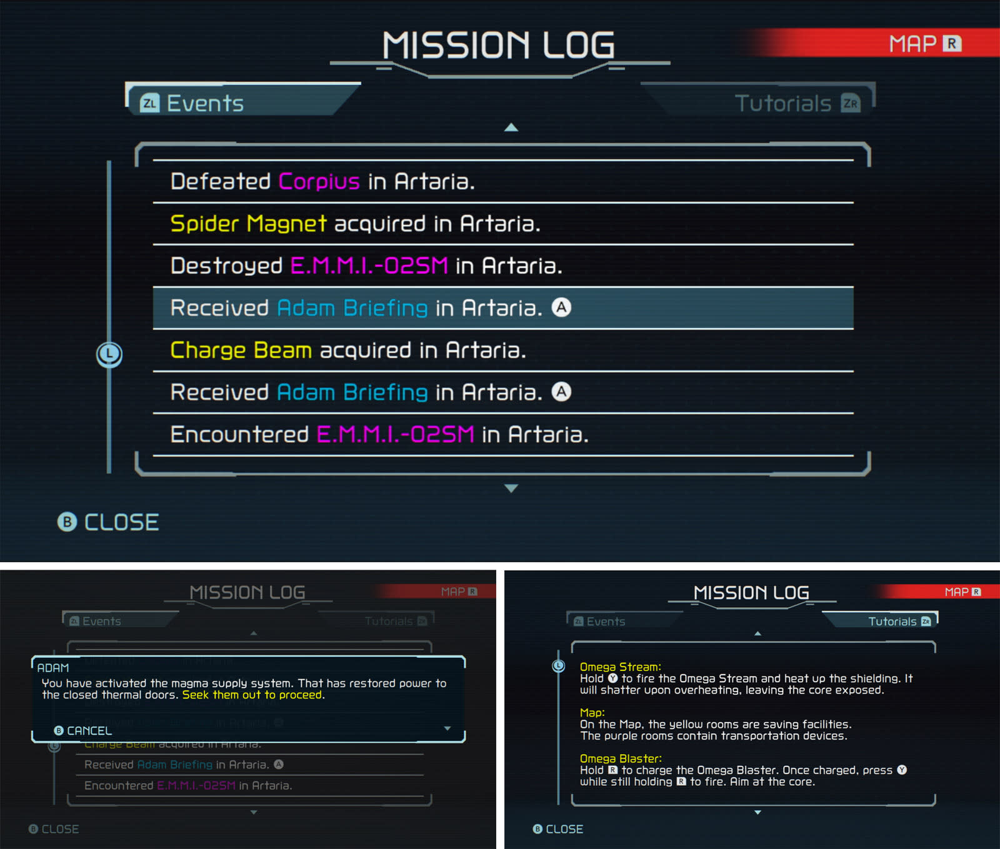
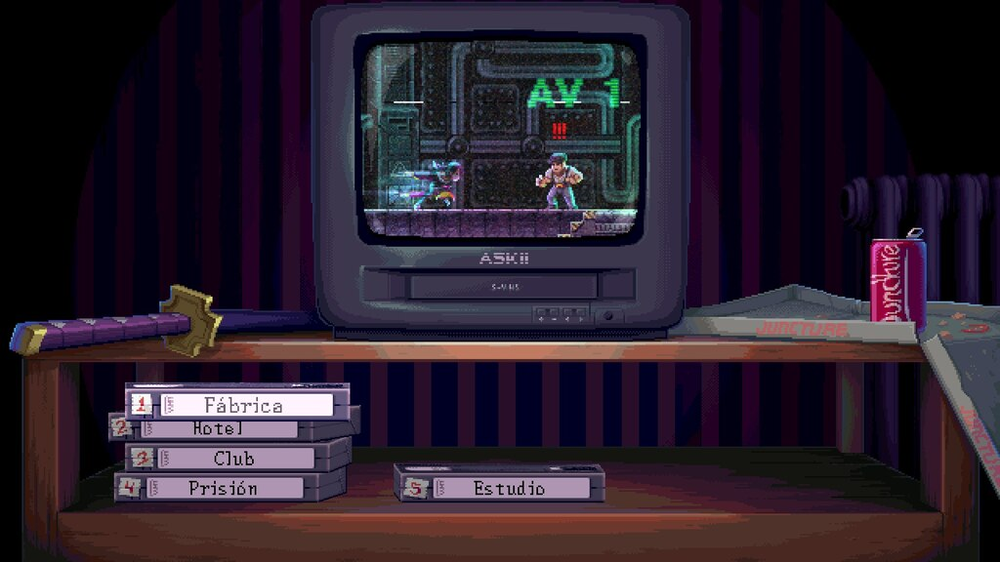
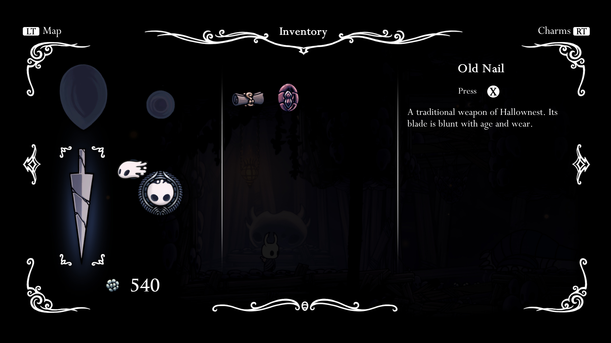

### 驗收條件
- [x] 圖鑑有回顧分頁，只列出本輪看過的過場，依章節與故事先後排列；沒有看過的不顯示或顯示為未解鎖剪影
- [x] 選一個項目即重看；重看時可略過，看完或略過回到圖鑑並恢復原本選中的項目與焦點
- [x] 重看前後故事旗標、任務、道具與觀看紀錄完全不變（關閉遊戲重開讀檔也一樣）
- [x] 主選單與暫停頁進入的圖鑑都能重看，暫停中重看不讓遊戲世界繼續跑
- [ ] 鍵盤、滑鼠與手把都能操作；項目有一句話說明這是哪一段（鍵鼠與合成手把事件已通過；實體手把保留本機驗收）
- [x] 三語名稱依劇本語言顯示；附 1280×720 與 1920×1080 的 Forward+ 截圖

### 測試流程
1. 新遊戲看完序章開場，回主選單開圖鑑的回顧分頁，確認只有「序章　雨裡的燈」
2. 選它重看，中途略過，確認回到圖鑑且焦點在原項目
3. 關閉遊戲重開讀檔，確認進度與重看前相同
4. 執行受影響範圍測試

---

# 跟其他票的關係

- Blocks：ST-16
- Blocked by：無
- Related：NE-228

---

# Commit-1

## 內文

**問題**：圖鑑只有敗北卡片，看過的故事沒有入口重看，暫停頁也無法開圖鑑。

**改動**：加入回顧分頁與暫停入口，依本輪已看過的故事排序，提供三語名稱、一句說明與直接重看。自然播完或略過回到原項目、焦點與清單位置；暫停中的世界繼續凍結。仍在閱讀重要通訊時，提示先讀完對話，避免兩套演出重疊。

移除會越過圖鑑蓋住過場的父選單說明，修正上一列殘留高亮；文字放大時固定重看與返回位置，三段故事的名稱與說明都能完整看見。

**驗收**：2026-10-17，官方 Godot 4.7／Forward+／軟體 Vulkan llvmpipe。固定基準的 18 組受影響測試通過；最終文案與版面另跑介面回歸。主選單、真實關卡暫停、正常結束的最小舞台樣本、真實故事略過、外部關閉、鍵鼠與合成手把輸入皆有覆蓋。主檔與備份在三個獨立程序間的雜湊完全一致。這些是程式化與軟體渲染驗證，不代表完整序章試玩、硬體效能或實體手把驗收。

### 測試結果

| 項目 | 結果 |
|---|---|
| 受影響 18 組 | 6,588 checks，0 新失敗、0 既知失敗 |
| 最終介面回歸 | 279 checks，0 失敗 |
| 三語 × 720p／1080p／1.2 倍文字 | 420 項通過；27 組故事名稱與說明完整顯示 |
| 三個獨立程序：建立樣本、回看、重開讀檔 | 9 項通過；主檔及備份 SHA-256 前後一致 |
| 原始紀錄、來源指紋與圖像雜湊 | [驗證帳本](attachments/NE-279-verification/receipt.json)、[完整日誌](attachments/NE-279-verification/logs.zip) |

### 截圖

以下都是本輪原生 Forward+ 軟體 Vulkan 擷取；已看過的故事由明示的驗證樣本解鎖。修前來自固定基準的原圖鑑，沒有回顧分頁。

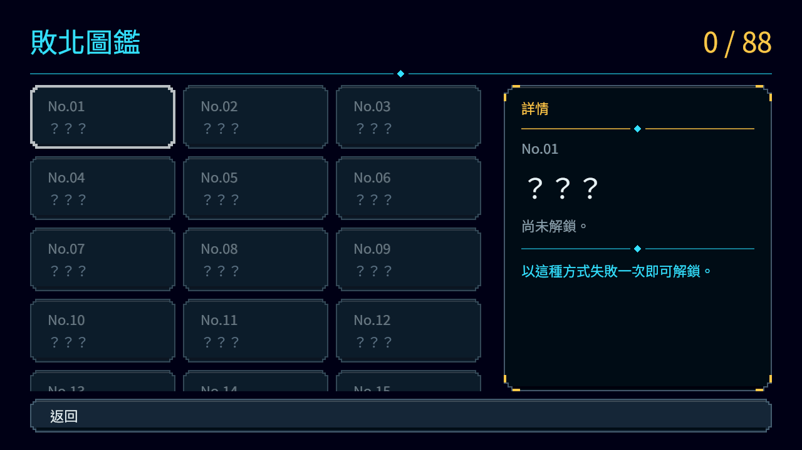
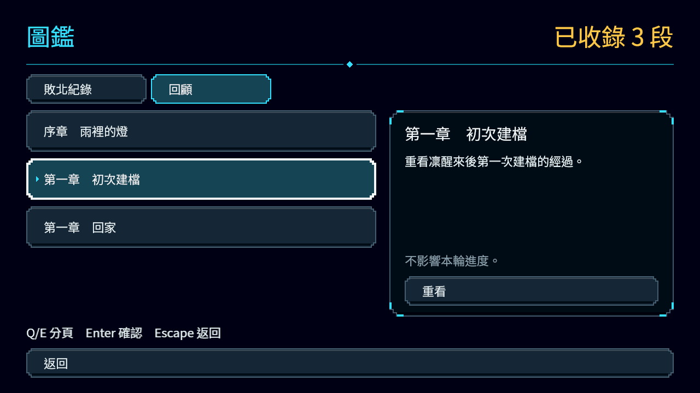
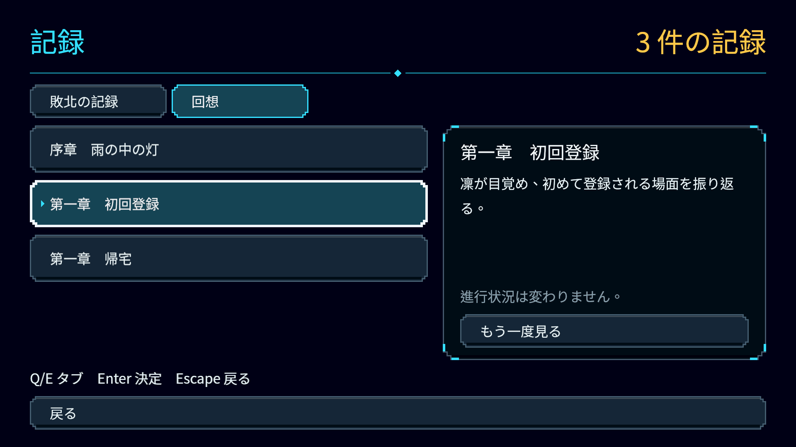
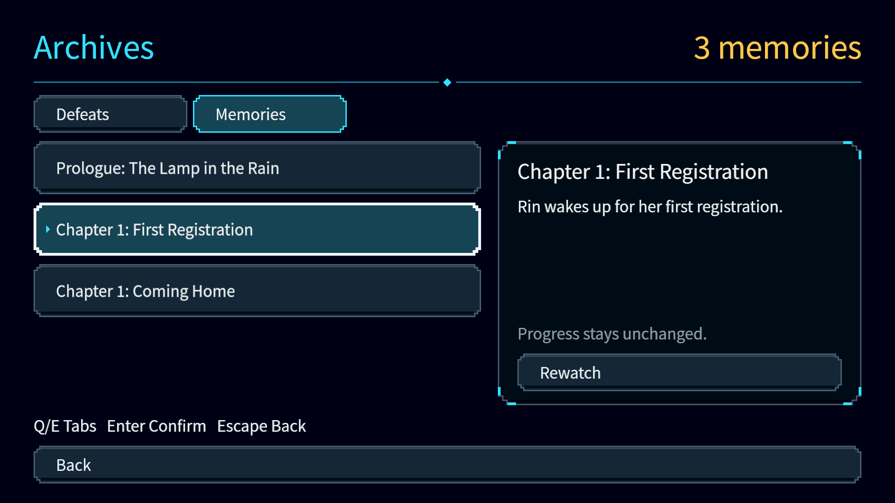
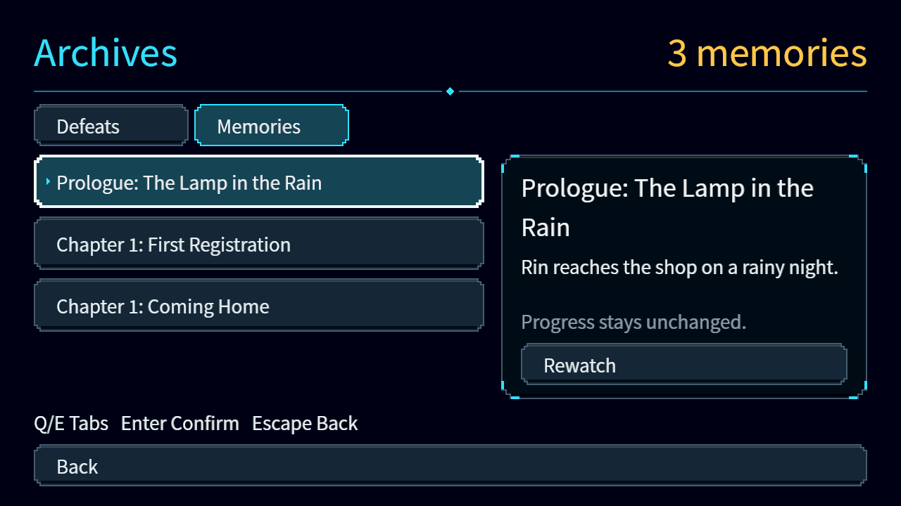
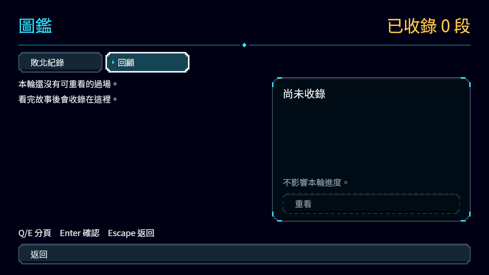
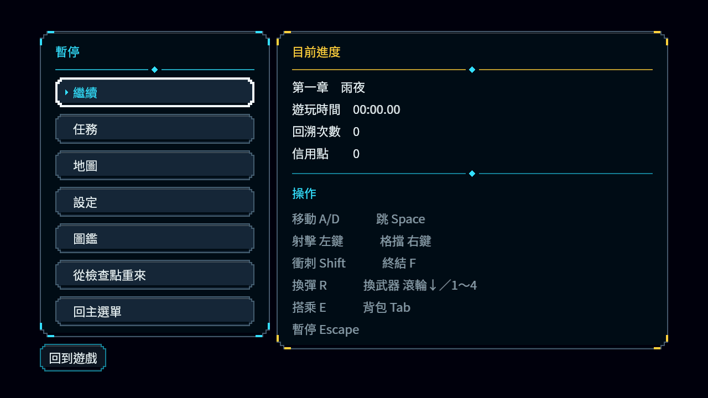
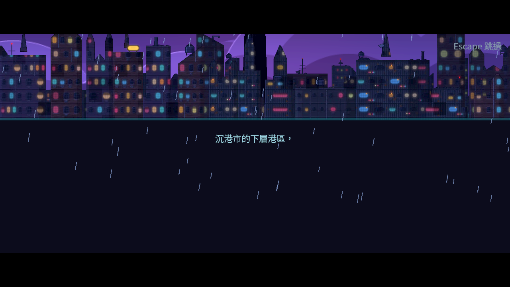
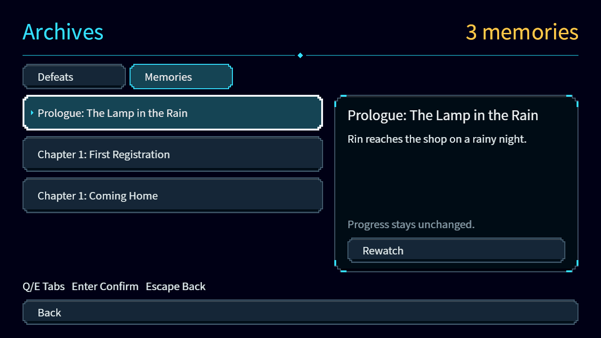
