# [NE-27] 製作第二章關卡

> 狀態：完成

## 內文

### 需求
第二章需要一個與第一章同規格的完整關卡：從開場到頭目戰到章節結算，並與第一章銜接。設計見 `design/09-content/DESIGN.md` 第一節。

### 來源
2026-10-02，使用者於開發對話中提出：「讓遊戲內容更豐富」；確認四個方向都要做（第二章／新關卡、新敵人與新頭目、場景互動與探索、成長系統），順序為先光影再內容。

### 驗收條件
- [x] 第二章是一個可玩的完整關卡，包含開場過場、通訊、頭目戰、結尾與章節結算
- [x] 至少五個區段，每個區段有自己的光影設定與色彩腳本
- [x] 使用新敵人、新頭目與環境機關
- [x] 每種機關（升降梯、閘門與開關、電力開關、油桶、玻璃牆）第一次出現時，放在沒有敵人的空曠處作為安全示範（提示文字已在 NE-30 完成）
- [x] 至少四個檢查點，死亡後從最近的檢查點繼續
- [x] 第一章結算後可接續進入第二章
- [x] 關卡地圖通過自動可通行檢查，每個檢查點都能站穩
- [x] 輔助、標準、硬核三種難度都能通關

### 測試流程
1. 從第一章結算進入第二章，確認銜接
2. 走完整個第二章，逐區段確認光影與敵人配置
3. 三種難度各通關一次
4. 執行完整測試套件，全部通過

---

# 跟其他票的關係

- Blocks：無
- Blocked by：NE-26、NE-28、NE-29、NE-30
- Related：無

---

---

# Commit-1

## 內文

第二章「天空的代價」成為可玩的完整關卡（340×24 格，全程室內密閉、沒有雨）：開場過場、8 段途中通訊、頭目登場過場與戰鬥、結尾過場與章節結算卡。依「往上走」分五個區段，每段有自己的光影與色彩腳本（橘色警示燈的升降井入口、更暗的升降井、灰白冷光的夾層區、青綠的電力室、慘白的轉運站，頭目戰轉橘紅）。內容用上本輪新增的全部東西：切割者、迷彩獵手、維修機、精銳保全、回收員；貨箱、油桶、玻璃牆、裂縫牆、升降梯與高升降梯、兩組閘門與開關、電力開關與受電的雷射柵欄和砲台；6 件背景收集品（2 件在隱藏房間）、信用點、2 個補給點；6 個檢查點。每種機關第一次出現的地方附近都沒有敵人（測試鎖定 9 格內無敵人），作為安全示範。
第一章通關後直接接續第二章：新增 `LevelData.next_level` 串接關卡，成長（信用點、改裝）與裝備（武器、消耗品）帶進去，重試重載同一關，第二章通關進入結算（結算畫面顯示背景收集進度）。沒有檢查點時（殘機用盡）從進入關卡時的狀態重來。地圖由 `tools/level/build_level_02.py` 產生，與第一章共用新的 `tools/level/level_kit.py`（網格、輸出、可通行檢查，第一章產生器已改用並確認輸出不變）；檢查包含跳躍高度、坑洞寬度、升降梯銜接與每個檢查點腳下是實心。暗場可讀性量測工具改為每一章都量測，第二章六個區段全部通過。
驗收方式：測試驗證關卡資料與每個場景／觸發點存在、至少五個各自光影的區段與頭目戰光影、地圖無警告、檢查點站得穩且觸碰會記錄、新敵人與每種機關／可破壞物／收集品都有放、六件收集品各放一次、機關的安全示範、閘門與開關成對、必經路線真的走得通（搭升降梯跳上平台、閘門擋路與開啟後通過）、第一章接第二章的成長與裝備帶入與重試與結算、三種難度各自進入頭目戰並通關接上結尾。誠實說明：三種難度的「通關」是用測試直接擊倒頭目後確認結尾流程，頭目戰鬥本身另由回收員套件以三種難度各跑 40 秒驗證；完整的人工通關體驗仍需要實機試玩確認手感與難度。

渲染量測（對比 = (內 − 外) / (外 + 0.02)；門檻：玩家 ≥ 0.6、亮邊 ≥ 1.0）：

| 區段 | 玩家對比 | 地面亮邊對比 |
|---|---|---|
| 升降井入口 | 5.84 | 6.99 |
| 升降井 | 4.25 | 15.48 |
| 夾層區 | 3.84 | 4.44 |
| 電力室 | 5.42 | 11.45 |
| 轉運站 | 1.46 | 2.39 |
| 回收員場地 | 5.01 | 9.11 |

### 測試結果

| 項目 | 結果 |
|---|---|
| 完整測試套件 | 通過 1651 / 1651 |
| 資料驗證 | 0 錯誤 |
| 執行 log | 無非預期 ERROR |
| 渲染量測（第一章 6 區段＋第二章 6 區段） | 全部通過 |

### 截圖

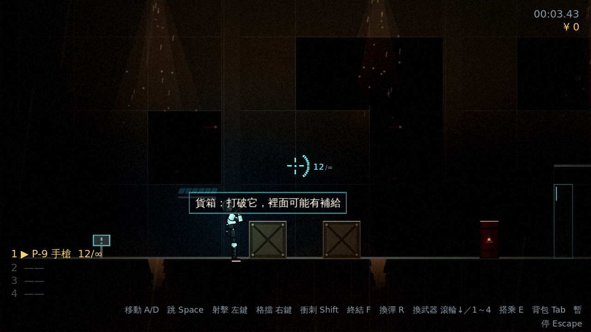

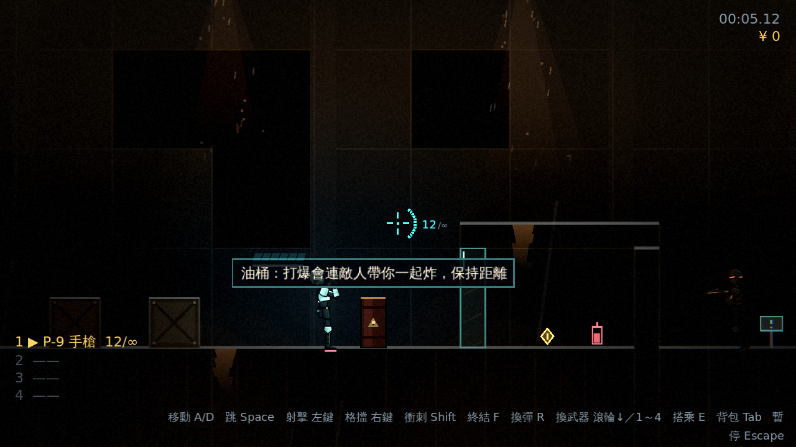

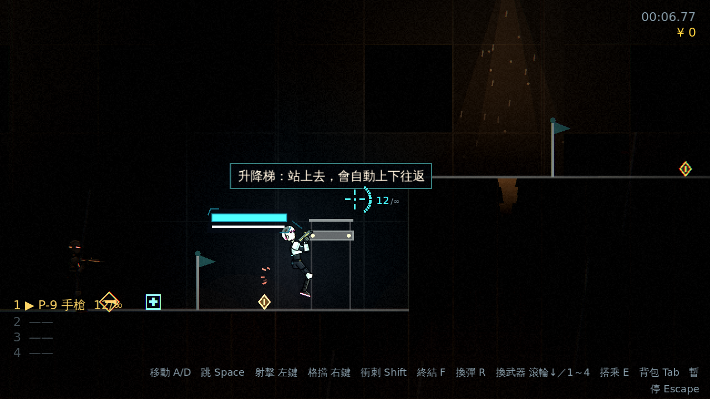

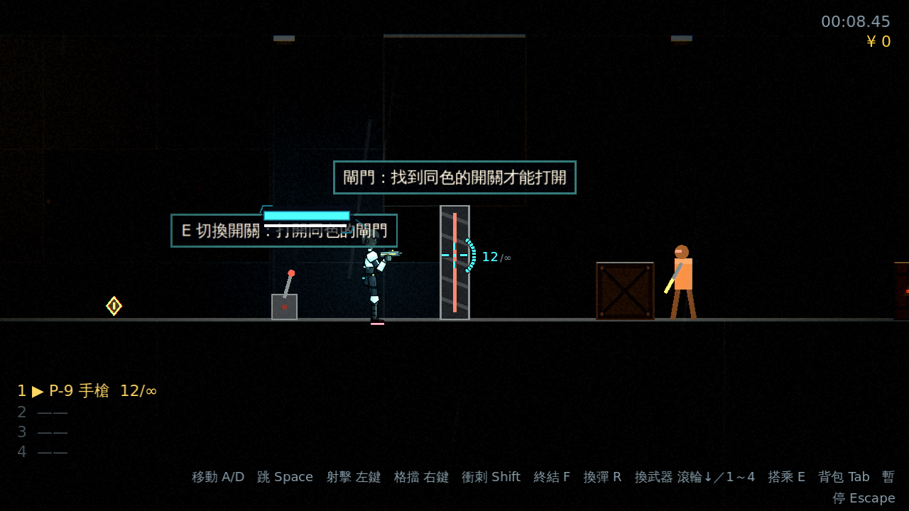

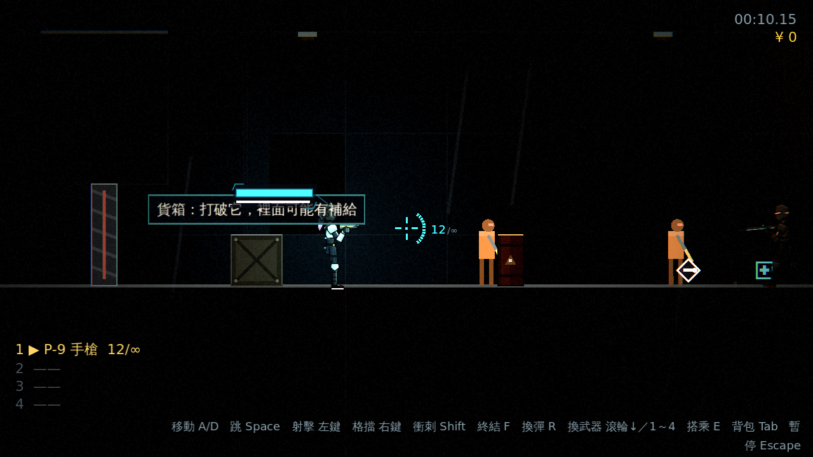

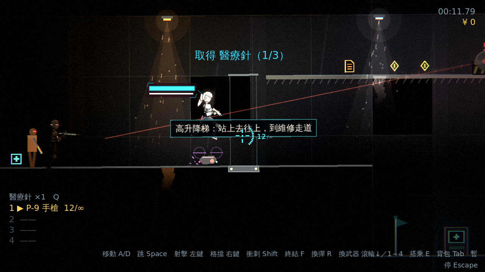

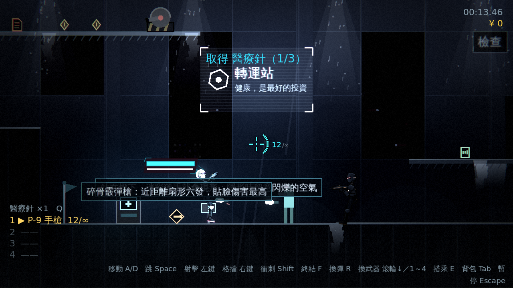

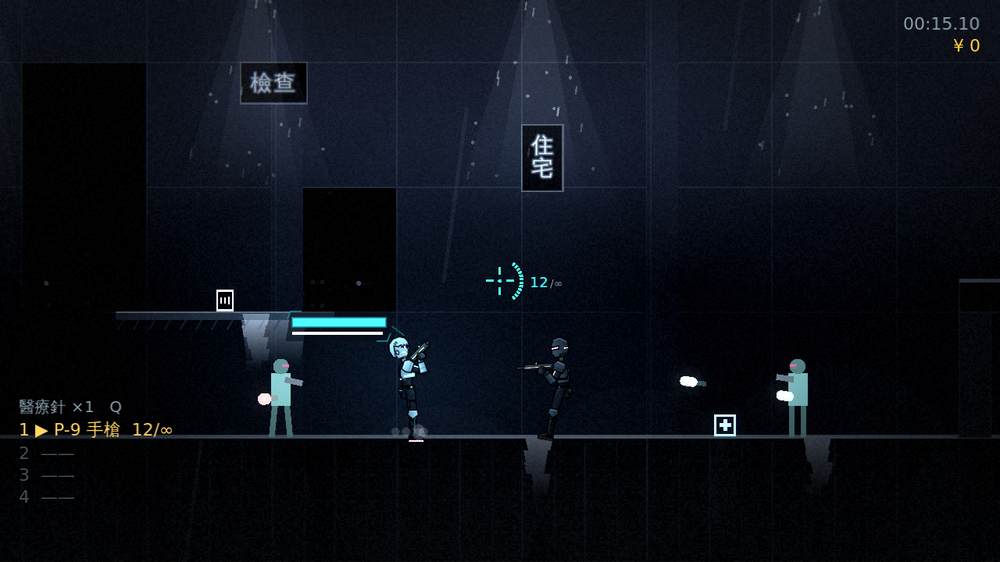

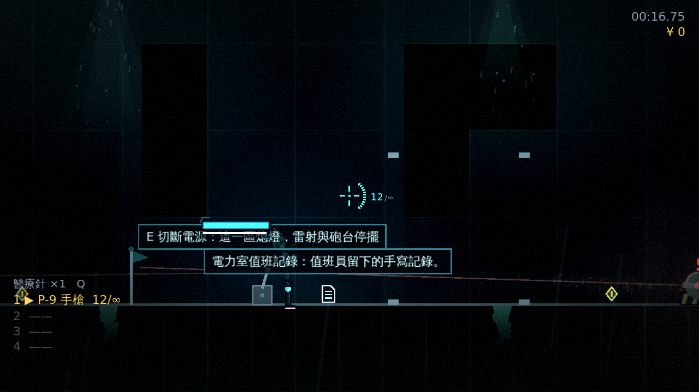

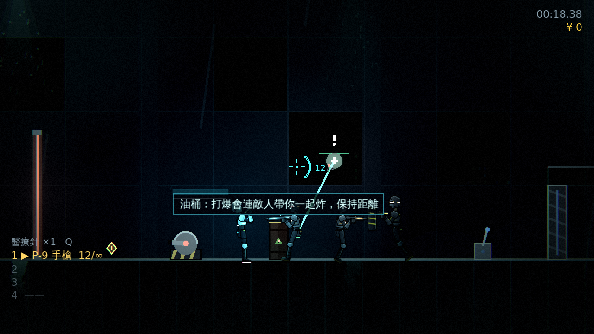

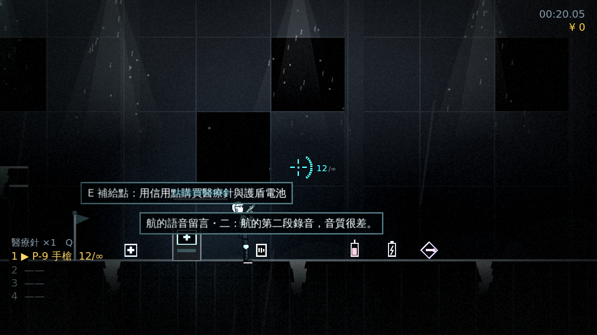
