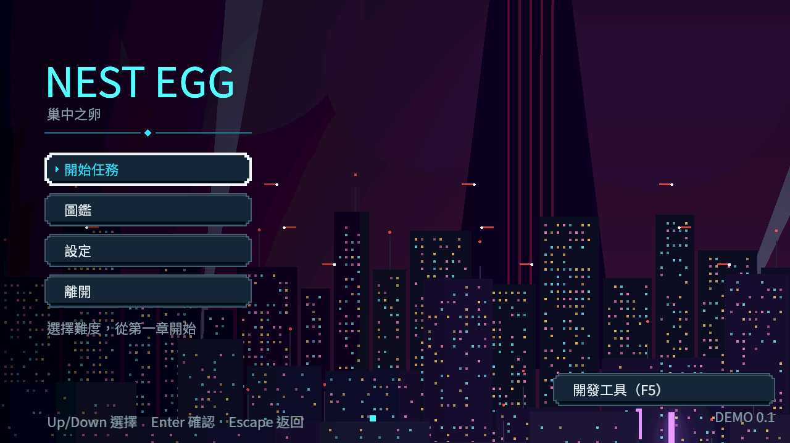

# [NE-282] 阻止退出後重新播放音訊

> 狀態：完成

## 內文

### 需求
退出已經停掉聲音後，晚到的提示或場景回呼仍可能重新開啟音效、配樂與環境音，讓程序帶著播放資源離開。接受退出後停止新的播放要求，保留日常遊戲的聲音及原退出收尾。

### 來源
2026-11-02，依使用者持續完成票券且不破壞原功能的要求，從原隔離箱退出的真實外洩及受控晚到播放重現發現。[設計與範圍](../../design/20-campaign-experience/AUDIO_MIX_LIFETIME.md)。

### 驗收條件
- [x] 真正接受程序退出後，音效、配樂及環境音的晚到要求不會重新建立播放。
- [x] 一般播放仍成功，回主選單、換區、保存與續玩的既有流程通過。
- [x] 主程式與共用退出工具在多種幀率都保留原停止及有上限的收尾，不以日常靜音交付。
- [x] 保留停止前後及晚到要求的真實紀錄、原失敗與退出診斷，必要回歸全過。

### 測試流程
1. 正常播放原音效、主選單配樂與環境音。
2. 接受退出，確認原播放器已停，再送入晚到要求。
3. 確認沒有重新播放且程序無外洩，核對不同幀率及共用工具退出。

---

# 跟其他票的關係

- Blocks：無
- Blocked by：無
- Related：NE-280、NE-281

---

# Commit-1（退出開始便停止接受新播放）

## 內文

原本停掉所有聲音後，晚到的回呼還能重新播放。現在一經接受程序退出，就不再接受新音效、配樂或環境音；正常遊戲不受影響，退出仍保留原有上限的收尾。

乾淨原版受控9項有3項失敗，留下16物件／5資源；修後8程序72項及原生兩程序18項全過、無嚴格診斷。既有交接櫃、第一章通道、阿勇與守門人共33程序384項，以及受影響76組94,120項皆全過。

[原失敗、前後播放紀錄、原圖與完整證據](attachments/NE-282-terminal-audio/README.md)。混音使用Dummy輸出，不代稱實體裝置試聽。
