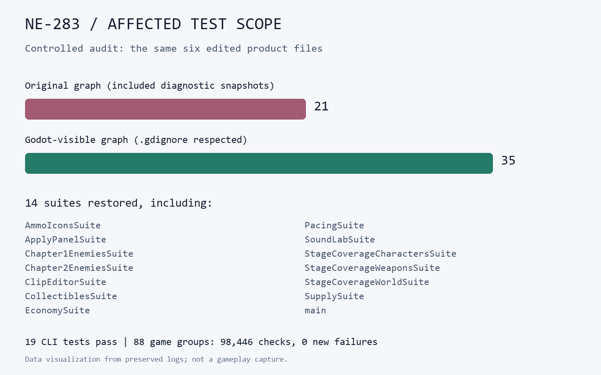

# [NE-283] 排除測試選擇器的診斷副本干擾

> 狀態：完成

## 內文

### 需求
保留測試與原生診斷證據後，增加的程式副本會讓受影響測試清單縮水，可能漏跑流程、經濟與武器回歸。選擇結果須符合正式資源範圍，診斷資料不影響應跑清單；來源本身有衝突時，要明確失敗，不能誤報沒有測試。

### 來源
2026-11-11，持續交付時發現同批近戰檔案選組在 31、21 間變動；同輸入隔離忽略目錄後，實際由 21 組補回 35 組。[調查與範圍決策](../../design/06-roadmap/CHANGED_TEST_SCOPE.md)。

### 驗收條件
- [x] 已忽略目錄內增加、移除或修改程式副本，不改變正式程式的應跑測試。
- [x] 新增的正式程式仍會被納入；正式資源忽略邊界變更會保守觸發完整測試。
- [x] 同名正式類別不能靜默覆蓋；錯誤指出衝突位置，流程以非零代碼結束。
- [x] 同一份負控制可重現修前漏選並驗證修後補回；原中文路徑、失敗傳遞及文件變更行為保持。
- [x] 正式完整回歸完成，附實際範圍與原始日誌；不降低原檢查門檻或隱藏失敗。

### 測試流程
1. 修改一個有間接使用者的正式程式，記錄應跑套件。
2. 在忽略目錄加入大量程式副本，再選一次，結果應一致。
3. 加入同名正式類別、改變忽略邊界，確認各自得到具體錯誤或完整測試。
4. 跑原選擇器測試與正式完整回歸。

---

# 跟其他票的關係

- Blocks：無
- Blocked by：無
- Related：NE-263、NE-277、BG-55

---

# Commit-1

## 內文

診斷副本原本會把正式程式的相依者數量膨脹，反而漏掉應跑的測試。現在依引擎的忽略目錄規則排除副本，同一批六份修改補回十四組測試；新增的正式程式仍會納入，正式忽略邊界變更則保守跑全部。同名正式類別會指出兩個衝突位置並失敗，不再依檔案順序覆蓋。重複呼叫不沿用前一份檔案集合。

### 測試結果

| 項目 | 結果 |
|---|---|
| 舊工具負控制 | 五案各自失敗；修後同案通過 |
| CLI 與殼層流程 | 19 項全過，包含中文路徑、失敗傳遞與文件變更 |
| 正式完整回歸 | 88 組、98,446 項，0 新失敗、0 已知失敗；exit 0 |
| 固定來源 | 十五份候選與 Git index byte 一致，執行前後 SHA 相同 |
| 證據讀回 | 100 項、0 失敗 |

完整回歸是在獨立目錄驗證本票與當時近戰／局部光影候選的固定組合，沒有把後續步態修正或製作中的角色當成已驗收。日誌保留既有規則允許的退出診斷，不宣稱全數零 ERROR。

[原始來源、完整範圍、負控制與日誌](attachments/NE-283-selector-scope-2026-11-11/README.md)

### 證據圖

工具輸出的資料圖，不是遊戲截圖。

