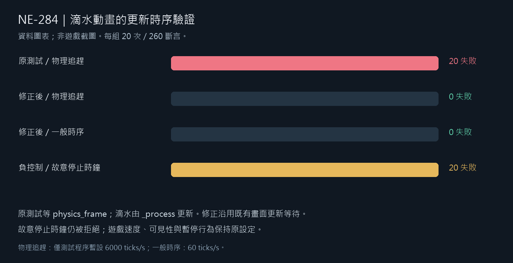

# [NE-284] 修正滴水測試的更新時序

> 狀態：完成

## 內文

### 需求
滴水動畫的自動驗證需要穩定區分畫面外停住、畫面內推進與暫停停住，避免等待錯誤的更新階段而誤報失敗，同時能抓到動畫真的停止的退步。

### 來源
2026-11-11，受影響 70 套件的 71,186 項驗證出現一項滴水推進失敗。分析與原始紀錄規劃見 `design/06-roadmap/PROCESS_PHASE_TESTS.md`。

### 驗收條件
- [x] 重現原失敗並保留實際更新時序與退出紀錄
- [x] 畫面外、畫面內與暫停三項行為皆穩定驗證，且不改遊戲行為或降低斷言
- [x] 故意停止畫面內滴水更新時，新測試仍會失敗
- [x] 受影響測試通過，附來源與完整結果

### 測試流程
1. 執行滴水更新時序重現，核對物理更新與動畫更新的實際次數。
2. 驗證三種可見與暫停狀態，另故意停止動畫，確認測試拒絕。
3. 執行受影響範圍並保存原始輸出。

---

# 跟其他票的關係

- Blocks：無
- Blocked by：無
- Related：NE-277、NE-283、BG-55

---

# Commit-1

## 內文

滴水原本已在畫面內正常更新，測試卻只等待物理時間；引擎連續追趕物理更新時，還沒輪到動畫就判成停止。現在等待動畫真正使用的畫面更新，畫面外停住、畫面內推進與暫停停住三個原判斷均保留。

原條件重複 20 次全數重現失敗；修正後在追趕與一般時序各 20 次全過。故意停止動畫時鐘的 20 次負控制仍全數失敗，遊戲動畫與速度沒有改動。

### 測試結果

| 項目 | 結果 |
| --- | --- |
| 原失敗重現 | 20 輪／260 檢查，20 次正確重現原失敗，exit1 |
| 修正後兩種時序 | 各 20 輪／260 檢查，0 失敗、exit0 |
| 故意停止動畫 | 20 輪全部拒絕、exit1 |
| 受影響測試 | 70 組／71,186 檢查，0 新失敗／0 已知失敗，exit0 |
| 來源與記錄 | 20 個候選前後 SHA 相同；無 SCRIPT ERROR，原篩選規則允許的資料錯誤與退出診斷保留 |

[原始紀錄與重驗入口](attachments/NE-284-process-phase-2026-11-11/README.md)。

### 截圖

本票為測試時序修正，以下是原始結果的資料圖表，並非遊戲畫面。

