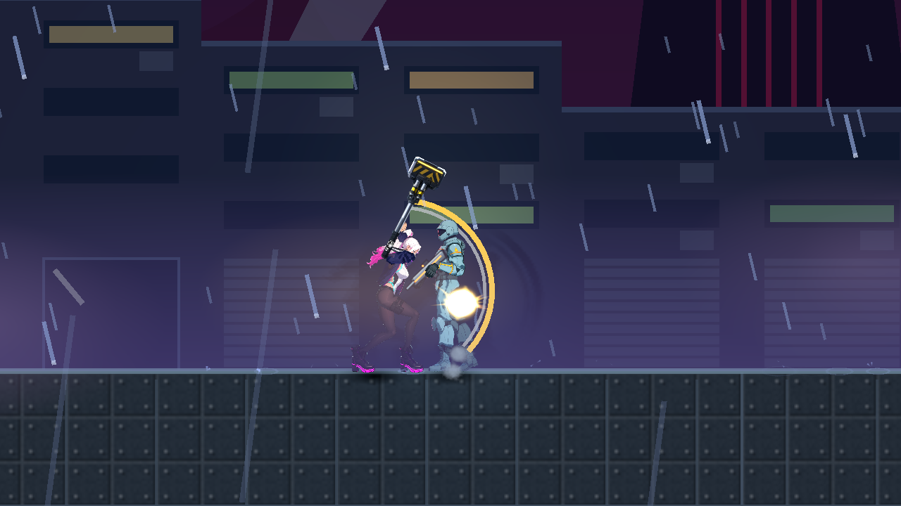

# [NE-285] 保留頓幀中的碰撞空間

> 狀態：完成

## 內文

### 需求
命中頓幀應停住角色動作，不能讓原本可碰撞的角色或受擊區暫時消失。結束後恢復原狀，已經停用、死亡或離場的物件不被意外喚醒。

### 來源
2026-11-11，NE-277 首傷順序追蹤在已發布基線確認主角、敵人的實體與受擊區，進入頓幀後都離開原 physics space。設計與實際紀錄見 `design/14-combat-variety/HITSTOP_COLLISION_SPACE.md`。

### 驗收條件
- [x] 保留原缺口的實際進入前／中／後紀錄與原來源
- [x] 正常頓幀期間動作停住，角色及子受擊區原有效碰撞保持，結束後正確恢復
- [x] 延長、父子重疊、不同恢復順序、已停用、離場、釋放與清除不損壞原狀態
- [x] 故意省略空間保留的控制仍能重現失敗，受影響測試通過

### 測試流程
1. 用正式命中或頓幀操作記錄主角、敵人與子受擊區的空間及實際碰撞。
2. 交替執行正常、延長、重疊與不同解凍順序，驗證停頓及恢復。
3. 驗已停用、死亡與離場案例，執行負控制及受影響測試。

---

# 跟其他票的關係

- Blocks：NE-277
- Blocked by：無
- Related：NE-236、NE-241

---

# Commit-1

## 內文

原本命中停頓時，角色和子受擊區會暫時變成碰不到。現在只停住動作，保留原本有效的碰撞；結束後恢復原狀。已停用的物件、停頓中死亡的敵人與離場物件不會被解凍重新喚醒。

正式傷害回呼前、停頓中、實際畫面呈現與解凍後均留下紀錄；延長、父子重疊與兩種恢復順序、離場、釋放與死亡案例通過。故意省略空間保留時，相同回歸仍確實失敗。

### 測試結果

| 項目 | 結果 |
|---|---|
| 正式受影響範圍 | 71 組、93,799 檢查，0 新失敗／0 已知失敗，exit0；12 份候選來源前後固定，本票三份與封包逐 byte 相同 |
| 頓幀與物理回歸 | 829／0，exit0；省略空間保留的控制 829／7，exit1 |
| 正式命中空間紀錄 | 原紅 CPU 16 項／修後 CPU 16 項／原生 21 項，前後空間、動作停頓與真實受擊區查詢符合預期 |
| 原生畫面 | 真 Forward+／RX 9070 XT，1280×720 原尺寸；來源前後固定、無 ERROR／SCRIPT ERROR／退出洩漏 |
| 獨立附件重算 | 1,051 檢查／0 失敗；3 個讀取器測試方法及 8 種破壞子案例通過 |

正式全範圍保留原過濾器允許的缺資料與退出診斷，四分片均無 SCRIPT ERROR，不能寫成零 ERROR／零洩漏。原始 log、命令、來源、負控制及各自判定界線見 [附件](attachments/NE-285-collision-space-2026-11-11/README.md)。畫面中的錘頭接觸時序仍由 NE-277 處理，本票只驗停頓與碰撞空間。

### 截圖

