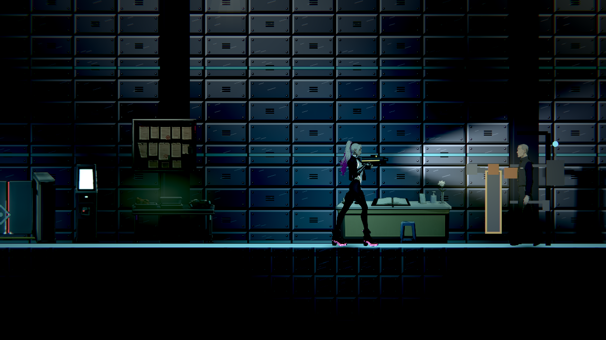

# [NE-286] 修正跨章頭目資料退出洩漏

> 狀態：完成

## 內文

### 需求

累積章節檢查同時讀到阿勇與JANUS資料時，會依載入順序在退出留下大量資源，即使結束碼為0也被發行流程正確拒絕。修正這個順序依賴，讓跨章檢查能乾淨結束，既有頭目戰與設定保持一致。

### 來源

2026-11-11，使用者要求持續完成全部票；實際驗證NE-232固定版本候選包時重現。[設計與原失敗](../../design/20-campaign-experience/RELEASE_PIPELINE.md)。

### 驗收條件

- [x] 阿勇先、守門人先的兩種資料載入順序，都能正常退出，無資源洩漏或腳本錯誤。
- [x] 完整版本的身分、收錄區域、章末及存檔位置回報保持一致，退出無錯誤。
- [x] 重複進入守門人戰鬥時設定一致，既有預兆、攻擊、弱點、停機與續玩結果未退化。
- [x] 修前失敗、修後原生日誌與受影響回歸結果保留，可從固定來源重跑。

### 測試流程

1. 依兩種順序讀取阿勇與JANUS資料，結束後核對原始日誌。
2. 回報完整累積版本資訊，核對前後內容與退出結果。
3. 重複進入守門人戰鬥並執行相關回歸。

---

# 跟其他票的關係

- Blocks：NE-232
- Blocked by：NE-287
- Related：NE-265、NE-271

---

# Commit-1

## 內文

跨章檢查原本會因阿勇與JANUS的載入順序，在結束時留下大量資源，版號正確也無法通過發行檢查。現在兩種順序都能乾淨退出，完整版本回報的十四欄保持相同；重複進場沿用原設定，預兆、攻擊、弱點、停機及續玩回歸通過。

### 測試結果

| 項目 | 結果 |
|---|---|
| 載入與快取控制 | 五個正控制exit0／無錯誤；關閉快取的負控制真exit1 |
| 完整版本回報 | 前後14欄一致，修後無錯誤或資源洩漏 |
| 原生門禁大廳 | RX9070XT／Forward+／HDR2D，真exit0／無錯誤或洩漏 |
| 原始失敗 | 舊版505 ObjectDB／306resources、跨票55／64／77組的失敗皆原樣保留 |
| 受影響回歸 | 完成52組範圍的驗證；二十源不變、無腳本錯誤，原始環境失敗及完整失敗套件重跑分開保留 |

原選測52組的其餘51組通過；隔離人物空目錄造成的一項環境失敗，在僅清除自有空目錄、二十源不變後，完整失敗套件重跑5,835檢查／0新失敗／0已知失敗。原52組exit1與重跑exit0皆保留，不宣稱一次全綠。

[原始日誌、固定來源、控制與重跑邊界](attachments/NE-286-boss-cache-2026-11-11/README.md)；[共用回歸原件](attachments/NE-286-boss-cache-2026-11-11/README.md)。原生控制及資料圖不代稱人工完整章節或實體手把驗收。

### 截圖

