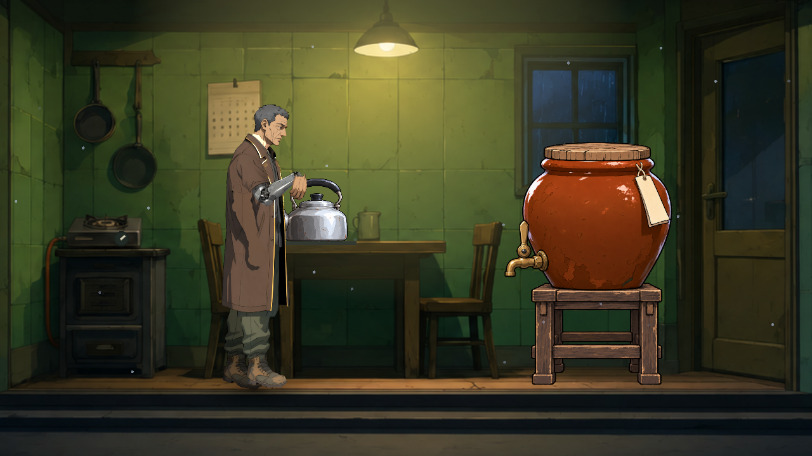

# [NE-287] 等待真實接觸後再交接道具

> 狀態：完成

## 內文

### 需求

伸手指令有時先回報等待完成，手卻尚未抵達終點，讓緊接著放下的水壺留在耐熱墊旁。等待實際接觸完成後才交接道具，讓不同更新排程下的握持、放置與收手一致。

### 來源

2026-11-11，使用者要求持續完成全部票；原受影響64組回歸與新舊播放器控制重現。[設計與原始失敗](../../design/20-campaign-experience/KITCHEN_PROP_CONTACTS.md)。

### 驗收條件

- [x] 等待伸手結束後立即放下，道具仍與真實支撐面對齊，不因更新順序提早放手。
- [x] 零秒接觸、一般伸手、收手與不等待的要求皆保留各自的正確時序。
- [x] 取消、跳過、移除或停用演員可安全結束，不留下等待或錯誤完成結果。
- [x] 正式廚房編舞與受影響回歸通過，保留修前失敗、排程控制及原生結果。

### 測試流程

1. 以一般及延後發起的更新排程執行伸手，完成後立即放下同一件道具。
2. 核對手部實際接點、物件支撐位置與握持釋放，重跑零秒、收手與中斷。
3. 播放正式廚房編舞，確認滿壺在耐熱墊，爐、龍頭與壺蓋狀態正確。

---

# 跟其他票的關係

- Blocks：NE-286、NE-267
- Blocked by：無
- Related：無

---

# Commit-1

## 內文

伸手等待原本可能早於真實接觸結束，讓剛放下的水壺留在耐熱墊旁。現在等到實際手部姿態完成才交接；零秒、收手、不等待及中斷保留各自時序，不會在演員失效後繼續結算。

### 測試結果

| 項目 | 結果 |
|---|---|
| 接觸與生命週期 | 44檢查／0失敗，無引擎錯誤或洩漏 |
| 原生同場控制 | 0.4秒要求原先只更新0.329166秒，偏離2.913101像素；修後實際完成0.4秒、偏離0 |
| 原生程序 | RX9070XT／Forward+／HDR2D；修前真exit1、修後真exit0，兩者無引擎錯誤或洩漏 |
| 受影響回歸 | 完成52組範圍的驗證；二十源不變、無腳本錯誤，原始環境失敗及完整失敗套件重跑分開保留 |

原選測52組的其餘51組通過；隔離人物空目錄造成的一項環境失敗，在僅清除自有空目錄、二十源不變後，完整失敗套件重跑5,835檢查／0新失敗／0已知失敗。原52組exit1與重跑exit0皆保留，不宣稱一次全綠。

[原始日誌、固定來源、控制與重跑邊界](attachments/NE-287-contact-completion-2026-11-11/README.md)；[共用回歸原件](attachments/NE-286-boss-cache-2026-11-11/README.md)。原生控制及資料圖不代稱人工完整章節或實體手把驗收。

### 截圖

