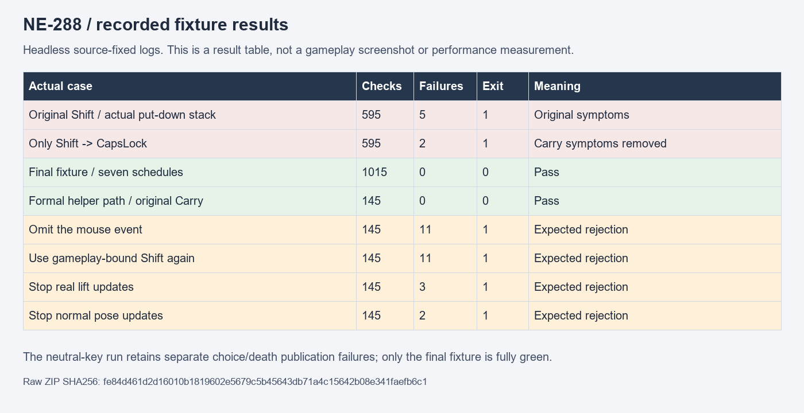

# [NE-288] 穩定閱讀搬運的輸入驗收前提

> 狀態：完成

## 內文

### 需求
閱讀與搬運的回歸驗收應只檢查交談時收起武器、保留搬運物件及正確恢復。模擬裝置切換不能殘留衝刺等遊戲操作；開始閱讀前，必須確定世界已恢復操作、物件已被舉好且支撐姿勢真正呈現。

### 來源
2026-11-11，NE-277 受影響測試出現兩項閱讀搬運失敗；隔離追蹤確認模擬切換裝置的按鍵同時是正式衝刺綁定，實際排程在未暫停時仍留下衝刺操作，觸發正常的放下物件。設計與驗收邊界見 [地圖交談與閱讀的收起武器](../../design/20-campaign-experience/INTERACTION_HOLSTER.md)。

### 驗收條件
- [x] 模擬手把、鍵盤與滑鼠切換確實被觀察到，且不殘留衝刺、攻擊、格擋、射擊或互動操作
- [x] 閱讀前確認實際恢復操作、搬運完成及支撐姿勢已呈現；閱讀開始當下與結束後的物件、姿勢及武器可見性符合原規則
- [x] 保留原失敗及實際放下原因，在低呈現頻率、物理追趕與正常排程下驗證修正；故意破壞前提仍能被拒絕
- [x] 受影響測試通過，原有閱讀、取消、選擇、死亡與裝置切換驗收維持有效

### 測試流程
1. 依序執行地圖閱讀、裝置切換、關閉選擇、舉起物件與再次閱讀。
2. 比較原失敗與修正後的操作事件、實際搬運狀態及首個閱讀畫面。
3. 交替使用正常與物理追趕排程，執行故意破壞前提的對照及受影響測試。

---

# 跟其他票的關係

- Blocks：NE-277
- Blocked by：無
- Related：無

---

# Commit-1

## 內文

閱讀搬運驗收原本用同時綁定衝刺的按鍵模擬裝置切換，殘留操作會在下一物理步正常放下箱子。現在使用未綁定操作的輸入，確認三類事件真正送達，並等世界、搬運與支撐姿態完成更新後才開始閱讀；首個閱讀畫面的手部及物件仍立即檢查。

### 測試結果

| 項目 | 結果 |
|---|---|
| 真實原因 | 原始堆疊保留：殘留衝刺使舉起中的箱子正常放下，沒有改搬運規則 |
| 更新排程 | 七種排程1,015檢查／0失敗；真原搬運元件正式入口145／0 |
| 負控制 | 缺滑鼠145／11、殘留衝刺145／11、停止搬運145／3、停止呈現145／2，均正確拒絕且無引擎錯誤 |
| 受影響回歸 | 完成52組範圍的驗證；二十源不變、無腳本錯誤，原始環境失敗及完整失敗套件重跑分開保留 |

原選測52組的其餘51組通過；隔離人物空目錄造成的一項環境失敗，在僅清除自有空目錄、二十源不變後，完整失敗套件重跑5,835檢查／0新失敗／0已知失敗。原52組exit1與重跑exit0皆保留，不宣稱一次全綠。

[原始日誌、固定來源、控制與重跑邊界](attachments/NE-288-input-publication-2026-11-11/README.md)；[共用回歸原件](attachments/NE-286-boss-cache-2026-11-11/README.md)。原生控制及資料圖不代稱人工完整章節或實體手把驗收。

### 截圖

