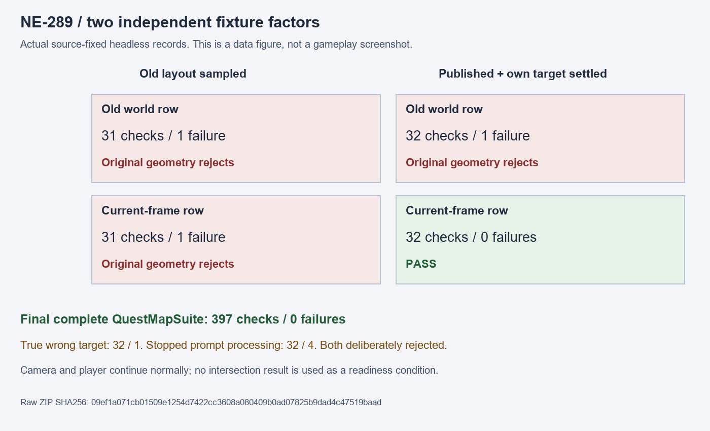

# [NE-289] 穩定世界提示與目標列的版面驗收

> 狀態：完成

## 內文

### 需求
世界提示蓋到任務目標列時，驗收應確認目標列讓出閱讀空間、提示仍留在可讀位置。開始檢查前應等待實際版面發布，比較同一畫面的座標，避免把正常的鏡頭移動或舊位移判成提示被推離。

### 來源
2026-11-11，固定來源的 77 組受影響測試出現唯一一項提示位置失敗。隔離觀察確認測試讀到對齊前的避讓位移，並將較晚的提示位置與較早鏡頭下的目標列座標比較。設計與驗收契約見 [任務與地圖指引](../../design/18-quest-map-ux/DESIGN.md)。

### 驗收條件
- [x] 保留原失敗、實際版面更新順序與鏡頭前後的座標紀錄
- [x] 檢查前以有期限的獨立條件確認版面已發布、位移已收斂，不以預期重疊結果作等待條件
- [x] 使用同一觀察畫面的提示與目標列座標，保留原重疊、讓位、滑鼠穿透與提示移除後恢復的判斷
- [x] 真正錯位或版面未發布時仍會失敗，修正後受影響測試通過，任務與正常鏡頭行為維持不變

### 測試流程
1. 讓世界提示與目標列相遇，記錄對齊前後、版面發布及最終檢查時的位置。
2. 核對同一畫面的世界與 HUD 座標，確認原幾何判斷及讓位流程正確。
3. 故意造成錯位或停止版面發布，確認驗收拒絕，再執行受影響測試。

---

# 跟其他票的關係

- Blocks：NE-277
- Blocked by：無
- Related：無

---

# Commit-1

## 內文

提示與目標列相遇時，原驗收會讀到上一輪版面，並把移動鏡頭前後的世界位置混在一起。現在先在期限內確認真實版面已發布、位移已收斂，再比較同一畫面的兩個位置；原重疊、讓位、滑鼠穿透與移除後恢復判斷保留。

### 測試結果

| 項目 | 結果 |
|---|---|
| 原失敗與因果控制 | 原失敗與兩項單獨修正仍紅，兩因素完成後通過，十一回合原件完整保留 |
| 故障負控制 | 真錯位32／1、停止版面32／4，均正確拒絕 |
| 獨立資料重驗 | 866檢查／0失敗，三項讀取器回歸通過 |
| 正式受影響測試 | 原選測入口選出1組，397檢查／0新失敗／0已知失敗／exit0；來源前後不變 |
| 引擎與任務 | 無腳本錯誤、引擎錯誤或退出洩漏，正常鏡頭及任務資料保持原行為 |

[固定來源、原始控制與正式日誌](attachments/NE-289-prompt-publication-2026-11-11/README.md)。資料圖為原始日誌對照，不代稱原生遊戲截圖。

### 截圖

