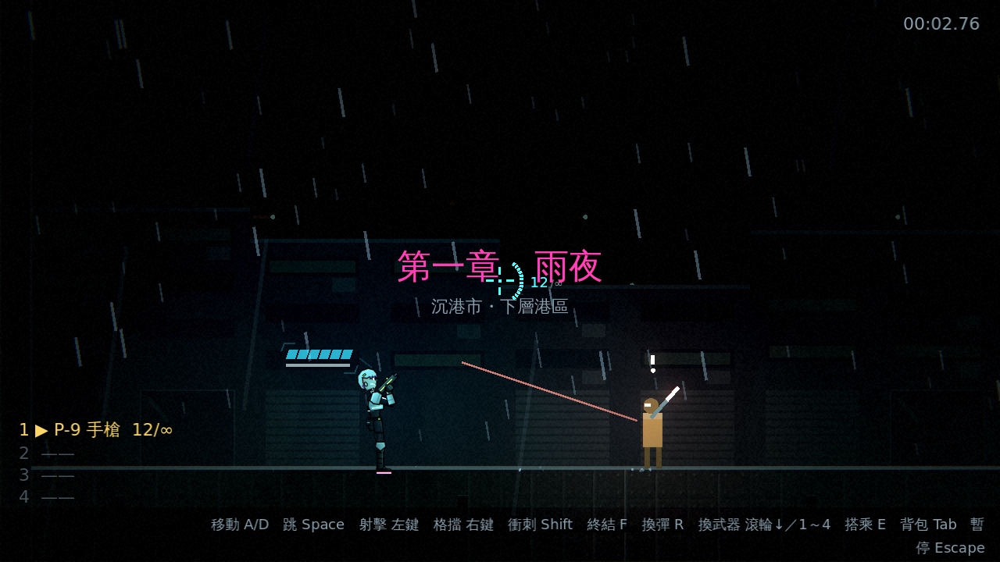
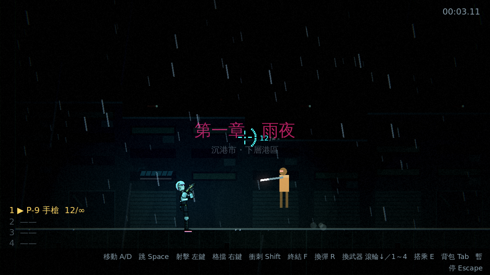
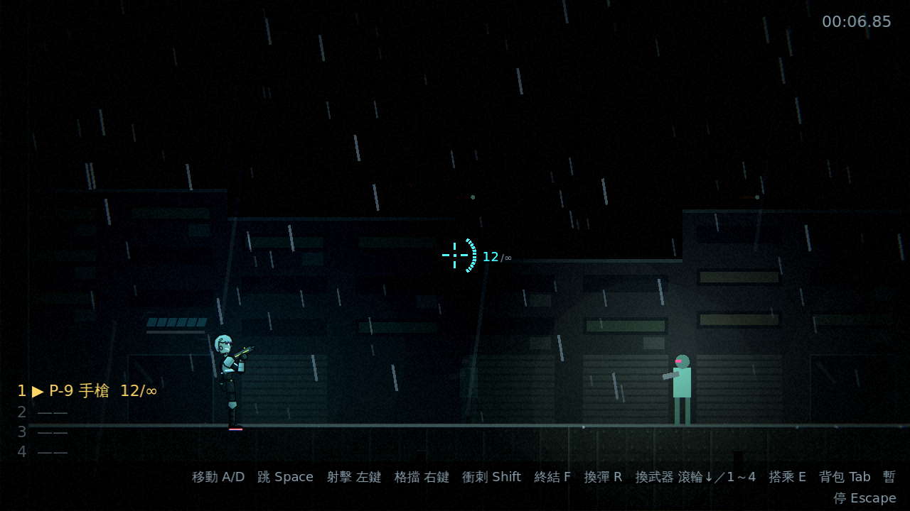
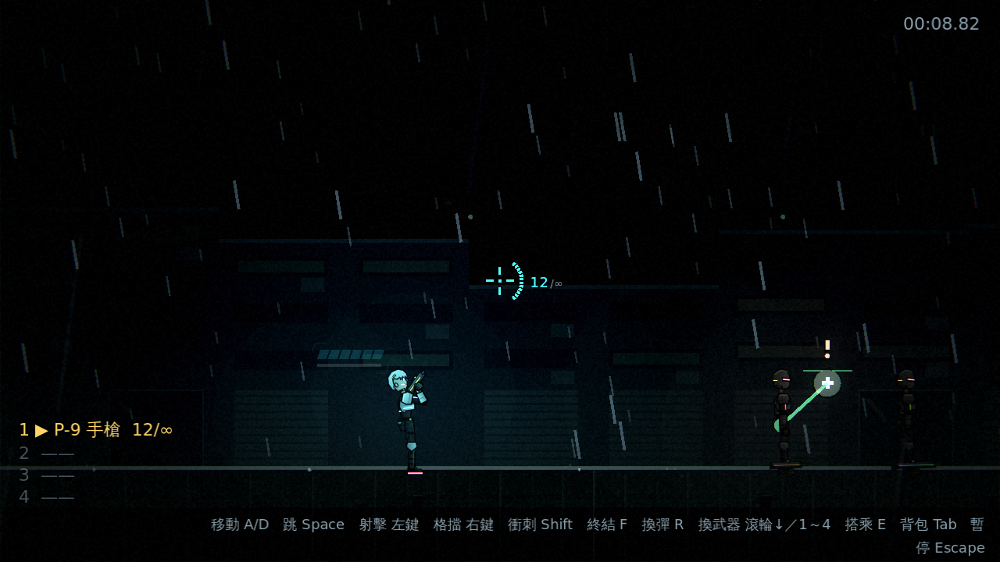
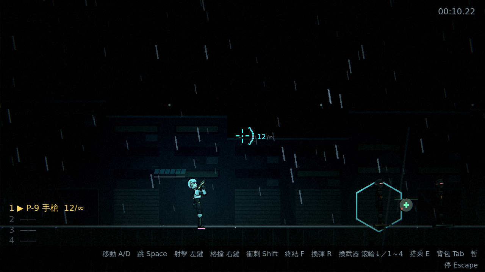

# [NE-28] 新增第二章的新敵人

> 狀態：完成

## 內文

### 需求
現有六種敵人涵蓋遠程瞄準、盾牌衝撞、空中俯衝、固定砲台、自爆與拋物線砲，缺少近戰突進、利用光影的敵人與支援型敵人。新增至少三種，並讓第二章的戰鬥更有變化。設計見 `design/09-content/DESIGN.md` 第二節。

### 來源
2026-10-02，使用者於開發對話中提出：「讓遊戲內容更豐富」；確認四個方向都要做（第二章／新關卡、新敵人與新頭目、場景互動與探索、成長系統），順序為先光影再內容。

### 驗收條件
- [x] 新增至少三種敵人：近戰突進、光學迷彩（只在受光或開火時現形）、支援型（替其他敵人加盾或修復）
- [x] 每種敵人的攻擊都有預兆，並且有明確的應對方式
- [x] 每種敵人在暗處依然看得見預兆（遵守暗場可讀性守則）
- [x] 每種敵人有對應的敗北圖鑑卡片與攻略
- [x] 敵人以資料檔定義，數值可在檔案中調整
- [x] 三種難度下都能擊敗新敵人

### 測試流程
1. 在測試場景逐一遭遇新敵人，確認預兆與應對方式成立
2. 被每種新敵人擊敗一次，確認圖鑑解鎖並顯示攻略
3. 執行完整測試套件，全部通過

---

# 跟其他票的關係

- Blocks：NE-27
- Blocked by：NE-25
- Related：NE-29

---

---

# Commit-1

## 內文

新增四種敵人，補上原本缺少的玩法面向：切割者（近戰突進：蹲伏舉刀預兆後撲出一記斬擊，落地有硬直，完美格擋可暈眩終結）、迷彩獵手（光學迷彩：預設隱形，只在被場景燈照到、貼近玩家、開火或受傷時現形；現形後紅色瞄準線預兆、兩連發、後退）、維修機（支援：飛到同伴身邊伸出綠色光束充能，完成後給對方一層護盾並修復一點生命；打斷即失效）、精銳保全（保全的資料變體：更多生命、更快鎖定、更快的彈速）。
護盾做在基底 `Enemy`（每層擋一次攻擊，上限 3 層；爆炸與終結技無視），任何敵人都能被加盾，畫面上有青色六角形標示。迷彩判斷用新的 `LightKit.light_level_at()`，所以和光影系統連動：停電會讓牠更難找。每種新敵人的攻擊來源都有敗北圖鑑卡片與攻略（含程式內切換的 `slasher_lunge`）。所有數值都在 `data/enemies/*.tres`。
順帶修正：`FogLayer` 的染色光源清單每 0.25 秒才更新，期間若有燈被移除會存取已釋放的物件（產生腳本錯誤），現在會略過。測試放在 `tests/suite/test_new_enemies.gd`（使用空曠測試場地 `tests/fixtures/arena_map.json`）。
驗收方式：測試驗證資料與圖鑑卡片、切割者的預兆／撲擊／傷害來源／硬直／暈眩中斷、迷彩獵手在暗處隱形、燈下現形、熄燈後再隱形、受傷現形、貼身現形、開火前有預兆、維修機的充能預兆與給盾與打斷、護盾上限與爆炸無視、任何難度的預兆與冷卻下限；截圖如下。

### 測試結果

| 項目 | 結果 |
|---|---|
| 完整測試套件 | 通過 1161 / 1161 |
| 資料驗證 | 0 錯誤 |
| 執行 log | 無非預期 ERROR |

### 截圖

