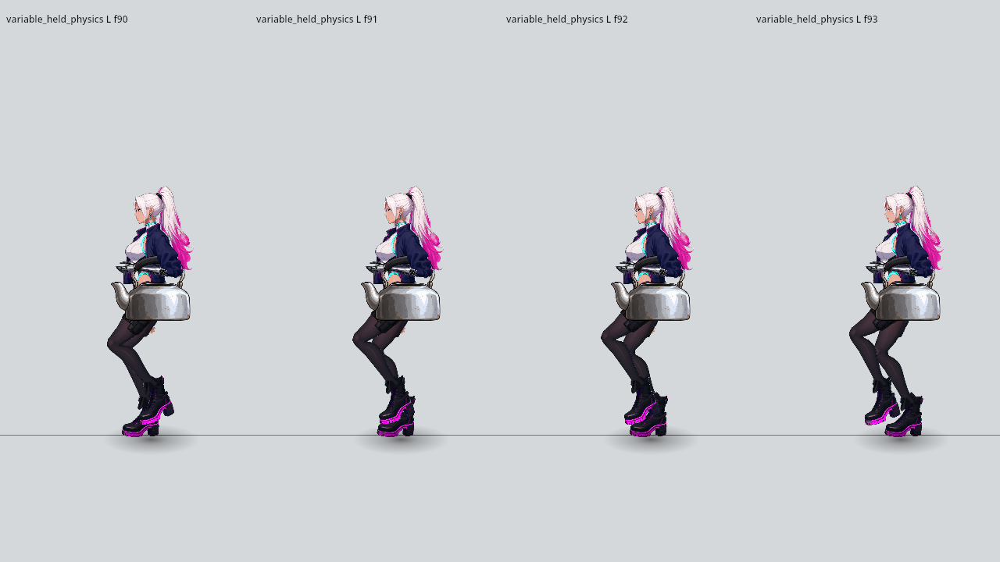
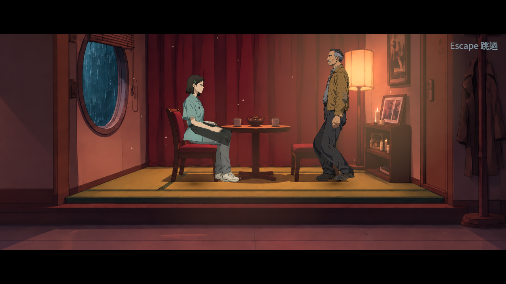
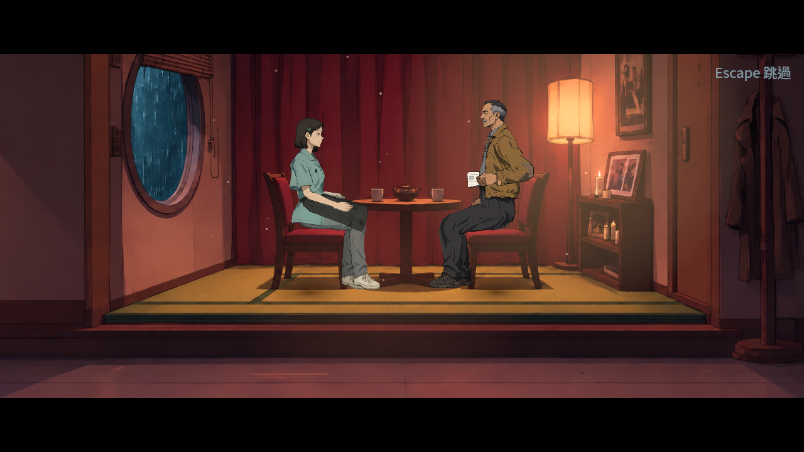
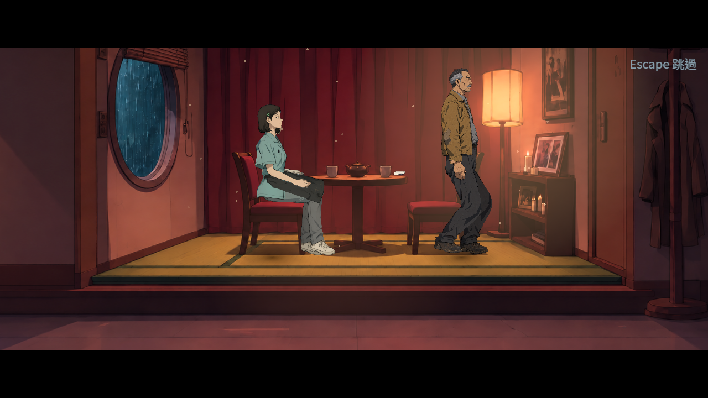

# [NE-290] 穩定過場移動的步態時鐘

> 狀態：完成

## 內文

### 需求
過場人物在實際畫面更新率起伏時，走路的腳底會短暫滑入地面；固定更新率的測試卻看不出來。移動與步態應根據同一份已發布的位置及時間更新，一般走路和持物移動都穩定，停止與中斷後保留正確姿勢。

### 來源
2026-11-12，持續完成全部票的第二章配角驗收。實際S18演出量到材質腳底偏移4.57舞台像素；只改變畫面更新時間的同來源控制，固定60Hz正常，交替更新最高偏移6.63像素。詳見[舞台移動設計](../../design/12-cast-redraw/STAGE_MOVE_CLOCK.md)。

### 驗收條件
- [x] 保留原實際演出與變動更新時間的失敗，單獨確認位置與時間錯配的成因，不以調整步態門檻過關
- [x] 一般移動與持物移動在不同畫面更新率、演出速度及物理更新下，步態連續、腳底符合原接地標準，沒有重複或零時間的動畫步
- [x] 完成、中斷、略過、替換移動或演員失效時，不繼續移動或套用過期姿勢；原伸手完成與手部接觸時序保持
- [x] 固定來源的原失敗／修後控制、永久回歸與受影響測試通過，真實S18及放大接點畫面符合原驗收

### 測試流程
1. 以相同人物、路徑與素材，對照固定及交替更新時間的一般走路與持物移動。
2. 檢查每次發布的位置、時間、步態與材質腳底，再中斷、替換或略過移動。
3. 重跑原接觸與移動回歸，拍攝真實S18及放大接點，確認原失敗不再出現。

---

# 跟其他票的關係

- Blocks：NE-267
- Blocked by：無
- Related：NE-287、NE-222

---
# Commit-1

## 內文

畫面更新時間起伏時，人物用錯了位置差所對應的時間，走路的腳底會滑入地面。現在一般走路與持物移動都用同一次發布的位置及時間推進步態；移動完成、中斷或被替換後，保留正確的姿勢與手部接觸。

同來源的交替更新失敗已消除。真實客人簿演出原最多穿地4.57舞台像素，修後三段皆符合原1像素接地標準；進出座位、持紙及離座的原生畫面已檢視，沒有新增時鐘閃跳。

[原失敗、修後控制、原生畫面、完整數值與重現方式](attachments/NE-290-stage-move-clock/README.md)。

### 測試結果

| 項目 | 結果 |
| --- | --- |
| 獨立已發布基底控制 | 原108項／26失敗，修後165項／0失敗 |
| 原移動與接觸回歸 | 1946項／0失敗 |
| 原受影響入口的固定來源聯合回歸 | 70組、94097項，0新／0已知失敗，exit0 |
| 真實演出材質腳底 | 三段皆0穿地、0雙腳無支撐；原門檻1舞台像素 |
| 原生程序 | 純基底7張與真演出19張；兩程序皆exit0，無腳本錯誤、引擎錯誤或清場洩漏 |
| 原圖與獨立重算 | 26張原圖逐一檢視，原始影像與材質足底獨立驗證通過 |

### 截圖

