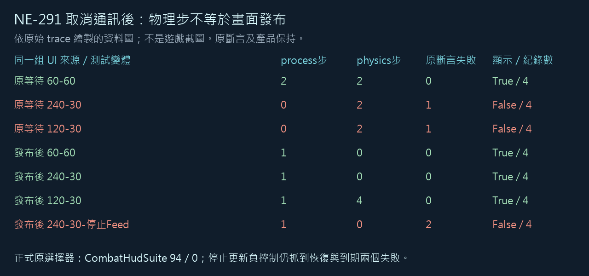

# [NE-291] 修正拾取紀錄恢復顯示的等待驗證

> 狀態：完成

## 內文

### 需求
通訊取消後，拾取紀錄還沒經過畫面更新，測試就先判定它沒有回來；物理更新比畫面快時，原基底也會失敗。驗證應觀察真正發布後的顯示狀態，並保留對紀錄消失、數量與剩餘時間的檢查。

### 來源
2026-11-12，持續完成全部票時，NE-228固定來源的31組回歸出現唯一失敗。原基底60／60通過，240／30與120／30均重現同一失敗；取消已完成，但兩次物理更新之間沒有任何畫面更新。詳見[等待發布設計](../../design/20-campaign-experience/PICKUP_FEED_TEST_PUBLICATION.md)。

### 驗收條件
- [x] 保存原受影響回歸與同來源失敗控制，實際證明不是通訊未取消或拾取資料遺失
- [x] 原顯示恢復檢查在真正畫面更新發布後判斷，三種更新組合均通過，原斷言保留
- [x] 真正停止更新或無法恢復的拾取紀錄仍被檢出，不以手動刷新、強制顯示或放寬條件過關
- [x] 受影響範圍原入口全過，原選擇器、過濾器與已知失敗保持

### 測試流程
1. 保留原相同測試，在60／60、240／30與120／30更新組合記錄取消前後的實際發布次數及紀錄狀態。
2. 用修正後的等待重跑，確認恢復、列數與自然到期皆符合原條件。
3. 停止拾取紀錄更新作負控制，再跑原受影響回歸。

---

# 跟其他票的關係

- Blocks：NE-228
- Blocked by：無
- Related：NE-289、NE-288

---
# Commit-1

## 內文

原驗證把兩次物理更新當成拾取紀錄已更新，實際上兩次之間可能沒有任何畫面更新。現在等到真正發布後才檢查恢復，原紀錄數、剩餘時間、顯示與自然到期的斷言保留，沒有改變遊戲介面。

相同來源的三種更新組合都通過；停止拾取紀錄更新時，原恢復與到期檢查仍會失敗，沒有用等待掩蓋真故障。

### 測試結果

| 項目 | 結果 |
| --- | --- |
| 原基底及原UI六修正控制 | 各60／60通過12項；240／30與120／30各12項中同一失敗 |
| 最後修正等待控制 | 三種更新組合共36項全過，來源固定 |
| 停止更新負控制 | 12項中恢復與到期2項真失敗 |
| 原受影響入口 | CombatHudSuite94項，0新／0已知失敗，exit0 |
| 原始紀錄 | 首輪觀察器錯誤及舊metadata錯誤全保留，最後收據另行更正與重跑 |

[全部原始來源、失敗、正式回歸及獨立校驗](attachments/NE-291-pickup-publication-2026-11-12/README.md)。

### 截圖

以下是原始觀測的資料圖，不是遊戲畫面。

