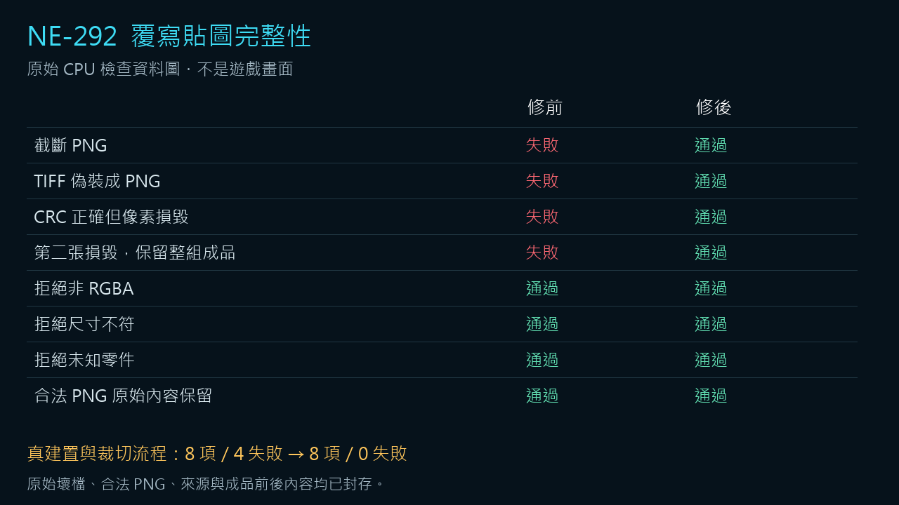

# [NE-292] 拒絕損毀的角色覆寫貼圖

> 狀態：完成

## 內文

### 需求

角色人工覆寫貼圖損毀或格式偽裝時，製作流程應指出具體檔案並停止，保留既有可用成品；合法貼圖仍以原始內容交付。

### 來源

2026-11-12，持續交付全部票、審查NE-255共用流程時，以真正製作流程重現截斷圖片及偽裝格式仍被接受。詳見[來源完整性設計](../../design/12-cast-redraw/OVERRIDE_TEXTURE_INTEGRITY.md)。

### 驗收條件

- [x] 原流程接受截斷PNG與偽裝格式的失敗有完整原始對照，未改寫成通過。
- [x] 建置與交付均拒絕損毀、格式不符、非RGBA或尺寸不符的覆寫，錯誤指出具體來源。
- [x] 多張覆寫中後一張失敗，也不更動先前可用成品或任何來源原件。
- [x] 合法PNG原始內容保持，原素材交付與受影響範圍檢查通過。

### 測試流程

1. 用隔離資料依序提供合法PNG、截斷PNG、偽裝格式及完整性錯誤圖片，走真正製作流程。
2. 在第二張覆寫安排失敗，比較成品與來源的前後內容。
3. 重跑原素材交付檢查與受影響範圍原入口。

---

# 跟其他票的關係

- Blocks：NE-255
- Blocked by：無
- Related：NE-267

---

# Commit-1

## 內文

原製作流程會把截斷PNG或偽裝格式當成合法覆寫，可能取代原本可用的角色零件。現在必須確認真實PNG、RGBA、尺寸與完整像素可讀；任何一張損毀都指出具體來源並停止，整組舊成品與來源保留。合法PNG直接保留原始內容，不重新編碼。

### 測試結果

| 項目 | 結果 |
| --- | --- |
| 真製作流程的八項對照 | 原碼8／4失敗→修正8／0，包含CRC正確但像素壞掉與第二張才失敗 |
| 原共用CPU製作檢查 | 八支全部通過，原隔離資料缺漏與失敗保留 |
| 主工作樹整合 | 相同永久八項8／0，355來源前後固定 |
| 原受影響入口 | 自然exit0，Python工具選0個Godot群組；沒有冒稱遊戲回歸 |
| 原件與容錯 | 獨立讀取器與兩個偽造資料負控制通過 |

[完整原始來源與對照](attachments/NE-292-override-integrity-2026-11-12/README.md)、[最後複核與原入口收據](attachments/NE-292-override-integrity-2026-11-12/ROOT_REVIEW.md)。製作流程的新角色成品驗收仍按NE255原條件另驗。

### 截圖

本次沒有遊戲畫面變更；下圖是原始檢查結果的資料圖。

