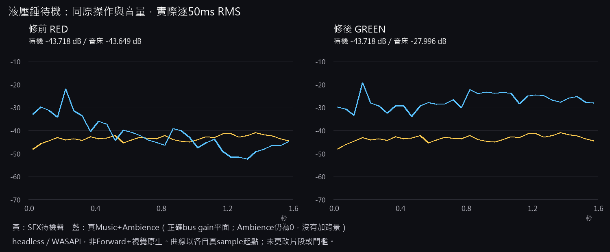
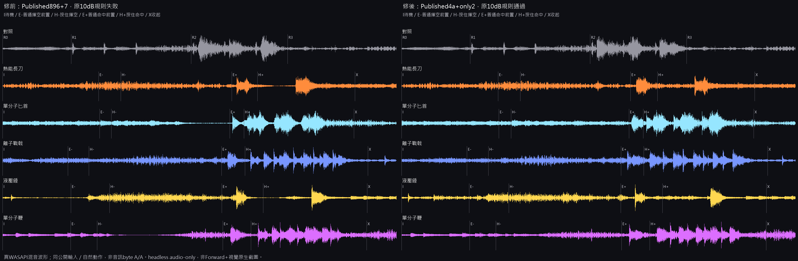

# [NE-293] 修正換曲時背景音量驟降

> 狀態：完成

## 內文

### 需求
換曲時前後兩首音樂一起變得很小聲，形成短暫的背景音量凹谷，讓原本很小聲的武器待機聲反而蓋過背景。音樂與環境音銜接應平順，不能靠提高背景音量或壓低武器聲掩蓋。

### 來源
2026-11-12，NE-261現行五種按住模式的兩次實際錄音與同輸入診斷；使用者要求持續完成交付。原因與設計見[音訊設計](../../design/16-audio/DESIGN.md)。

### 驗收條件
- [x] 相同音量的固定輸入換曲，實際錄音沒有淡化算法造成的中段音量驟降，保留修前修後對照。
- [x] 不同目標音量與淡化秒數、快速連續換曲、首播、同曲調整、停止、尋位、暫停及離場釋放維持正確。
- [x] 音樂與環境音共用的銜接均正常，原音量滑桿、壓低包絡與聲音釋放機制不被破壞。
- [x] 在原中性試場、原操作與原音量下，五種按住模式及待機聲通過原聲音平衡規則；原失敗與原始PCM完整保留。

### 測試流程
1. 使用相同固定聲音輸入，錄下兩首同音量及不同音量的切換中段，與修前比較。
2. 測不同淡化時間、快速切換、停止、暫停及離場，確認端點與釋放。
3. 重走原五種武器按住模式的錄音流程，保留真傷害、音訊與時間邊界，按原音量規則重算。

---

# 跟其他票的關係

- Blocks：NE-261
- Blocked by：無
- Related：NE-154、NE-155、NE-160

---

# Commit-1

## 內文

原本換曲時兩首音樂在中段一起變得很小聲，相同固定輸入的實際錄音最低下降23.87dB。現在以平順的音量銜接取代這個凹谷；相同錄音的中段維持原音量，原音量目標、各自淡化時間、滑桿與壓低音樂的機制保留。

不同音量與不同淡化時間也完成實錄，按各自正確曲線及端點核對。五種近戰按住模式沿用原操作、音量與門檻重錄，34段內容及音量規則全部通過；液壓錘待機聲未調低，現在比其實際背景低15.72dB。兩次原待機失敗與完整錄音保留。

### 測試結果

| 項目 | 結果 |
|---|---|
| 同音量固定輸入實錄 | 原中段最低−23.871dB；修後+0.008686至+0.008697dB，各82,432樣本幀、0丟幀 |
| 不同音量／時間實錄 | 0dB轉−6dB，淡出0.4秒／淡入0.8秒；各75,264樣本幀，端點及實際振幅曲線通過 |
| 同一組狀態回歸 | 原26項／4失敗，修後26項／0失敗；新增9項永久回歸，原斷言保留 |
| 原受影響入口 | 30組、47,507項，0新失敗、0已知失敗，原腳本exit0 |
| 原聲音與曲目套件 | 27,821項、0失敗 |
| 真曲目與五種按住模式 | 34段、10段按住、32次真傷害、312次命中查詢；原聲音規則0問題 |

原受影響測試保留137行刻意錯誤訊息，原過濾器無非預期錯誤、無腳本錯誤或退出洩漏。額外程序觀察器未取得各子程序退出碼，沒有補造；原腳本退出碼與兩份完整測試結尾均保留。這是音訊裝置的真實錄音，沒有宣稱新的遊玩試聽或Forward+畫面驗收。

[原始紀錄、重算入口與完整範圍](attachments/NE-293-crossfade-2026-11-12/README.md)。大型原始錄音另存持久交付目錄，公開索引逐檔核對，不把只有小附件的遠端checkout說成已包含全部PCM。

### 截圖

