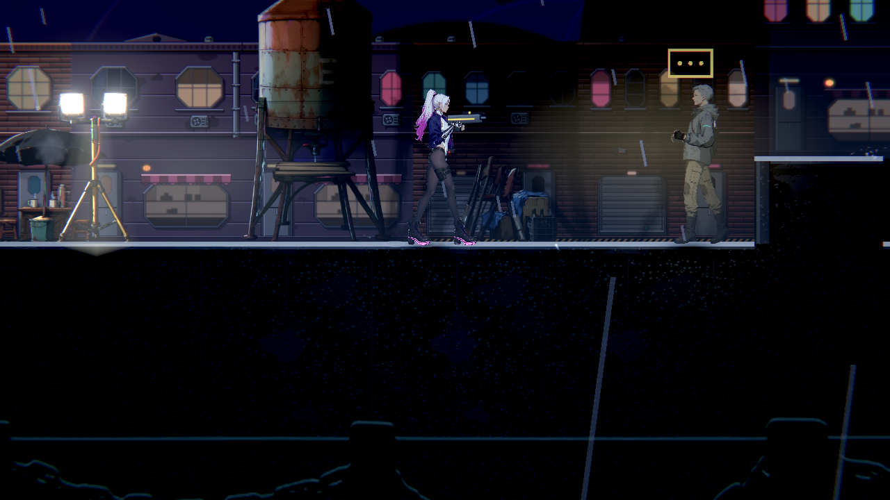
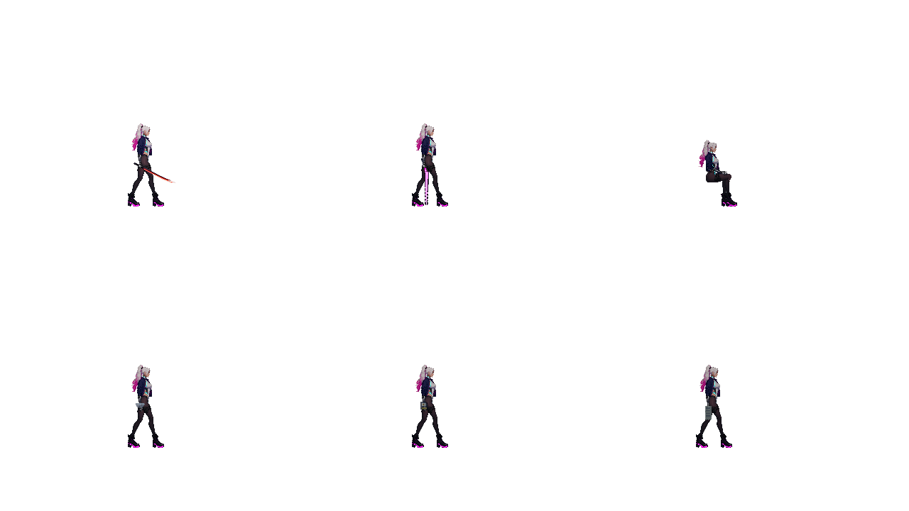
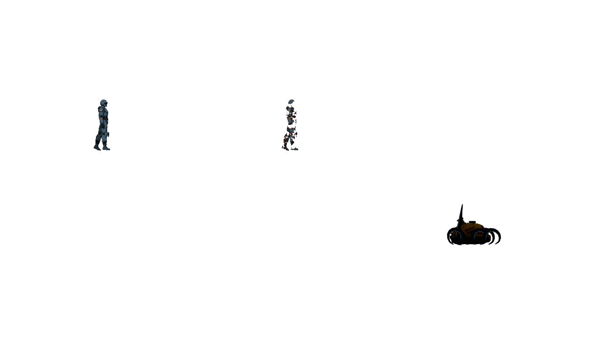

# [NE-295] 統一角色與持物受光

> 狀態：完成

## 內文

### 需求
修正近戰、世界人物、持物、脫落與死亡過程中的受光分岔，角色部件維持一致的光照規則。

### 來源
2026-11-13，使用者要求三章類銀河戰士惡魔城地圖與全場景光影一致；設計見 [立體探索與一致受光](../../design/21-metroidvania/DESIGN.md)。

### 驗收條件
- [x] 角色手掌、握拳、姿勢替圖及持物在同光源下保留正確受光
- [x] 近戰反射本體受光，刃光與霓虹仍清楚發光
- [x] 世界人物與舞台人物各自使用正確場景的光影
- [x] 脫落零件與燒融仍可見本體保留原色、透明度與受光
- [x] 長體生物腹部法線隨外觀正確對齊，死亡時頭身一致淡出
- [x] 高低品質、持物切換與物件重用不留下前次材質狀態

### 測試流程
1. 依設計列出的正常與缺失資料情境操作，檢查結果與提示。
2. 在同一場景切換對應狀態，確認既有玩法與持久內容沒有改變。
3. 執行受影響測試；畫面變動保存原生截圖與對照。

---

# 跟其他票的關係

- Blocks：無
- Blocked by：無
- Related：ST-4

---

# Commit-1

## 內文

角色手掌、握拳、前臂與坐姿替圖現在遵循同一受光規則。近戰及手持物的反射本體隨環境光與遮擋改變，原有刃光與霓虹保留；世界人物與舞台人物使用各自場景的光影。

脫落與燒融仍可見的部件保留原色、透明度及受光。長體生物腹部的明暗方向與外觀對齊，死亡時頭身一致淡出；品質往返與物件重用不留下前次材質狀態。

### 測試結果

| 項目 | 結果 |
|---|---|
| 受影響測試（四票整合） | 87 組、99,550 檢查；新失敗 0、已知失敗 0 |
| 腳本與解析診斷 | 0；刻意拒收損毀資料的原始紀錄另存附件 |
| 手部、姿勢與近戰持物 | 原生法線方向、遮擋、重複與回復對照通過 |
| 碎片、燒融與自然死亡 | 原生透明度、重用與頭身淡出對照通過 |
| 高低品質與場景回歸 | 品質往返及同格世界人物對照通過 |

完整原圖、負控制及來源見[驗證附件](attachments/NE-295-character-lighting-2026-11-13/README.md)與[整合驗收](attachments/NE-295-character-lighting-2026-11-13/official-v1/README.md)。

### 截圖

