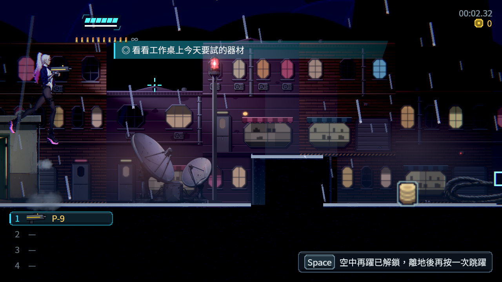

# [NE-296] 加入永久空中再躍

> 狀態：完成

## 內文

### 需求
以可保存的探索能力打開回訪高處，保留原跳躍與衝刺手感。

### 來源
2026-11-13，使用者要求整體地圖採類銀河戰士惡魔城設計；設計見 [立體探索與一致受光](../../design/21-metroidvania/DESIGN.md)。

### 驗收條件
- [x] 正式取得資料盤後可在空中額外跳一次，落地重置
- [x] 取得前不能使用；已有相同進度的舊檔續玩可使用
- [x] 解鎖有一句重點提示，鍵盤與手把沿原跳躍按鍵操作
- [x] 土狼跳、短跳、跳躍緩衝、下穿、死亡及衝刺既有行為不被破壞

### 測試流程
1. 從正常章節進度探索主線、支線、秘密與回環。
2. 分別在取得條件前後回訪，確認可通行範圍與獎勵正確。
3. 以舊存檔續玩、死亡與重新開啟，檢查進度、物品與安全落點。
4. 執行受影響測試並保存代表性原生畫面。

---

# 跟其他票的關係

- Blocks：無
- Blocked by：無
- Related：ST-4、NE-294、NE-298

---

# Commit-1

## 內文

取得資料盤後，離地時可沿原跳躍按鍵再躍一次；落地重置，短跳與空中衝刺保留，舊進度重讀也可使用。不需要信用點、耗能或裝備。解鎖提示沿目前綁定按鍵顯示。

### 測試結果

| 項目 | 結果 |
|---|---|
| 原受影響完整範圍 | 65 組、92,936 項，0 新／0 已知失敗，538 秒、exit0 |
| 原出生介面回歸 | 原 28／2 失敗完整保留；修正初始化位置後 28／0 |
| 真實玩家原生跳躍 | 11／0、零診斷，未取得／取得的第二次按鍵結果正確 |
| 進度與動作 | 舊格式重讀、落地重置、第三次按鍵、短跳及衝刺配合通過 |
| 退出貼圖檢查 | 6 個原 log、DummyTexture 診斷 0 |
| 原始畫面重讀 | 兩張 RGBH 原圖與 PNG SHA 一致，sRGB 誤差低於 1／255 容差 |

### 截圖

[原失敗、最終來源與可攜核對](attachments/NE-296-aerial-jump-2026-11-13/README.md)。
