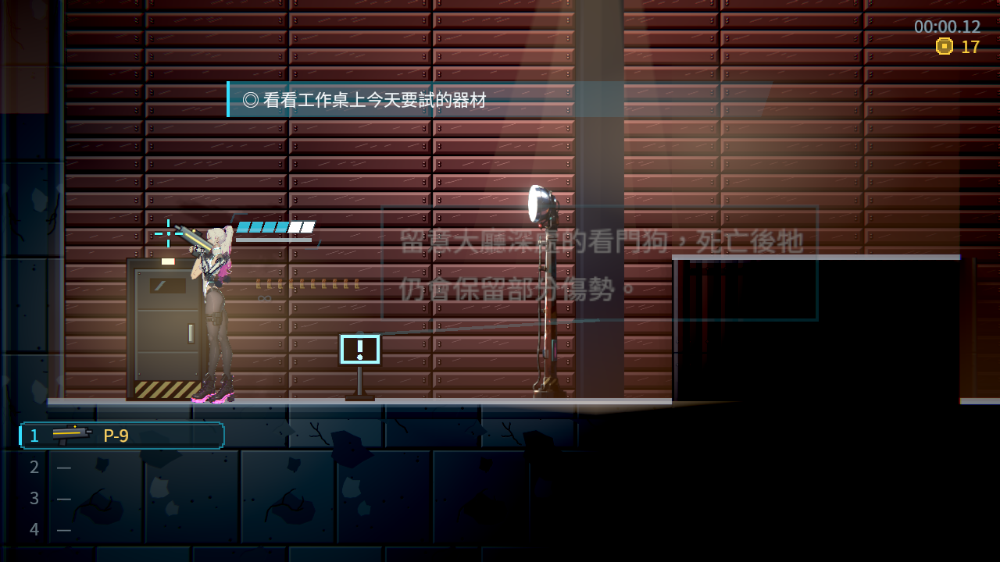
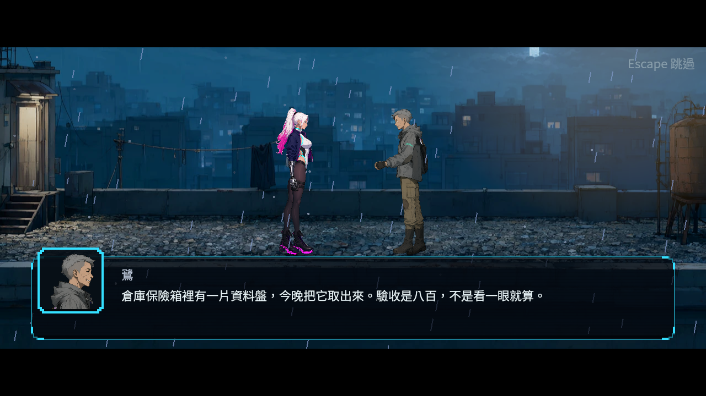
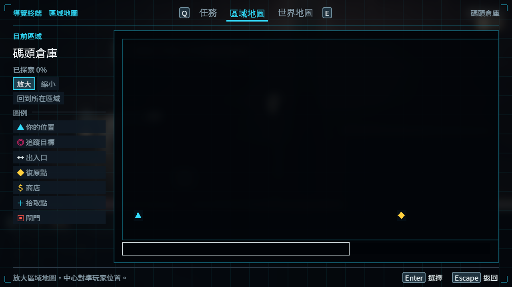

# [NE-297] 相容改圖前的探索存檔

> 狀態：完成

## 內文

### 需求
版面重設後，既有存檔能安全續玩，不重發已取得內容。

### 來源
2026-11-13，使用者要求整體地圖採類銀河戰士惡魔城設計；設計見 [立體探索與一致受光](../../design/21-metroidvania/DESIGN.md)。

### 驗收條件
- [x] 舊位置與檢查點遷至符合目前進度的安全落點
- [x] 已擊倒敵人、已領取內容及已開通機關維持一致
- [x] 探索紀錄與標記可遷移，導覽顯示新的上下層關係
- [x] 中斷或損毀資料採安全預設，保存失敗不吃掉原存檔

### 測試流程
1. 從正常章節進度探索主線、支線、秘密與回環。
2. 分別在取得條件前後回訪，確認可通行範圍與獎勵正確。
3. 以舊存檔續玩、死亡與重新開啟，檢查進度、物品與安全落點。
4. 執行受影響測試並保存代表性原生畫面。

---

# 跟其他票的關係

- Blocks：NE-298
- Blocked by：無
- Related：ST-4、NE-294

---

# Commit-1

## 內文

地圖改為上下分層後，舊存檔可從原區域的安全入口續玩，復原點、探索紀錄、已取得物品、受損與已擊倒的敵人，以及機關進度一起保留。再次讀取不會把位置或內容搬移兩次。

中斷的對話可從搬移後的人物接續，讀完只記錄一次，不多領錢物。跨區的新入口使用目的地版面；遇到無法安全使用的資料或保存失敗時，保留原存檔。

### 測試結果

| 項目 | 結果 |
|---|---|
| 受影響測試（四票整合） | 87 組、99,550 檢查；新失敗 0、已知失敗 0 |
| 腳本與解析診斷 | 0；刻意拒收損毀資料的原始紀錄另存附件 |
| 舊檔與再次冷啟動續玩 | 原血量、錢物、敵人、復原點及探索保留；不重複遷移 |
| 中斷對話 | 七句原對白接續完成一次，錢物及取得紀錄不重複 |
| 區域與世界地圖 | 使用遷移後的實際探索紀錄，上下層顯示與版面檢查通過 |
| 損毀與保存保護 | 未知版本、衝突資料、無效區域與拒寫回歸通過 |

完整原檔、負控制及來源見[驗證附件](attachments/NE-297-map-save-2026-11-13/README.md)與[整合驗收](attachments/NE-297-map-save-2026-11-13/official-v1/README.md)。

### 截圖

# Commit-追加（略過序章後進不了當舖）

## 內文

**問題**：版面修訂上線後，CI 的「略過序章」流程一直失敗：在序章確認略過，畫面停在序章，跳出存檔失敗的提示。原因是準備目的地（當舖）時，即使玩家從沒去過，也替它新建一筆區域存檔；而「略過」屬於只改結果的批次保存，規定不能新建區域，於是整筆被拒絕。

**改動**：只有目的地原本就有區域存檔，或這次真的換算了存在那裡的復原點時，才寫回該區域；第一次進入時新版面的修訂號仍記在這一輪的區域資料上，讀檔不會重複換算。

**驗收**：`tools/run_skip_completion.py` 原本 skip／trained 兩個情境失敗，修正後 7 個情境全部通過；受影響範圍 8 組、4,217 項 0 失敗。

