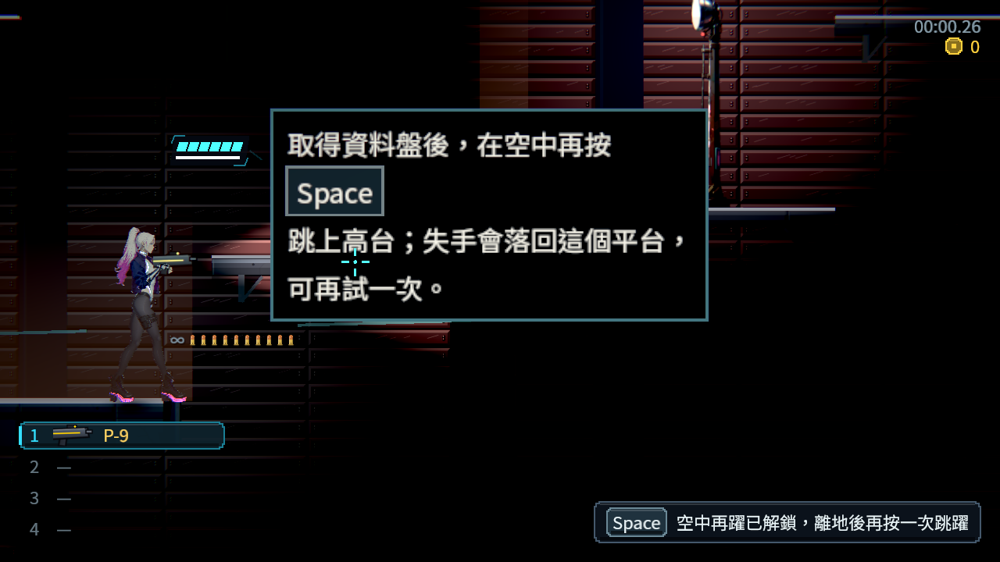
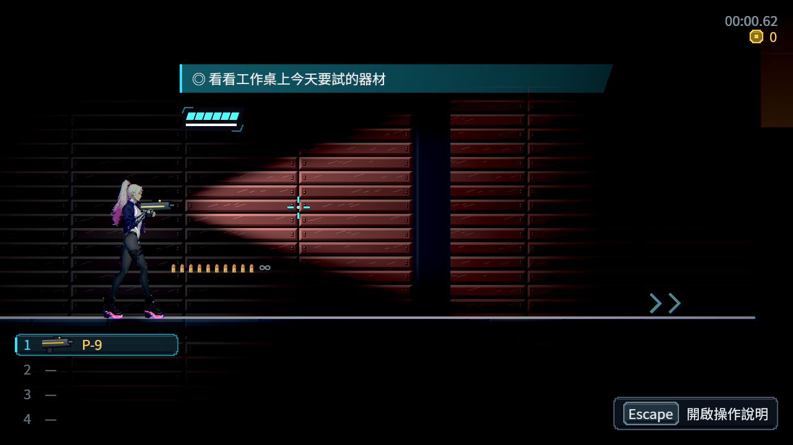
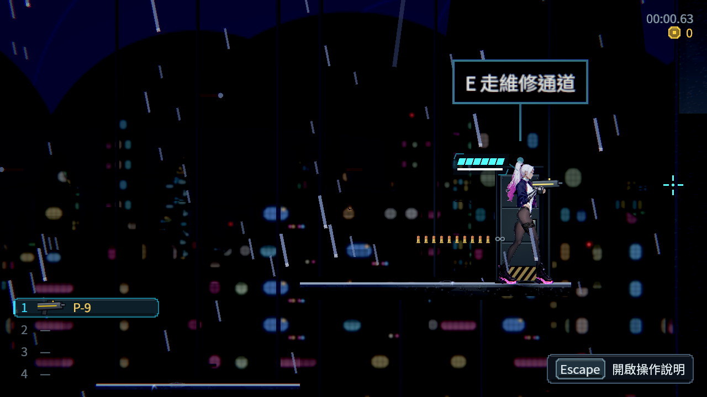

# [NE-298] 重構首章港區立體回環

> 狀態：完成

## 內文

### 需求
把港區街道、屋頂與倉庫改為有層次、地標與回訪的可玩網路。

### 來源
2026-11-13，使用者要求整體地圖採類銀河戰士惡魔城設計；設計見 [立體探索與一致受光](../../design/21-metroidvania/DESIGN.md)。

### 驗收條件
- [x] 街道、倉庫與深處有真正可玩的上下層與不同接近路線
- [x] 取得資料盤後開通深處至街道維修道回環，屋頂接入探索網
- [x] 至少一處可見高處獎勵於取得空中再躍後可回訪取得
- [x] 取得新能力後有不受敵人與致命地形干擾的練習位置，失手可安全重試
- [x] 看門狗、水位、首次診間、交接及回家順序保持合理
- [x] 相鄰區域出口、地圖、鏡頭落點與光影一致，舊檔可安全續玩

### 測試流程
1. 從正常章節進度探索主線、支線、秘密與回環。
2. 分別在取得條件前後回訪，確認可通行範圍與獎勵正確。
3. 以舊存檔續玩、死亡與重新開啟，檢查進度、物品與安全落點。
4. 執行受影響測試並保存代表性原生畫面。

---

# 跟其他票的關係

- Blocks：無
- Blocked by：NE-297
- Related：ST-4、NE-294、NE-296

---

# Commit-1

## 內文

首章街道主路線現在穿越不同樓層，倉庫貨運階梯與深處平台提供可預讀的落點和退路。取得資料盤後，維修道連回街道與屋頂，也能回訪先前可見的高處獎勵。

新能力的練習位置可安全落回台階重試，解鎖時顯示簡短操作提示。看門狗、水位、診間、交接與回家的既有條件保留；截圖與可讀性工具同步使用新地面及真實敵人位置。

### 測試結果

| 項目 | 結果 |
|---|---|
| 受影響測試（四票整合） | 87 組、99,550 檢查；新失敗 0、已知失敗 0 |
| 腳本與解析診斷 | 0；刻意拒收損毀資料的原始紀錄另存附件 |
| 原生操作與代表路線 | 152 檢查、0 失敗；21 張原生畫面 |
| 能力前後與安全練習 | 可達性負控制、真實輸入及敵人啟用下血量 6→6 通過 |
| 高低品質可讀性 | 七處、兩種品質共 14 組原生量測，原有對比門檻全通過 |
| 舊檔與導覽 | 最終整合版冷續玩及區域／世界地圖通過 |

原生操作採已記錄進度的受控案例。完整原圖、負控制及來源見[驗證附件](attachments/NE-298-metroidvania-chapter-one-2026-11-13/README.md)與[整合驗收](attachments/NE-298-metroidvania-chapter-one-2026-11-13/official-v1/README.md)。

### 截圖

