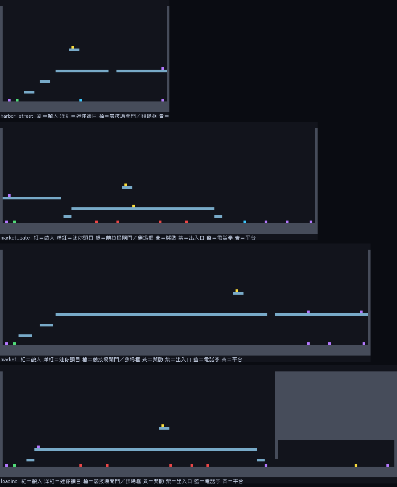
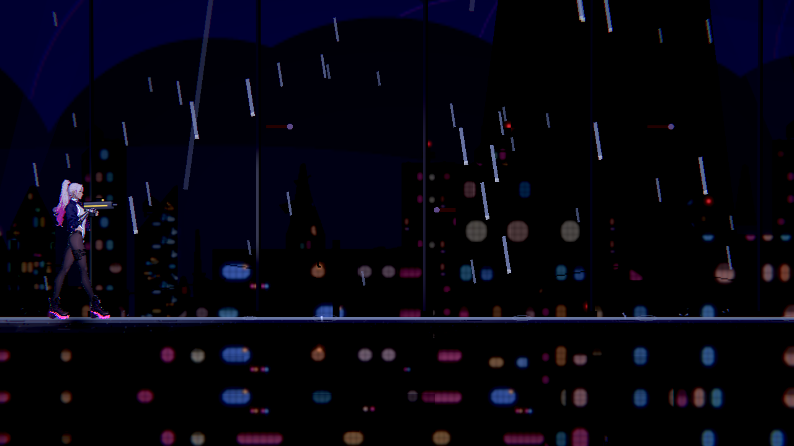
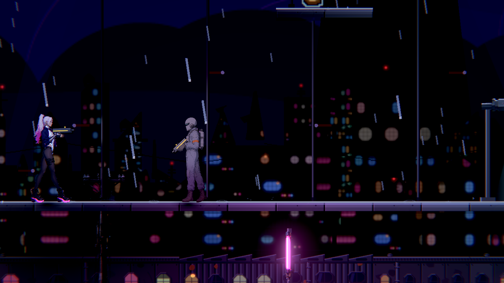

# [NE-299] 重構次章上下貨道網

> 狀態：審查中

## 內文

### 需求
把市集與裝卸場改為上下相連的貨道，既有捷徑成為實際探索回環。

### 來源
2026-11-13，使用者要求整體地圖採類銀河戰士惡魔城設計；設計見 [立體探索與一致受光](../../design/21-metroidvania/DESIGN.md)。

### 驗收條件
- [x] 港街、市集與裝卸場有上下層可玩路徑與回環
- [x] 保留裝卸側捷徑與家屬出口的正式開通條件
- [x] 高處獎勵、秘密與安全休息點提供回訪理由
- [x] 查核、證據、原帳、搬送與審計不能被新入口錯誤繞過
- [x] 上下層落點、光影、導覽及舊檔續玩一致

### 測試流程
1. 從正常章節進度探索主線、支線、秘密與回環。
2. 分別在取得條件前後回訪，確認可通行範圍與獎勵正確。
3. 以舊存檔續玩、死亡與重新開啟，檢查進度、物品與安全落點。
4. 執行受影響測試並保存代表性原生畫面。

---

# 跟其他票的關係

- Blocks：無
- Blocked by：無
- Related：ST-4、NE-294

---

# Commit-1

## 內文

**問題**：第二章的港區街道、市集入口、公眾攤道與裝卸場都是 20 格高的一條平路，只有市集入口和裝卸場各有一段可以繞過戰鬥的上層，區域之間沒有上下相連的路，走過一次就沒有回去的理由。

**改動**（設計見 [第二章：上下貨道網](../../design/21-metroidvania/CHAPTER2.md)）：
- 四張圖加高到 40 格，原有的人、物件、敵人、出入口與燈整批下移 16 格；舊存檔照同一個位移遷移，沒有任何內容換位置或重發。
- 港街雨棚、市集入口上層攤道、公眾攤道雨棚與雨棚背面的上層連成一條上層路：港街雨棚 ↔ 市集入口上層攤道；公眾攤道雨棚右端 ↔ 貨道上層；阿梨小廚房多一扇後窗通到公眾攤道雨棚，安全的小廚房成為回環上的休息點。
- 往貨道上層的雨棚門和原本的貨道入口一樣，要先到代收處問過代收款；橋梯捷徑、家屬出口、北棟貨門與帳房門的條件都沒動，查核、證據、原帳、搬送與審計不會被新路繞過。
- 四處高處信用點都比所在層高 8 格，只有空中再躍拿得到，給回訪的理由；原本乾燥盒的秘密保留。
- 兩塊一句話的提示告訴玩家雨棚上層通往哪裡；任務地圖的步驟格位跟著下移。
- 第三章的產生器共用同一套「加高、搬移、新門」的資料格式，之後各章只改資料。

**驗收**：產生器的格子路線檢查與新的版面測試確認：原內容逐格下移、三對新門兩端互通且條件一致、普通跳躍上得了每一層、到不了高處獎勵而空中再躍到得了、任務格位指向真的內容、裝卸間屋頂完整。暗場可讀性在港街與攤道雨棚、上層攤道、電線橋都合格。實際操作手感、舊存檔實機續玩與自然通關尚未在本機實玩，最後一條先不勾。

### 測試結果

| 項目 | 結果 |
|---|---|
| 受影響範圍（`tools/run_tests_changed.sh`） | 53 組、57,920 項；兩項寫死舊列號的雨棚測試改成新列號後重跑 0 失敗 |
| 版面與關卡工具 Python 測試 | 29 項，0 失敗 |
| 劇情契約 Python 測試 | 18 項，0 失敗 |
| 暗場可讀性（Forward+） | 6 個取樣點全部合格 |

### 截圖

# Commit-2（舊存檔的格位對照與驗收收尾）

## 內文

**問題**：加高後的地圖靠位移換算舊存檔，但沒有用實際關卡驗證過：舊存檔裡的人物對話紀錄、探索格、已啟用的電話亭、拿過的獎勵是否真的換到新格。

**改動**：新增實際關卡的舊檔檢查（第二章港街、市集入口、公眾攤道、裝卸場與第三章廣場、泵室、夾層共七張）：每張都讀得到版面修訂 2；探索格、電話亭、已拿走的拾取物照宣告的 16 格位移換算且不會換算兩次；巡帳員、利息、小販、代收簿等人物的對話紀錄換到新格後，新格上真的是那個人物。故意把位移改錯時這些檢查會失敗。

**驗收**：上下層落點（格子路線檢查）、光影（暗場可讀性合格）、導覽（提示與任務格位）與舊檔續玩（上面的對照）都有證據，最後一條勾選；狀態改為審查中，等使用者實際操作上下層與回環。

### 測試結果

| 項目 | 結果 |
|---|---|
| 存檔套件（含新的實際關卡舊檔對照） | 987 項，0 失敗；位移故意改錯的負控制會失敗 |

