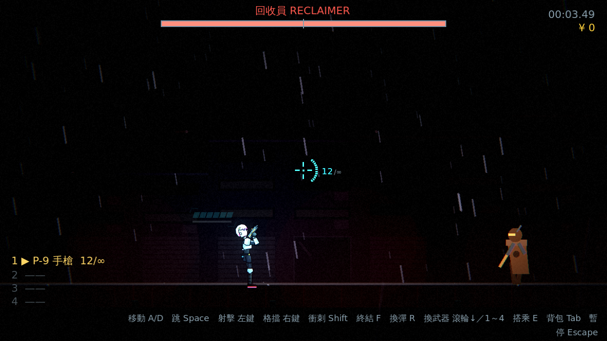
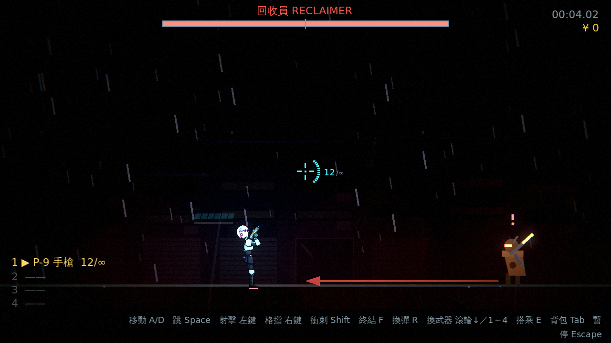
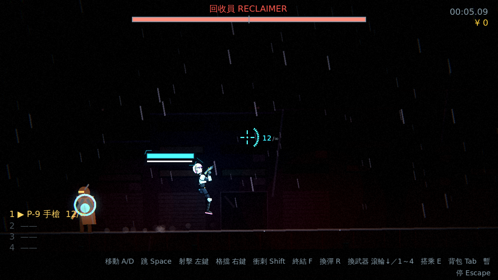
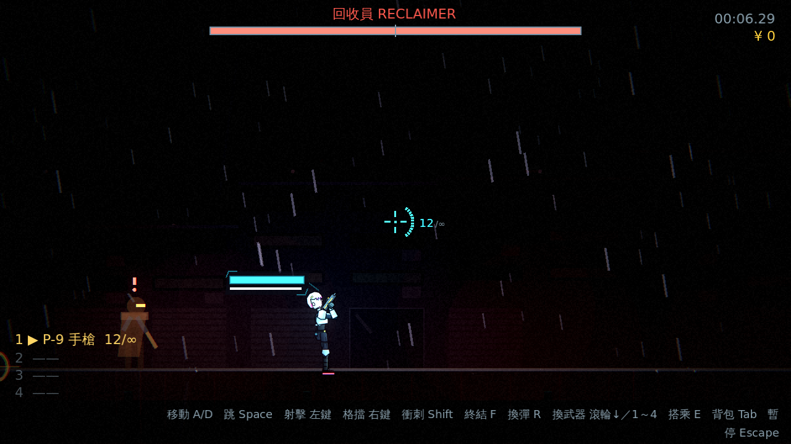
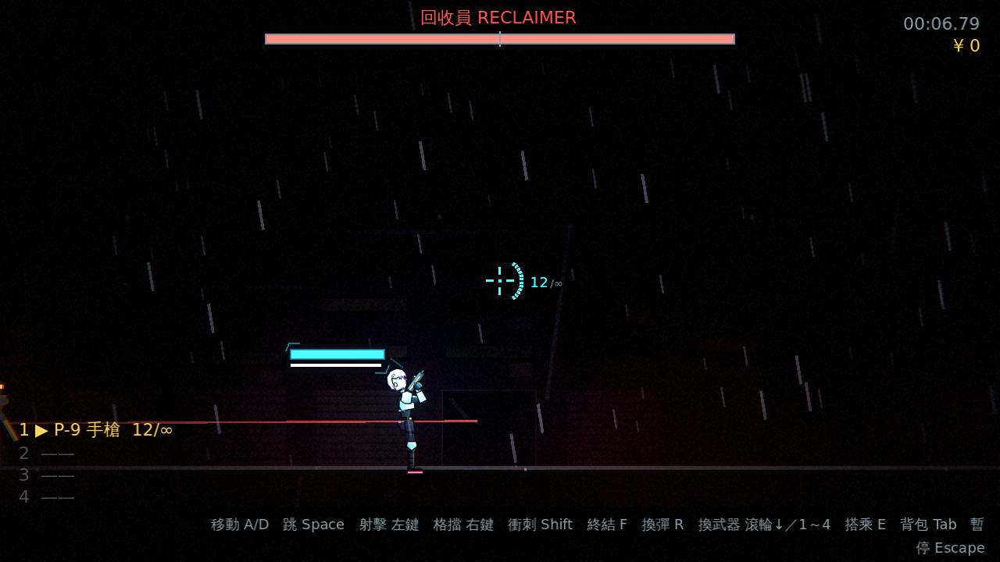
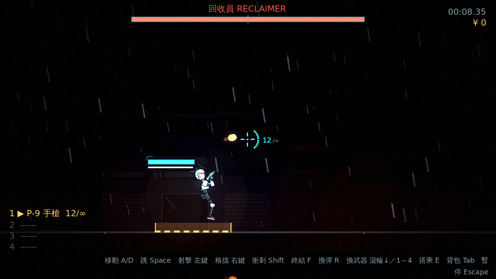
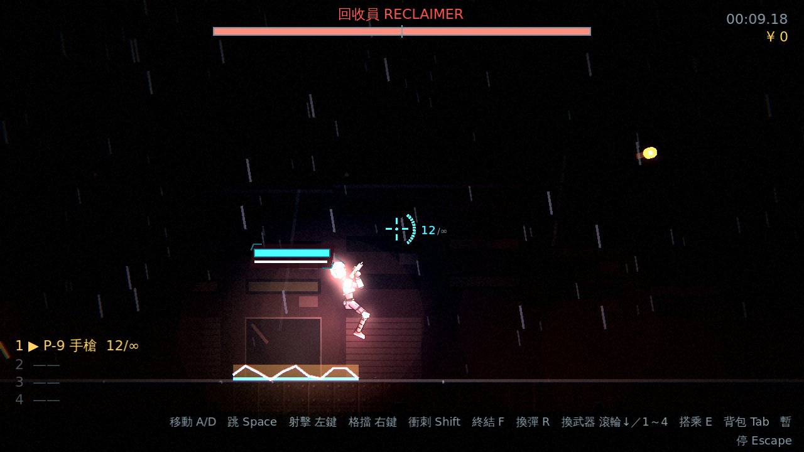
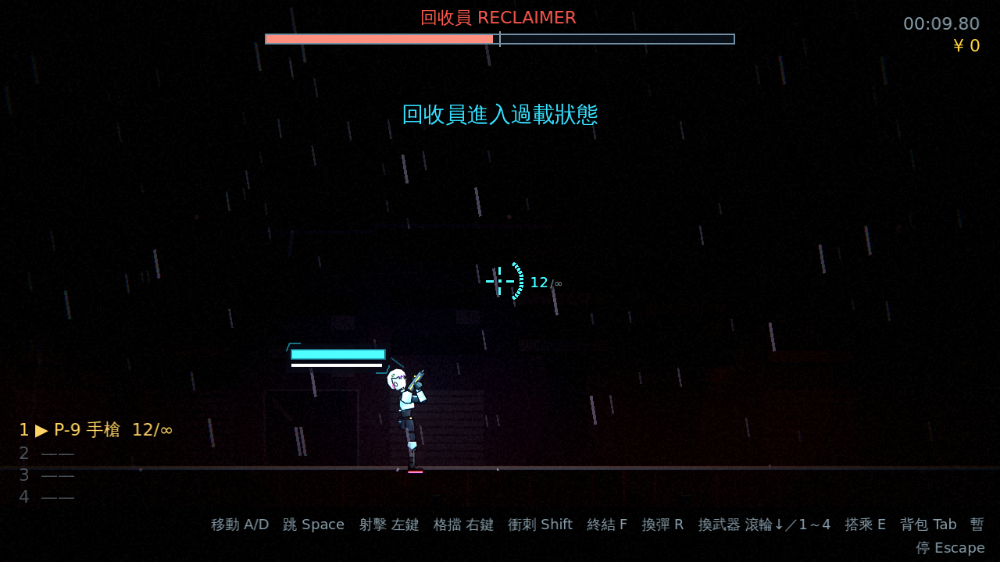

# [NE-29] 製作第二章頭目

> 狀態：完成

## 內文

### 需求
第二章需要一個與監管者風格不同的頭目。設計見 `design/09-content/DESIGN.md` 第二節。

### 來源
2026-10-02，使用者於開發對話中提出：「讓遊戲內容更豐富」；確認四個方向都要做（第二章／新關卡、新敵人與新頭目、場景互動與探索、成長系統），順序為先光影再內容。

### 驗收條件
- [x] 頭目至少兩個階段，每個招式都有明確預兆，並在暗處看得清楚
- [x] 有登場過場、頭目血條與擊敗後的結尾演出
- [x] 有對應的敗北圖鑑卡片與攻略
- [x] 風格與機制和監管者明顯不同
- [x] 輔助、標準、硬核三種難度都能通關

### 測試流程
1. 進入頭目戰，確認登場過場與血條
2. 逐一觀察每個招式的預兆與應對
3. 三種難度各打贏一次
4. 執行完整測試套件，全部通過

---

# 跟其他票的關係

- Blocks：NE-27
- Blocked by：NE-26
- Related：NE-28

---

---

# Commit-1

## 內文

第二章頭目「回收員 RECLAIMER」完成，風格與監管者相反：機動型加場地機關型，靠位移與通電的地板逼玩家移動。三個招式，每個都有明確預兆且在暗處看得清楚（發光的路線預告、圓圈標記、黃色預警地板與驚嘆號紅光）：衝刺斬（蹲低、地上畫出紅色衝刺路線；衝完硬直、核心外露受 1.5 倍傷害）、瞬移射擊（淡出消失並在新位置標出圓圈，現身後瞄準線預兆再三連散射）、電軌通電（舉手後玩家腳下與隨機幾段地板先黃色閃爍預警，1 秒後通電，永遠留有安全區段）。生命低於一半進入第二階段：衝刺連續兩次、散射變五連、電軌多標記一段、節奏加快。
有登場過場（`c2_boss_intro`）、血條、階段轉換提示、擊敗後的連續爆炸與結尾過場，以及四張敗北圖鑑卡片與攻略（衝刺、散射、電軌、接觸）。新增通用場地機關 `ElectricRail`（預警→通電→熄滅，可重複使用）；頭目的場地範圍由關卡傳入（`set_arena`），頭目不會離開場地。所有數值在 `data/enemies/reclaimer.tres`。
順帶：發現並記錄測試的時間陷阱——受傷的短暫時間減慢（hitstop）會讓固定影格數不等於固定時間，頭目測試改為「等到狀態出現」。
驗收方式：測試驗證資料與圖鑑（4 張卡、每張有攻略）、與監管者不同的行為腳本、最短預兆在任何難度下都 ≥ 0.3 秒、衝刺的預兆／傷害來源／硬直／傷害加成／結束恢復、頭目不離開場地、瞬移的淡出／標記／現身／預兆／散射、電軌的預警／通電時機／預警期間安全／通電傷害／熄滅／永遠有安全區段、階段轉換與連續衝刺、擊敗只通報一次且電軌清除；另以三種難度各跑 40 秒的長時間測試，五種狀態（衝刺、硬直、瞬移瞄準、電軌、階段轉換）都會出現且不報錯；截圖如下。

### 測試結果

| 項目 | 結果 |
|---|---|
| 完整測試套件 | 通過 1491 / 1491 |
| 資料驗證 | 0 錯誤 |
| 執行 log | 無非預期 ERROR |

### 截圖

