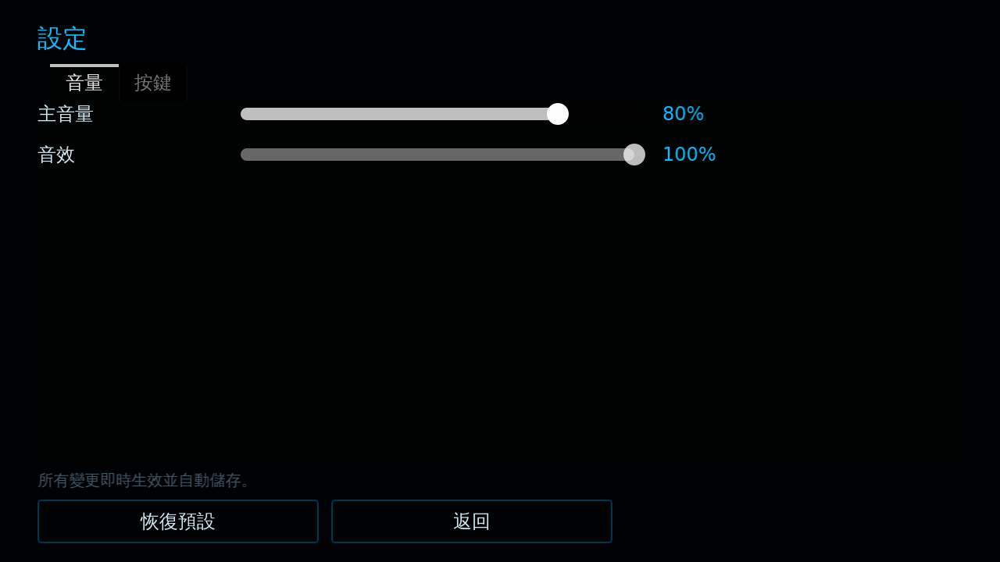
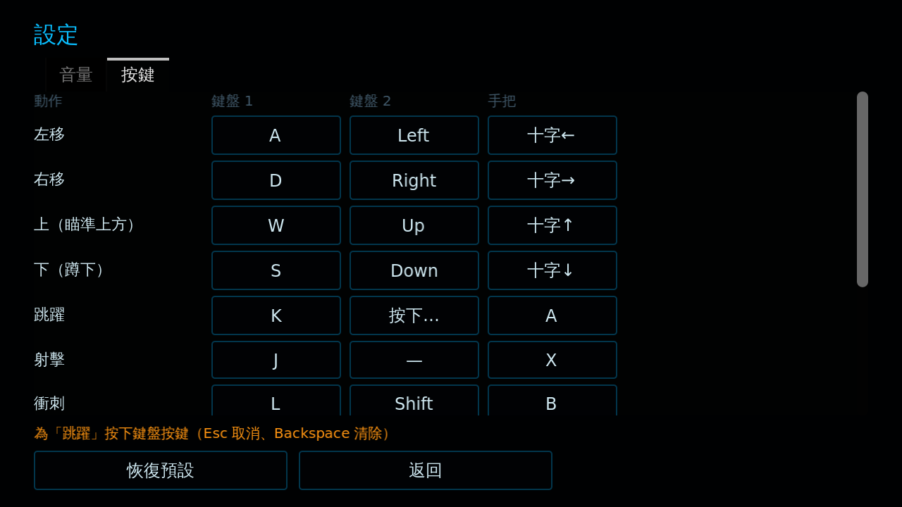

# [NE-2] 新增音量與按鍵設定選單

> 狀態：完成

## 內文

### 需求
玩家需要能調整音量與重新設定按鍵，並且設定要在重開遊戲後保留。

### 來源
2026-10-02，使用者於開發對話中提出：「加一個設定選單，可以調音量跟按鍵」。

### 驗收條件
- [x] 主選單與暫停選單都能開啟設定畫面
- [x] 可分別調整主音量與音效音量，拖動時立即聽得到變化，調到 0 為靜音
- [x] 每個動作可設定兩個鍵盤按鍵與一個手把按鈕
- [x] 設定到已被使用的按鍵時自動互換，任何動作都不會變成沒有按鍵
- [x] 教學提示與操作說明顯示的按鍵會跟著玩家的設定改變
- [x] 設定在重開遊戲後保留；設定檔損毀時退回預設值且遊戲正常運作
- [x] 可分別恢復音量或按鍵的預設值

### 測試流程
1. 開啟設定，把跳躍改成射擊正在使用的按鍵，確認兩者互換
2. 回到遊戲靠近教學看板，確認看板上的按鍵已更新
3. 重開遊戲，確認設定保留
4. 執行完整測試套件，全部通過

---

# 跟其他票的關係

- Blocks：無
- Blocked by：無
- Related：NE-1、NE-5

---

# Commit-1

## 內文

原本音量與按鍵都寫死，玩家無法調整。
現在主選單與暫停選單都有設定畫面：音量分主音量與音效兩條滑桿；按鍵每個動作可設兩個鍵盤按鍵加一個手把按鈕，衝突時自動互換，教學看板與操作說明會顯示玩家設定的按鍵。所有設定即時生效並自動存檔。
驗證了音量套用與靜音、改鍵互換、保留鍵拒絕、存檔重載、損毀資料退回預設、設定畫面的改鍵與取消，以及從暫停選單開關設定。

### 測試結果

| 項目 | 結果 |
|---|---|
| 完整測試套件 | 通過 117 / 117 |
| 資料驗證 | 0 錯誤 |
| 執行 log | 無 ERROR，連續三次執行無記憶體洩漏警告 |

### 截圖

