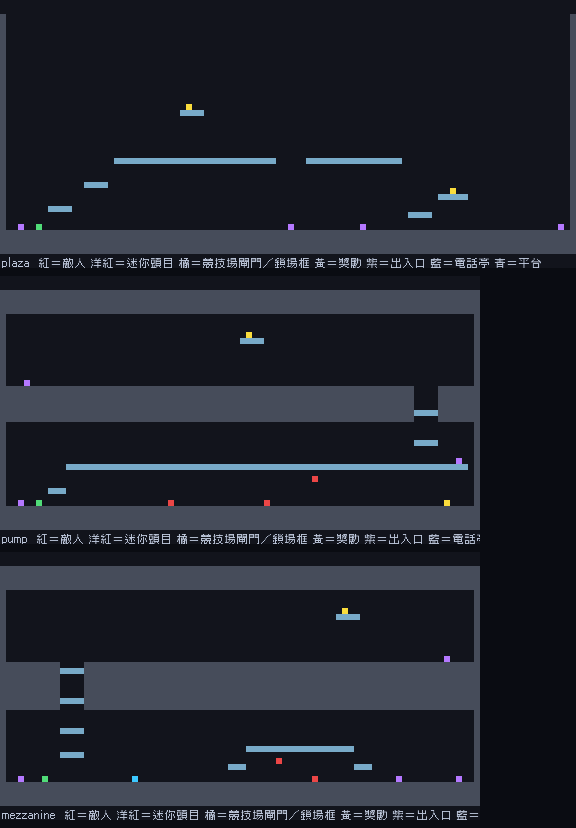
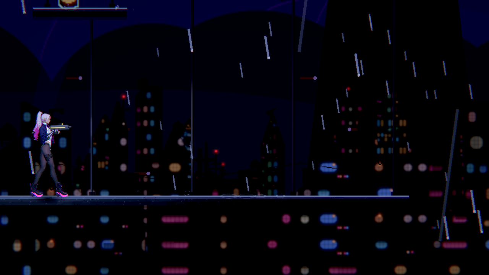
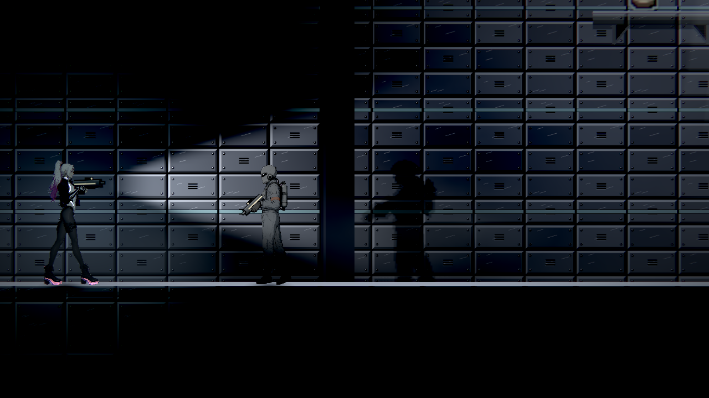
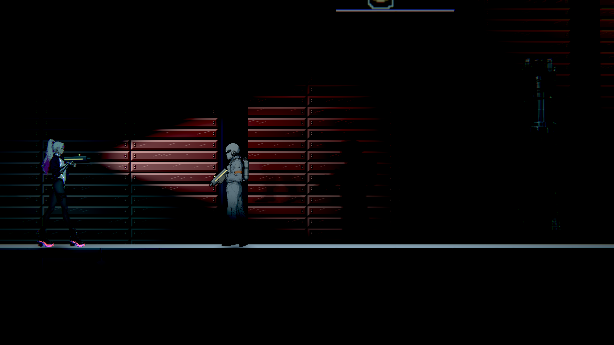

# [NE-300] 重構末章垂直交通網

> 狀態：審查中

## 內文

### 需求
把廣場、泵室與夾層的交通關係做成可讀且可回訪的立體探索。

### 來源
2026-11-13，使用者要求整體地圖採類銀河戰士惡魔城設計；設計見 [立體探索與一致受光](../../design/21-metroidvania/DESIGN.md)。

### 驗收條件
- [x] 廣場、泵室與夾層具真正的垂直路線與可辨識交通地標
- [x] 外梯、照護與展廳回環可正常解鎖與返回
- [x] 高處獎勵與秘密鼓勵能力回訪，主要落點可預讀
- [x] 排水、供電、正式資料、照護、請願與回家流程保持合理
- [x] 上下層光影、導覽及舊檔續玩一致

### 測試流程
1. 從正常章節進度探索主線、支線、秘密與回環。
2. 分別在取得條件前後回訪，確認可通行範圍與獎勵正確。
3. 以舊存檔續玩、死亡與重新開啟，檢查進度、物品與安全落點。
4. 執行受影響測試並保存代表性原生畫面。

---

# 跟其他票的關係

- Blocks：無
- Blocked by：無
- Related：ST-4、NE-294

---

# Commit-1

## 內文

**問題**：第三章的廣場、泵室與夾層各只有 20 格高，泵室和夾層的上層只是戰鬥區上方的一段步道；三張圖之間只有貨梯、外梯和下路，看不出「港區在下、夾層在上」的立體關係，也沒有回訪的理由。

**改動**（設計見 [第三章：垂直交通網](../../design/21-metroidvania/CHAPTER3.md)）：
- 三張圖加高到 40 格，原內容（含吊軌上的巡檢器）整批下移 16 格；舊存檔照同一個位移遷移。
- 廣場：左側兩階踏台上「纜輪維修道」，越過貨梯纜輪後落到原本的高架維修盒，站在上面看得到貨梯、外梯與往泵室的下路。
- 泵室與夾層：原天花板之上各加一層管線廊／豎井廊，由泵室上橋右端與夾層貨梯口旁的豎井爬上去；兩條廊之間的維修豎井互通，條件和貨梯一樣要等貨梯接通，排水、供電的先後不變。
- 外梯、護理通道與展廳回環的開通條件不動；三處高處信用點只有空中再躍拿得到。
- 每一處新路都有一句提示；豎井門鎖住時說明要先排水、接通貨梯。任務地圖的控制箱、排水輪、配電盤格位跟著下移。

**驗收**：格子路線檢查與新的版面測試確認原內容逐格下移、豎井門雙向且和貨梯同條件、外梯與護理通道條件不變、普通跳躍上得了新層、高處獎勵只有空中再躍到得了、室內屋頂完整、任務格位指向真的內容。暗場可讀性六個取樣點（含纜輪維修道、管線廊、豎井廊）都合格。實機操作與舊存檔實機續玩尚未在本機實玩，最後一條先不勾。

### 測試結果

| 項目 | 結果 |
|---|---|
| 受影響範圍（`tools/run_tests_changed.sh`） | 53 組、57,922 項，0 失敗 |
| 版面與關卡工具 Python 測試（含第二章） | 34 項，0 失敗 |
| 暗場可讀性（Forward+） | 6 個取樣點全部合格 |

### 截圖

# Commit-2（舊存檔的格位對照與驗收收尾）

## 內文

**問題**：加高後的地圖靠位移換算舊存檔，但沒有用實際關卡驗證過：舊存檔裡的人物對話紀錄、探索格、已啟用的電話亭、拿過的獎勵是否真的換到新格。

**改動**：新增實際關卡的舊檔檢查（第二章港街、市集入口、公眾攤道、裝卸場與第三章廣場、泵室、夾層共七張）：每張都讀得到版面修訂 2；探索格、電話亭、已拿走的拾取物照宣告的 16 格位移換算且不會換算兩次；巡帳員、利息、小販、代收簿等人物的對話紀錄換到新格後，新格上真的是那個人物。故意把位移改錯時這些檢查會失敗。

**驗收**：上下層落點（格子路線檢查）、光影（暗場可讀性合格）、導覽（提示與任務格位）與舊檔續玩（上面的對照）都有證據，最後一條勾選；狀態改為審查中，等使用者實際操作上下層與回環。

### 測試結果

| 項目 | 結果 |
|---|---|
| 存檔套件（含新的實際關卡舊檔對照） | 987 項，0 失敗；位移故意改錯的負控制會失敗 |

