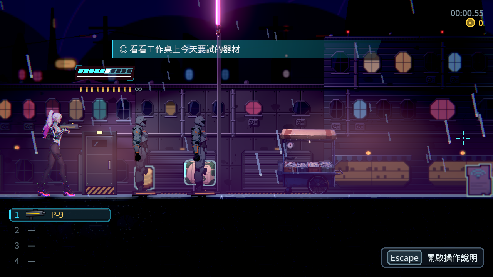
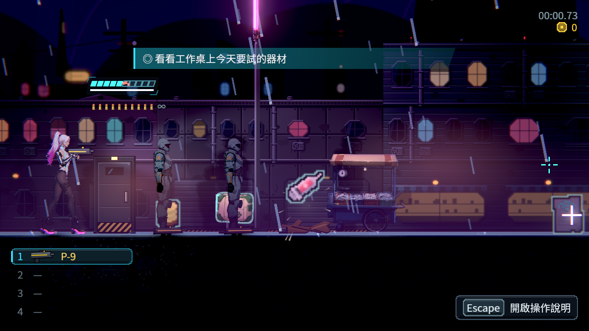
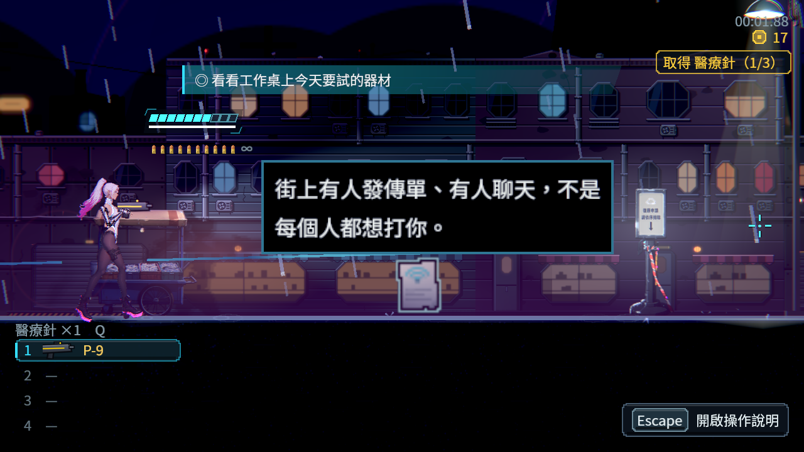

# [NE-301] 回收延後生成的掉落物

> 狀態：完成

## 內文

### 需求

敵人或可破壞物掉落獎勵時，如果場景在同一格被移除，尚未出現的掉落物不能留成無人管理的物件；正常生成與拾取維持。

### 來源

2026-11-17，持續交付全部票並重驗 BG-32 時，原有退出診斷出現未回收信用點道具。實際生成後在同一格移除場景的最小重現，孤兒數由 0 增至 1。[生命週期設計](../../design/09-content/DEFERRED_PICKUP_LIFETIME.md)。

### 驗收條件

- [x] 原版在場景移除邊界留下掉落物的失敗有原始對照。
- [x] 敵人掉錢、敵人補給與破壞物獎勵在場景移除時都會回收，沒有未入場景的殘留。
- [x] 正常掉落的位置、數量與拾取效果維持，沒有重複獎勵。
- [x] 物理查詢期間與遊戲退出邊界不新增引擎錯誤；受影響測試通過。

### 測試流程

1. 從三種正式掉落來源生成獎勵，分別正常等待與同格移除場景。
2. 正常等待時拾取獎勵，比較數量與效果。
3. 移除時確認原掉落物確實釋放，重複流程與退出沒有新增錯誤。
4. 跑受影響範圍並保存原始失敗與修正結果。

---

# 跟其他票的關係

- Blocks：無
- Blocked by：無
- Related：BG-32、NE-118

---

# Commit-1

## 內文

敵人與破壞物原本已經建立掉落物，卻把「加入場景」排在可能同一格就離場的父節點上。父節點先被移除時，這個動作不會再執行，沒有進場的信用點與補給便無人管理。

現在交付時會重新核對原場景是否仍存在：已離場就回收尚未交給任何人的掉落物；正常場景仍在就照常加入。途中已被釋放的物件會安全略過，已交給另一個場景的物件不會被接管或刪除。保留原本安全的延後加入時點、掉落機率、位置、金額、武器與物品設定，不改圖、劇情或預載。

原版三種真正掉落入口在同格移除場景時，孤兒數分別由 0 增至 1、1、2；候選都回到 0。另在還沒加入場景前立即退出整個遊戲，原版雖然退出碼為 0，完整 log 仍有未釋放診斷；候選退出與完整 log 都乾淨。原始失敗與正常場景對照完整保存，沒有改掉原數字。

正常情境驗信用點、補給、武器、消耗品的位置／數量與實際拾取只生效一次；物理碰撞回呼中也驗證物件等回呼結束後才加入。原生 Forward+ 在正式街道以實際移動收取：信用點 0→17、生命 5→7、醫療針 0→1，三個掉落物確實釋放。這是受控正式 Level，並非完整 Main 或真人手把通關。

### 測試結果

| 項目 | 結果 |
|---|---|
| 正式受影響測試（純 AAE 基準、76 組、2 程序） | 97,199 項、新失敗 0、已知失敗 0，自然退出 0；五份來源前後完全一致 |
| 原版／候選獨立生成、移場、整樹退出控制 | 各 12 例；原版移場重現殘留，候選完整 EOF 乾淨 |
| 永久掉落、所有權、真正物理回呼與拾取回歸 | 87 項通過，沒有新增退出診斷；保留原有刻意缺招式的容錯 ERROR |
| 故意移除回收的負控制 | 同 87 項出現 14 項失敗，自然退出 1；恢復候選後全過 |
| 9070 XT 原生 Forward+／HDR 2D | 9 項通過，獨立 profile、自然退出 0、完整 log 無 ERROR／leak |

正式分片 0 結束乾淨；分片 1 尚有 1 CanvasItem、9 ObjectDB、5 resources 的退出診斷，原樣保留，沒有逐 ID 歸因或宣稱整份 headless raw log 全部無 ERROR。這與本票獨立正常／移場／整樹退出控制、永久套件及原生見證均無洩漏的結果分開記錄；沒有更動既有測試 filter。

舊 fixture 的 VFX/FSM 錯誤、型別推論編譯失敗、舊測試 getter 未釋放的物件，以及外部原生工具的啟動／profile 修正都有來源與原 log。正式交付畫面採明確隔離 profile 的第四輪，不把早期成功輪冒稱為個人 profile 未變的證明。

[完整原始失敗、候選來源、退出控制、原圖與可攜核驗](attachments/NE-301-deferred-pickups-2026-11-17/README.md)。

### 截圖

敵人實際掉落信用點與補給：

破箱後產生設定的醫療針：

實際移動收取後的信用點、生命與醫療針（自然出現的街道提示保留）：

