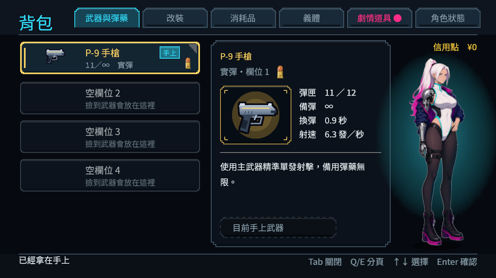

# [NE-303] 修正預設武器遺失時的讀檔復原

> 狀態：完成

## 內文

### 需求

玩家參數缺少預設武器，且新遊戲或續玩沒有可用武器時，凜仍能初始化和操作。武器欄需給出可用的正式預設或安全空手狀態。

### 來源

2026-11-21，驗證補給提示時重現玩家參數缺少武器，空武器欄在還原與重新計算改裝時讀取空值。規則見[《武器與背包》](../../design/07-weapons-inventory/DESIGN.md)。

### 驗收條件

- [x] 空存檔、損壞的武器清單和遺失武器檔均可初始化，記錄缺件並恢復可射擊的 P-9。
- [x] 已存的有效武器及彈藥可載入。玩家設定完整時仍沿用原裝備。
- [x] 緊急預設武器也無法載入時，武器欄維持有效空手狀態，射擊或重新計算改裝均不造成腳本錯誤。

### 測試流程

1. 以空白和損壞的存檔建立玩家，觀察武器欄及射擊。
2. 以有效武器存檔及正式玩家設定重跑，核對武器與彈藥。
3. 在隔離執行程序模擬緊急預設資源遺失，確認空手狀態。

---

# 跟其他票的關係

- Blocks：無
- Blocked by：無
- Related：NE-13、NE-228

---

# Commit-1

## 內文

原本武器欄在預設和存檔都沒有武器時，會把空值塞進武器資料並讀取彈匣。現在先保留有效存檔武器。只有確實沒有可用武器時才載入 P-9，並記錄缺少的欄位和退回結果。緊急 P-9 本身遺失時，武器欄、彈匣和備彈維持一致的空狀態。

### 測試結果

- 原版在三種缺件案例中共出現四個腳本錯誤。修後三種案例皆用真正的玩家發射 P-9，彈匣由 12 扣為 11。有效的存檔步槍保留 9 發與 21 發備彈，正式設定的 P-9 也照常開火。
- 隔離程序暫時移走緊急 P-9 資源。三種無武器案例均正確空手，重新計算改裝和射擊都能安全完成，有效的存檔步槍仍能開火。測試結束後以雜湊核對武器資源已還原。
- RX 9070 XT Forward+ 實際查看復原後的背包與子彈。新回歸在原版重現 6 項失敗，修後受影響回歸 34 套、43,561 項全過，479 秒。

[原生畫面、缺件案例與回歸紀錄](attachments/NE-303-missing-primary-2026-11-21/evidence.zip)

