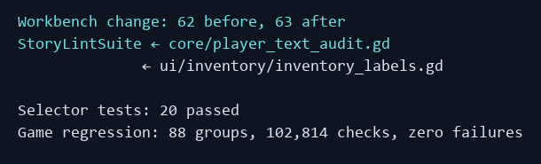

# [NE-304] 補齊動態來源的測試選擇

> 狀態：完成

## 內文

### 需求

修改玩家介面或劇情文字時，受影響測試要檢查執行時讀到的文字。新檔與移除的檔案都要納入判斷。

### 來源

2026-11-23，工作台文字移到共用檔後，本機受影響測試漏選閱讀性檢查。完整 CI 的執行 45101068265 發現來源契約失敗。見[測試範圍設計](../../design/06-roadmap/CHANGED_TEST_SCOPE.md)。

### 驗收條件

- [x] 修改、新增或移除玩家文字來源，會選到閱讀性套件並指出涉及的路徑。
- [x] 不相關檔案維持原選擇結果，只改文件時照原流程略過遊戲測試。
- [x] 同一版本的工作台來源對照能重現漏選，修後補回閱讀性套件。原本選到的套件仍會執行。

### 測試流程

1. 用實際工作台修改清單重跑選擇，確認閱讀性套件和來源路徑。
2. 在隔離 Git 專案加入新來源、移除來源及修改無關檔案，檢查選擇結果。
3. 跑原有選擇器測試和受影響回歸。

---

# 跟其他票的關係

- Blocks：無
- Blocked by：無
- Related：NE-228、NE-263、NE-283

---

# Commit-1

## 內文

玩家文字盤點在執行時讀取目錄中的來源。現在這些來源有更動時，受影響測試會包含閱讀性套件。移除文字檔也會觸發檢查，選擇結果可追到改動檔案。

### 測試結果

- 舊工具重現一項漏選，修後選擇器測試 20 項全過。實際工作台版本由 62 組補到 63 組，新增閱讀性套件，其餘測試清單一致。
- 正式受影響回歸 88 組、102,814 項全過，1280 秒。

[原版漏選、實際路徑與正式回歸](attachments/NE-304-live-text-test-scope-2026-11-23/evidence.zip)

