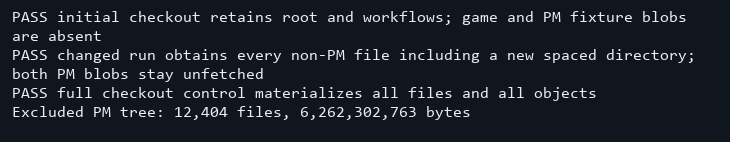

# [NE-305] 減少 CI 測試的票據下載

> 狀態：完成

## 內文

### 需求

減少完整遊戲測試複製票據與驗收附件所需的暫存空間。保留正式證據和完整遊戲測試。

### 來源

2026-11-23，依使用者要求縮小票據與驗收儲存量。遊戲測試的完整檢出原先會同時帶入全部 PM 檔案。見[驗收證據保留規則](../../design/06-roadmap/EVIDENCE_RETENTION.md)。

### 驗收條件

- [x] 已有成功結果的同一提交可以在排程階段略過，工作目錄只需根目錄與工作流程。
- [x] 需要跑測試時取出遊戲、素材、工具及後續新增的非 PM 目錄。
- [x] 票據附件的 Git 物件在測試檢出中維持未下載，可照常由完整檢出取得。
- [x] 保留原有觸發條件、測試命令及自動清理保留證據的規則。

### 測試流程

1. 用可部分下載的 Git 測試倉庫執行兩段檢出，檢查下載的物件與實際檔案。
2. 加入含空白的新來源目錄，確認測試階段能取到它。用完整檢出比對票據附件。
3. 執行既有證據保留測試及受影響選測，核對原工作流程其餘各步驟。

---

# 跟其他票的關係

- Blocks：無
- Blocked by：無
- Related：NE-302、NE-304

---

# Commit-1

遊戲測試先取根目錄與工作流程。排程確定需要測試後，再依同一提交展開 PM 以外的目錄。

### 測試結果

- 實際 Git 部分下載及完整檢出對照通過。兩段稀疏檢出後，測試用的票據與大型附件物件仍未下載。
- 驗證基準含 12,404 份 PM 檔案，未壓縮大小 6,262,302,763 bytes。實際 GitHub 下載量會依壓縮與可重用物件而不同。
- 原流程的其餘步驟比對一致，證據保留測試及正式受影響選測通過。

[實際 Git 檢出與測試紀錄](attachments/NE-305-ci-sparse-checkout-2026-11-23/evidence.zip)

