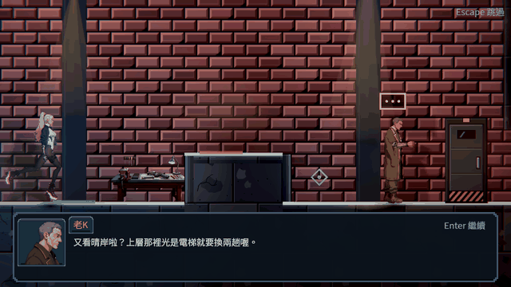

# [NE-307] 修正音效尚未匯入時的啟動錯誤

> 狀態：完成

## 內文

### 需求

在 Godot 本機編輯器執行時，音效匯入快取暫時缺失會讓啟動檢查報錯，且同一輪無法播放音效。有效原檔仍在時，遊戲應能播放原音效。

### 來源

2026-11-23，使用者回報序章試玩時，廚房沖洗音效的匯入快取找不到。

### 驗收條件

- [x] 在具備正常 Ogg 原檔及匯入設定、缺少匯入快取時，可正常啟動並載入該音效。
- [x] 保留原匯入的迴圈與節拍設定。原檔確實遺失時仍有原本的備援。
- [x] 完成匯入後，正常啟動走原匯入資料，原生畫面及受影響測試通過。

### 測試流程

1. 在隔離專案保留原始沖洗音效與匯入設定，略去其產生的快取。
2. 執行同一個音效庫，確認真的可取得具有播放長度的音效，且警告寫出路徑。
3. 回到已匯入的正式專案，正常續玩序章。

---

# 跟其他票的關係

- Blocks：無
- Blocked by：無
- Related：NE-156

---

# Commit-1

缺少快取時，開發版以同一原始 Ogg 播放。匯入完成後，下一次啟動走一般匯入流程。

### 測試結果

- 隔離缺快取重現原錯誤，修前 0 個可播變體，修後 1 個，0.44 秒。受影響回歸 15 組、35,606 項全過。
- RX 9070 XT Forward+ 正常載入隔離的序章續玩資料，啟動沒有音效載入錯誤。

[重現、修正與回歸紀錄](attachments/NE-307-ogg-import-2026-11-23/evidence.zip)

