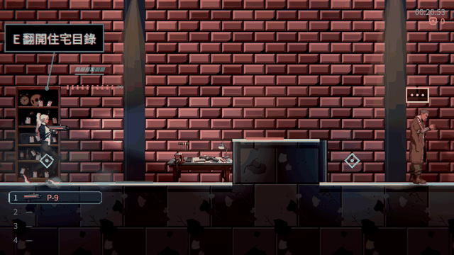

# [NE-308] 改善續玩和自動存檔卡頓

> 狀態：完成

## 內文

### 需求

續玩及操作中的自動存檔都應降低停頓。已保存的任務、地圖探索、復原點與舊版進度仍可正常還原。

### 來源

Stanley 於 2026-11-23 回報試玩時嚴重卡頓。

### 驗收條件

- [x] 同一份序章存檔重複續玩時，最長停頓低於修正前的 60%。
- [x] 同一段序章操作成功自動存檔，最長影格維持在 120 ms 以內。
- [x] 合法的跨章釘選、探索、復原點與版面遷移照常還原，無效資料仍依原有規則處理。

### 測試流程

1. 在序章對話中保存，重開後從主選單繼續，確認對話及原進度恢復。
2. 結束對話後移動和跳躍，等到自動存檔發生，再接續一次確認進度。

---

# 跟其他票的關係

- Blocks：無
- Blocked by：無
- Related：NE-228、NE-307

---

# Commit-1

## 內文

續玩時回到正確的對話進度，走動時的自動存檔延遲也降低。用同一份隔離存檔在 RX 9070 XT、Godot 4.7.2、Forward+、1280×720 及原有垂直同步設定下，交錯測量原版與修正版各兩次。

### 測試結果

| 項目 | 修正前 | 修正後 |
|---|---:|---:|
| 按下繼續後的首段停頓 | 2408～2433 ms | 86～88 ms |
| 轉場內關卡載入單格 | 444～461 ms | 617～646 ms |
| 操作期間最長影格 | 62～65 ms | 66～69 ms |
| 受影響測試 | — | 27 組、12,549 項檢查全過 |
| 原生執行紀錄 | — | 四次完成，均無 ERROR |

只降低續玩準備的早期候選，操作時曾出現 611 ms 影格；完整修正後，自動存檔不需依賴續玩時預先載入其他章節的資料。

[幀時間、存檔驗證與測試紀錄](images/NE-308-resume-autosave-evidence.zip)

### 截圖

