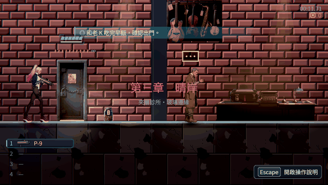

# [NE-309] 分段載入關卡與索引

> 狀態：完成

## 內文

### 需求

冷啟動後首次進場、跨區與跨章時，轉場應持續更新並顯示載入狀態。玩家只能在關卡完成後開始操作，續玩仍保留原進度。

### 來源

Stanley 於 2026-11-23 要求完整檢查關卡載入與效能退化。

### 驗收條件

- [x] 同一台 RX 9070 XT 的兩次新遊戲量測中，最長影格低於 300 ms。
- [x] 轉場期間可顯示載入提示，關卡未完成時不能操作、寫入半成品或提前通知進度還原。
- [x] 正常出入口與兩次跨章接續都載入正確區域。
- [x] 自動檢查可發現區域清單與實際關卡不符。

### 測試流程

1. 以空存檔從主選單開始遊戲，觀察轉場和進場。
2. 使用正式出入口進當舖、街道及倉庫，由章末接第二章與第三章。
3. 從已保存的位置續玩，確認只在玩家與關卡都就緒後恢復進度。

---

# 跟其他票的關係

- Blocks：無
- Blocked by：無
- Related：NE-308、BG-50

---

# Commit-1

## 內文

同一套 Main 遊戲流程在 Godot 4.7.2、Forward+、RX 9070 XT 及 1280×720 下各量兩次。畫面載入期間保持輸入鎖，完整關卡才揭開。區域清單核對了全部 32 個正式資源。

### 測試結果

| 路徑的最長影格 | 修正前 | 修正後 |
|---|---:|---:|
| 從選單開始新遊戲 | 1614～1873 ms | 201～220 ms |
| 進入街道 | 340～420 ms | 213～242 ms |
| 第一章接第二章 | 355～471 ms | 177～180 ms |
| 第二章接第三章 | 296～438 ms | 162～177 ms |
| 受影響測試 | — | 67 組、90,781 項檢查全過 |

[原生路線與測試紀錄](images/NE-309-level-entry-evidence.zip)

### 截圖

