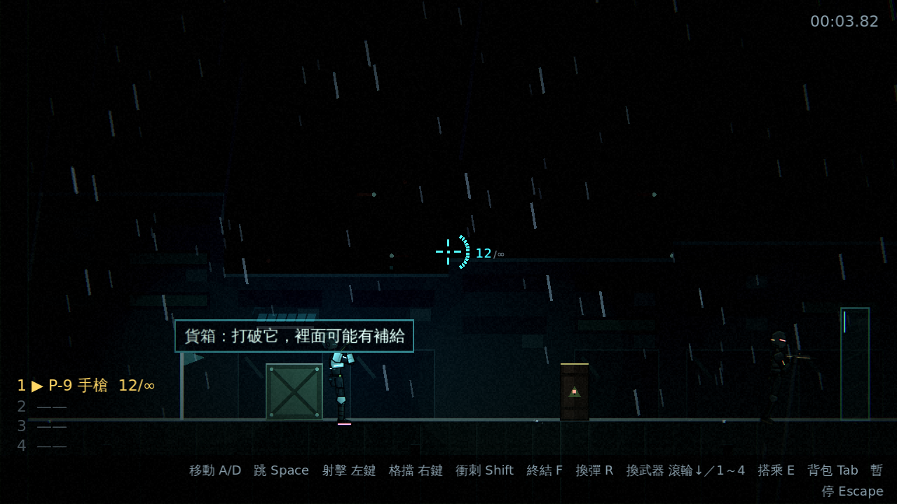
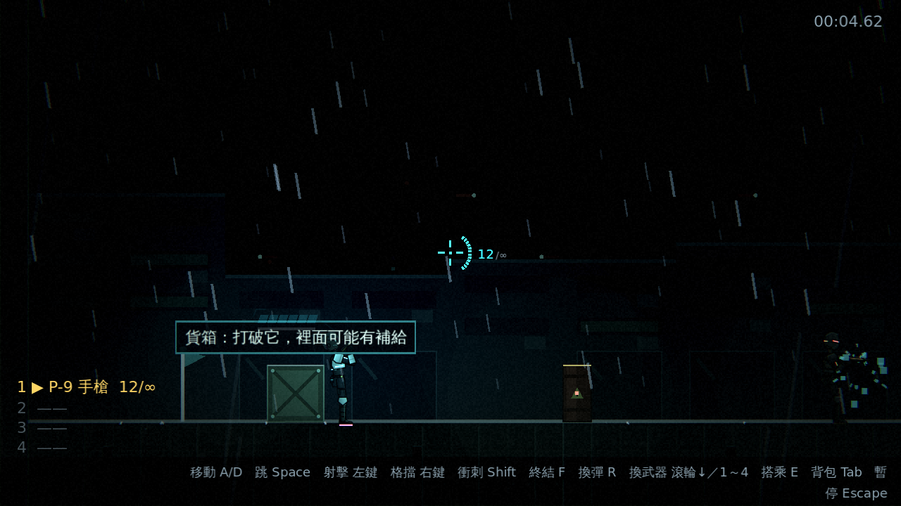
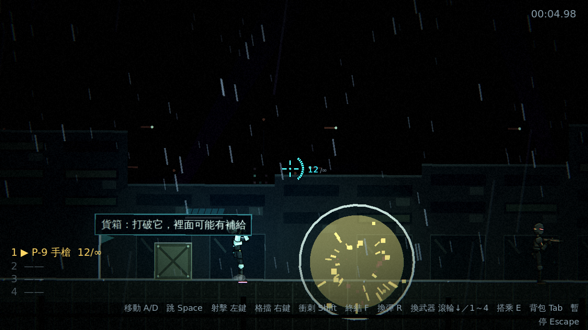
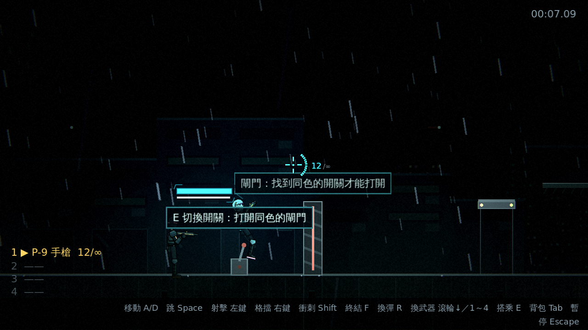
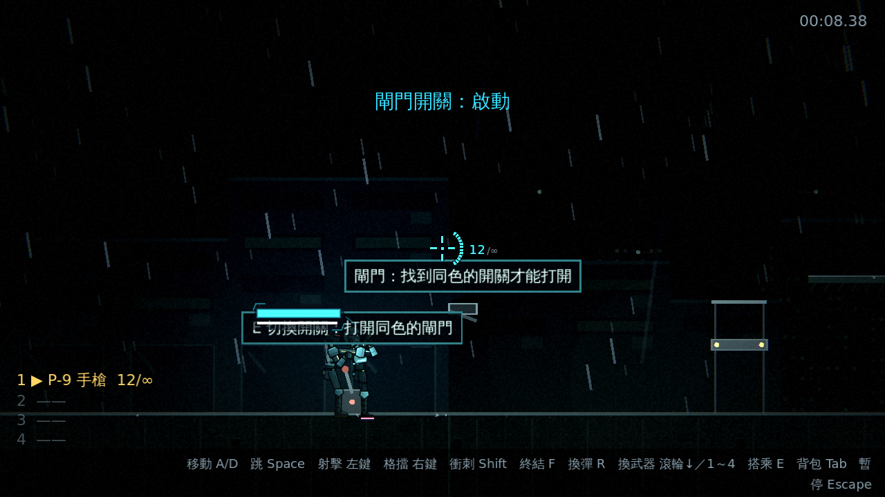
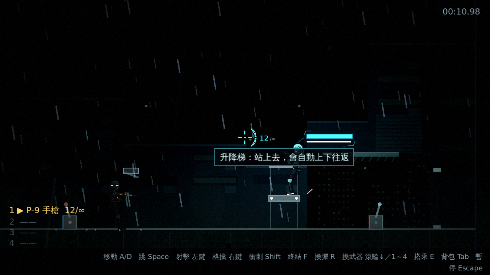
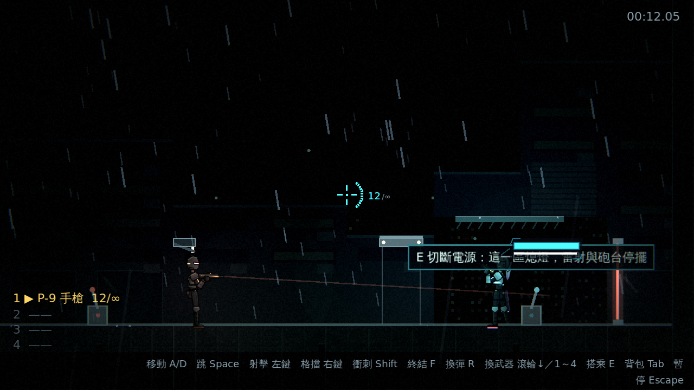
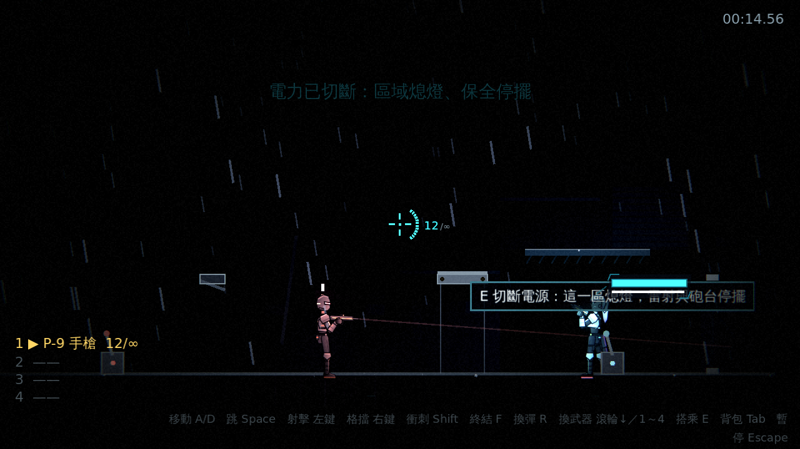

# [NE-30] 加入可破壞物與環境機關

> 狀態：完成

## 內文

### 需求
目前場景只有背景，沒有可以互動的東西。加入可破壞物件與環境機關，讓戰鬥與探索更有變化，並與光影連動。設計見 `design/09-content/DESIGN.md` 第三節。

### 來源
2026-10-02，使用者於開發對話中提出：「讓遊戲內容更豐富」；確認四個方向都要做（第二章／新關卡、新敵人與新頭目、場景互動與探索、成長系統），順序為先光影再內容。

### 驗收條件
- [x] 可破壞物件（木箱、油桶、玻璃牆）被攻擊後破壞，可能掉出道具
- [x] 油桶被引爆時會傷害附近的敵人與玩家
- [x] 環境機關：升降梯、可開關的閘門、電力開關
- [x] 電力開關切斷電源會讓該區域熄燈，重新啟動後恢復
- [x] 每種新機關都有一句提示（靠近時顯示，資料的 `hint`）；「安全示範」的擺放屬於關卡設計，已移到 NE-27 的驗收條件
- [x] 可破壞物與機關的狀態存進檢查點，重生後還原

### 測試流程
1. 打破木箱與玻璃牆，確認破壞效果與掉落
2. 引爆油桶傷到敵人
3. 切斷電力開關，確認區域熄燈並可重新啟動
4. 通過檢查點後死亡，確認狀態還原
5. 執行完整測試套件，全部通過

---

# 跟其他票的關係

- Blocks：NE-27、NE-31
- Blocked by：NE-25
- Related：無

---

---

# Commit-1

## 內文

場景現在有可以互動的東西。可破壞物件（貨箱、油桶、強化玻璃）擋路也擋敵人的子彈（所以是掩體），被玩家的子彈、近戰或爆炸打破，可能掉出補給；油桶被打爆時會同時傷害附近的敵人與玩家，也會引爆旁邊的油桶（死因有敗北圖鑑卡片「火花與油桶」）。環境機關有升降梯（單向平台、上下往返）、閘門與開關（同頻道連動）、電力開關：切斷電源會讓該區域熄燈（光影事件），區域內的雷射柵欄、砲台與升降梯停擺，再按一次恢復。
全部以資料定義：`BreakableData`、`MechanismData`（`data/props/*.tres`），關卡 legend 一個字元對應一個資料檔，不需要改程式。檢查點會存下世界狀態（被打破的箱子、開關、閘門、電力），重生時還原；`WorldState` 是通用機制，之後新增的可變物件加入群組並實作三個方法即可。每個新物件靠近時顯示一句重點提示。
順帶修正：背景牆立面在相鄰兩塊地面高度差大時會算出負高度（出現引擎錯誤），現在會夾限。測試新增 `tests/suite/` 功能套件框架（`TestSuite`），本票的測試放在 `test_props.gd`，並使用專用測試地圖 `tests/fixtures/props_map.json`。
驗收方式：測試驗證資料驗證與提示、破壞與只受玩家傷害、子彈與敵方子彈、掉落依位置固定、爆炸傷敵不傷範圍外的玩家、站在旁邊會受傷、開關與閘門、升降梯行程、斷電使柵欄停擺與熄燈、恢復後淡回、檢查點存取與還原、損毀快照不崩潰；截圖如下。

### 測試結果

| 項目 | 結果 |
|---|---|
| 完整測試套件 | 通過 1065 / 1065 |
| 資料驗證 | 0 錯誤 |
| 執行 log | 無非預期 ERROR |

### 截圖

