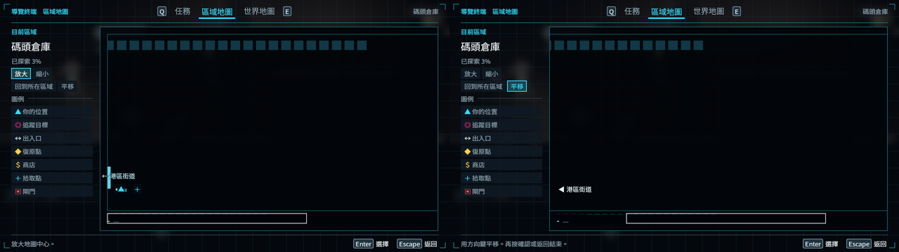

# [NE-312] 在區域地圖查看整條路線

> 狀態：完成

## 內文

### 需求

玩家可以查看寬大區域的另一端，回顧已走過的通道及出入口。詳見[回訪探索與場景氛圍](../../design/20-campaign-experience/EXPLORATION_AND_ATMOSPHERE.md)。

### 來源

2026-11-24，使用者要求完整地圖，方便探索和折返尋找捷徑。

### 驗收條件

- [x] 鍵盤及手把可平移，鼠標可點下方縮圖移動視窗。
- [x] 返回區域地圖保留查看位置與倍率，重置可回角色或文件來源。
- [x] 平移沿用已探索地形，未探索區不會多揭露，快取不重建。
- [x] 1280×720 與 1920×1080 地圖及按鍵提示完整顯示。

### 測試流程

1. 在碼頭倉庫開地圖，選「平移」，以方向鍵查看遠端。用手把方向鍵往回，再點縮圖查看另一處。
2. 開世界地圖後返回，確認視窗位置不變。使用「回到所在區域」恢復預設。

---

# 跟其他票的關係

- Blocks：無
- Blocked by：無
- Related：NE-223、NE-298

---

# Commit-1

## 內文

在 RX 9070 XT 的 Forward+ 畫面中操作碼頭倉庫地圖，確認平移後能查閱遠端位置。以 720p 預設文字和 1080p 放大文字核對介面，兩種尺寸均無溢出。用原遊戲的輸入檢查鍵盤方向鍵、手把方向鍵、返回和復位。

### 測試結果

受影響測試 16 組全過。地圖專項共 525 項檢查全過。

### 截圖

