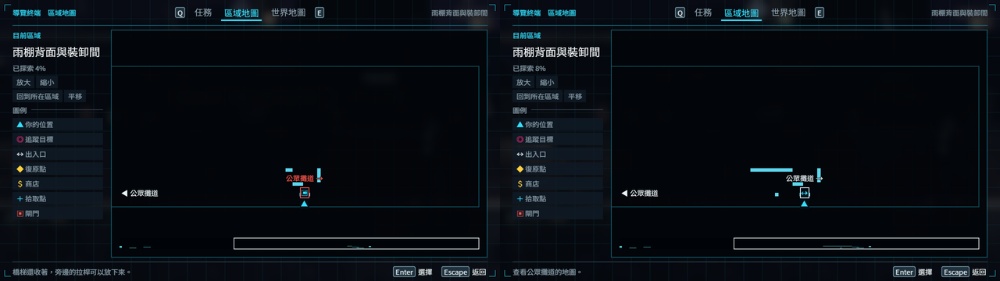

# [NE-313] 從地圖查看捷徑與出口狀態

> 狀態：完成

## 內文

### 需求

區域地圖可區分已發現的鎖門與可通行出口，玩家在回訪前能看見開啟條件，並可直接查看已接通的另一端。[探索設計](../../design/20-campaign-experience/EXPLORATION_AND_ATMOSPHERE.md)

### 來源

2026-11-24，使用者要求地圖支援複雜連線、捷徑與折返探索。

### 驗收條件

- [x] 地圖提示反映遊戲中同一出入口的通行條件。
- [x] 選取可用出口會查看另一端。已探索的落點可聚焦，返回可回原視窗。
- [x] 站在出口時，位置和出口圖示均可看見；查看另一端不會補探索。
- [x] 橋梯經正式拉桿解鎖後可往返，完全退出並重新讀檔仍可通行。

### 測試流程

1. 在第二章裝卸間查看未放下的橋梯，再操作旁邊拉桿。
2. 選取區域圖中的橋梯確認另一端位置。實際過橋並折返，再退出和續玩。

---

# 跟其他票的關係

- Blocks：無
- Blocked by：無
- Related：NE-223、NE-312、ST-19

---

# Commit-1

## 內文

第二章裝卸間的橋梯現在會在區域圖顯示原本的鎖定提示。用原拉桿放下橋梯後可選出口查看公眾攤道。確認已探索的另一端會移至落點，返回仍選中原出口。玩家位置圖示會與門標分開顯示。

### 測試結果

受影響測試 31 組、22,434 項全過。地圖專項 536 項全過。使用 RX 9070 XT Forward+ 進行中途存檔樣本的拉桿、往返、讀檔測試，兩個原生程序合計 26 項全過。

### 截圖

