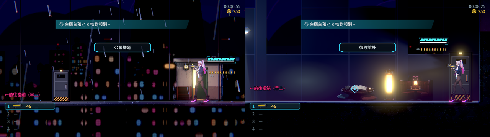

# [NE-314] 加入市集雨棚到復原館的回環

> 狀態：完成

## 內文

### 需求

已完成查核的玩家可從復原館東側員工門回到公眾攤道上層，往返時可走不同的路。[探索設計](../../design/20-campaign-experience/EXPLORATION_AND_ATMOSPHERE.md)

### 來源

2026-11-24，使用者要求新增有回訪價值的地圖與複雜路線。

### 驗收條件

- [x] 通道在正式委託終端完成查核上傳後開啟，兩個入口提供同一解鎖提示。
- [x] 復原館與雨棚各有辨認入口的設施，實際走到門口可雙向通行。
- [x] 到達時站在對應的入口，落地可繼續移動，原主線出入口與獎勵維持。

### 測試流程

1. 在終端上傳前試用東側門。上傳後沿室內走到門口。
2. 穿越到公眾攤道上層，移動離開再折返，由同一通道回到復原館。

---

# 跟其他票的關係

- Blocks：無
- Blocked by：無
- Related：NE-313、ST-19

---

# Commit-1

## 內文

從復原館東側可走員工通道，在雨棚上層的樓梯間出來。實測先以劇情前置樣本檢查鎖門，再操作正式終端送件。原生視窗中以移動輸入走到兩側門口，雙向穿越後都落在對應入口，查核報酬仍只結算一次。

### 測試結果

RX 9070 XT 原生 Forward+ 12 項路線檢查全過。受影響測試 54 組、60,833 項全過。章節產生器與出入口檢查全過。

### 截圖

