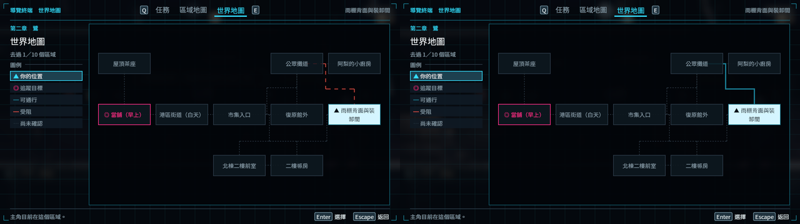

# [NE-315] 穩定世界地圖並區分連線狀態

> 狀態：完成

## 內文

### 需求

反覆走訪不同區域時，世界地圖保有相同配置。連線清楚標示已發現、可通行或仍受阻的走法。[探索設計](../../design/20-campaign-experience/EXPLORATION_AND_ATMOSPHERE.md)

### 來源

2026-11-24，使用者要求完整地圖，方便掌握互連區域與回訪路線。

### 驗收條件

- [x] 在同一章以相同顯示設定跨區，世界圖的區域位置保持一致。
- [x] 區分可通行、受阻、尚未確認的連線，圖例有一致的聚焦和 Hover 說明。
- [x] 平行路線中只要有一處已知出口可通行，就顯示為可通行。

### 測試流程

1. 查看第二章世界圖，經公眾攤道到裝卸間後重新開圖。
2. 查看只發現橋梯時的鎖定狀態，再拉下橋梯，核對連線圖例與樣式。
3. 展開同一對區域間多條路線，確認地面出口已知時橋梯鎖定仍可繞行。

---

# 跟其他票的關係

- Blocks：無
- Blocked by：無
- Related：NE-312、NE-313、NE-314

---

# Commit-1

## 內文

世界圖以章節入口定位，穿越區域時只移動所在位置的標記。新增三種線樣式和圖例，支援確認目前可通行或受阻的路。以下為只發現橋梯的顯示樣本，分別取正式拉桿前後的畫面。另核對自然狀態下，已發現的地面出口仍可走。

### 測試結果

RX 9070 XT 原生 Forward+ 的往返與重讀合計 36 項全過。受影響測試 16 組、9,505 項全過。

### 截圖

