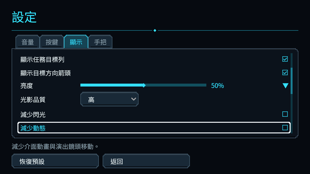

# [NE-316] 說明減少動態也會調整演出鏡頭

> 狀態：完成

## 內文

### 需求

玩家在顯示設定能找到減少鏡頭動態的選項，提示簡短說明影響介面和場景取景。[場景設計](../../design/20-campaign-experience/EXPLORATION_AND_ATMOSPHERE.md)

### 來源

2026-11-24，使用者要求增加場景氛圍，功能引導和 Hover 要說明重點。

### 驗收條件

- [x] 中文、日文與英文能從選項名稱或提示辨認效果。
- [x] 文字放大時可聚焦設定並讀到說明，鍵盤操作照常。

### 測試流程

1. 進入顯示設定，聚焦減少動態，查看說明並啟用。
2. 切換介面語言，確認說明與控制仍可操作。

---

# 跟其他票的關係

- Blocks：無
- Blocked by：無
- Related：BG-58、NE-228

---

# Commit-1

## 內文

顯示設定的名稱改為減少動態，說明同時涵蓋介面動畫和演出鏡頭。原生顯示設定使用 120% 文字，逐一核對中、日、英的文字、聚焦與切換。

### 測試結果

RX 9070 XT Forward+ 原生 9 項全過。受影響測試 22 組、11,513 項全過。

### 截圖

