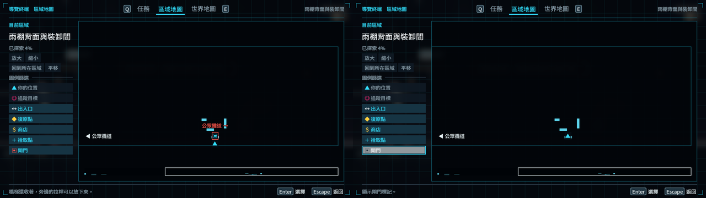

# [NE-317] 區域地圖可按圖例收起標記

> 狀態：完成

## 內文

### 需求

同區回訪時能從圖例選擇想看的標記。從橋梯入口找拉桿，或回頭找復原點、商店與補給時，其他標記可以暫時收起。[地圖設計](../../design/20-campaign-experience/EXPLORATION_AND_ATMOSPHERE.md)

### 來源

2026-11-24，使用者要求完整且適合反覆探索的地圖系統。

### 驗收條件

- [x] 可以用鍵盤、滑鼠或手把操作圖例。焦點和 Hover 顯示同一句操作說明。
- [x] 玩家、追蹤目標、視窗位置與探索資料維持。切分頁再回來保留篩選，放大字體時能捲到每個圖例。
- [x] 已發現的鎖門跟隨閘門篩選，開通後跟隨出入口。世界圖照原規則呈現。

### 測試流程

1. 到第二章裝卸間，選擇閘門圖例，確認已發現的橋梯標記暫時收起。
2. 用正式拉桿開通橋梯，切換出入口圖例，再顯示並查看另一端。

---

# 跟其他票的關係

- Blocks：無
- Blocked by：無
- Related：NE-313、NE-315

---

# Commit-1

## 內文

出入口、復原點、商店、拾取點及閘門可分開切換。圖例顏色和操作提示同步。切換時沿用地形貼圖，保留視窗、探索和追蹤資料。文字放大時區域圖的圖例欄可捲動，鍵盤和手把的焦點會自動帶入可見範圍。世界圖與文件來源圖維持原圖例。

### 測試結果

- RX 9070 XT Forward+ 原生 47 項全過。依正式拉桿的結果切換閘門與出入口、用原門來回走通橋梯。篩選透過鍵盤、視窗內合成滑鼠點擊與合成手把確認事件切換。中、日、英文的圖例在 120% 字級各完成聚焦捲動。
- 受影響 Godot 回歸 16 組、9,515 項全過。

### 截圖

