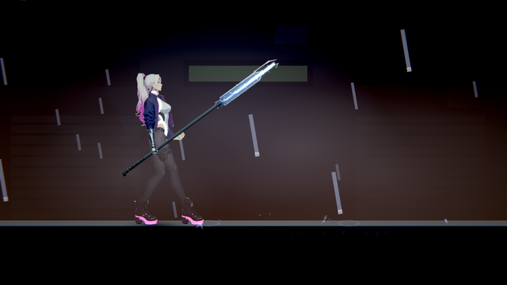

# [NE-318] 近戰待機跳過重複的刃光與音量更新

> 狀態：完成

## 內文

### 需求

拿著近戰武器時減少重複處理。拿出、收起、轉向與出招時的刃光與待機聲仍跟著武器，並遵循可及性設定。[戰鬥設計](../../design/15-combat-feel/DESIGN.md)

### 來源

2026-11-24，使用者要求從架構解決遊玩時的卡頓並繼續處理近戰效能。

### 驗收條件

- [x] 待機直接沿用相同的光源參數、位置與音量；效果轉換時仍按原規則更新。
- [x] 五把武器在正常設定與減少閃光及動態設定中的持握和出招效果一致。
- [x] 在現行主線對照中重複量測，不增加代表性待機影格耗時。

### 測試流程

1. 逐把換上近戰武器，從待機、轉向、攻擊到收起，檢查刃光與音量。
2. 開啟減少閃光與動態以同樣輸入再跑一輪，最後量測待機。

---

# 跟其他票的關係

- Blocks：無
- Blocked by：無
- Related：NE-260、NE-261、NE-275

---

# Commit-1

## 內文

刃光的腳本只有在傳給渲染器的位置、亮度、半徑或啟用狀態有變化時更新。武器嗡聲的音量在淡入、出招壓低、淡出與起播時更新。沿用原有插值和命中時序。

### 測試結果

- RX 9070 XT Forward+，同程式除本次兩處更動外，設定與輸入相同。五把武器的 1,440 個演出取樣逐格核對光源、音量、相位與方向。光源範圍變更通知由 1,141 降至 1,007 次。20 個正常／輔助模式武器實測均通過。
- 以交替順序量測五把武器的 24,000 個待機影格。液壓錘四組中位數變化為 +0.73%，再以加長暖機和取樣單獨重測六對共 10,800 格，有四對較快。表列成對變化的中位數。NE-275 與歷史開票版本的整幀門檻仍開啟。

| 武器 | 中位耗時 | 第 95 百分位 | 第 99 百分位 | 成對量測 |
|---|---:|---:|---:|---|
| 熱能長刀 | -1.07% | -1.80% | -14.94% | 4 對、各 600 格 |
| 匕首 | -1.20% | -1.51% | -0.44% | 4 對、各 600 格 |
| 戰戟 | -1.58% | -5.03% | -15.48% | 4 對、各 600 格 |
| 液壓錘 | -0.46% | -1.10% | -3.32% | 6 對、各 900 格 |
| 軟鞭 | -1.43% | -19.53% | -27.64% | 4 對、各 600 格 |

- 受影響的 Godot 回歸 30 組、47,565 項全過。

### 截圖

