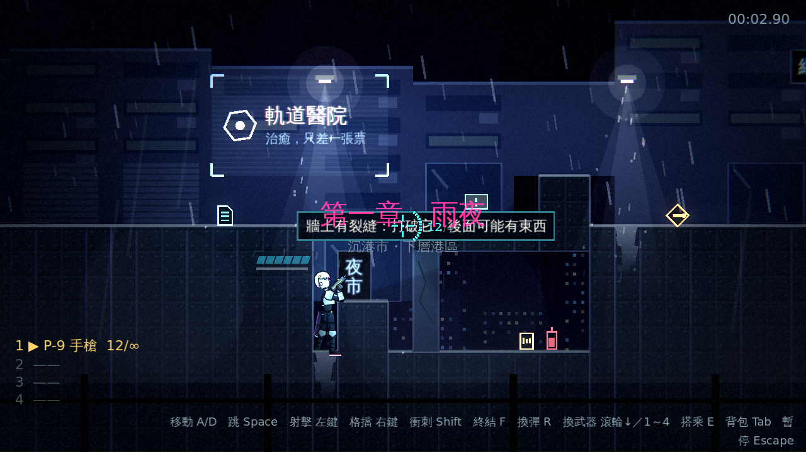
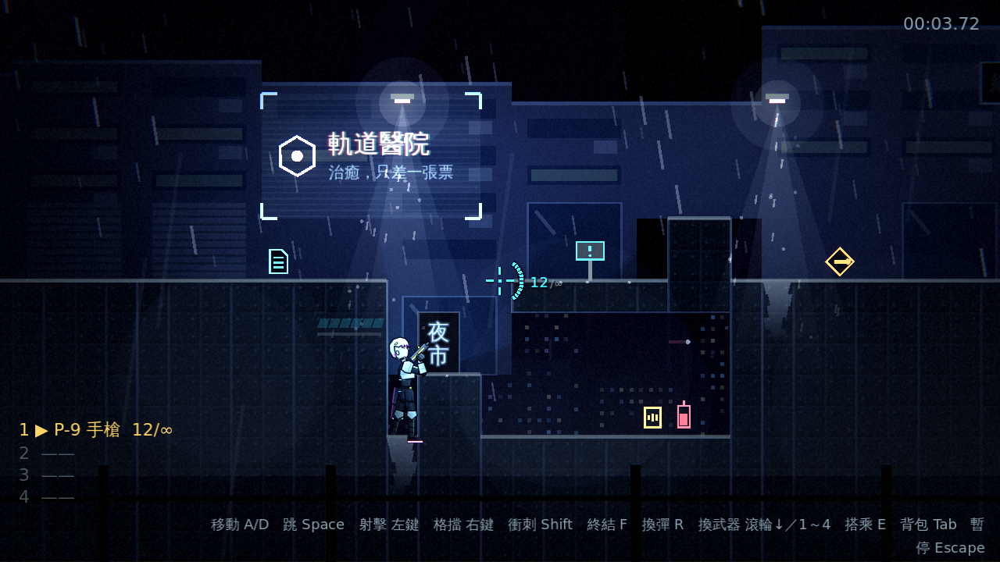
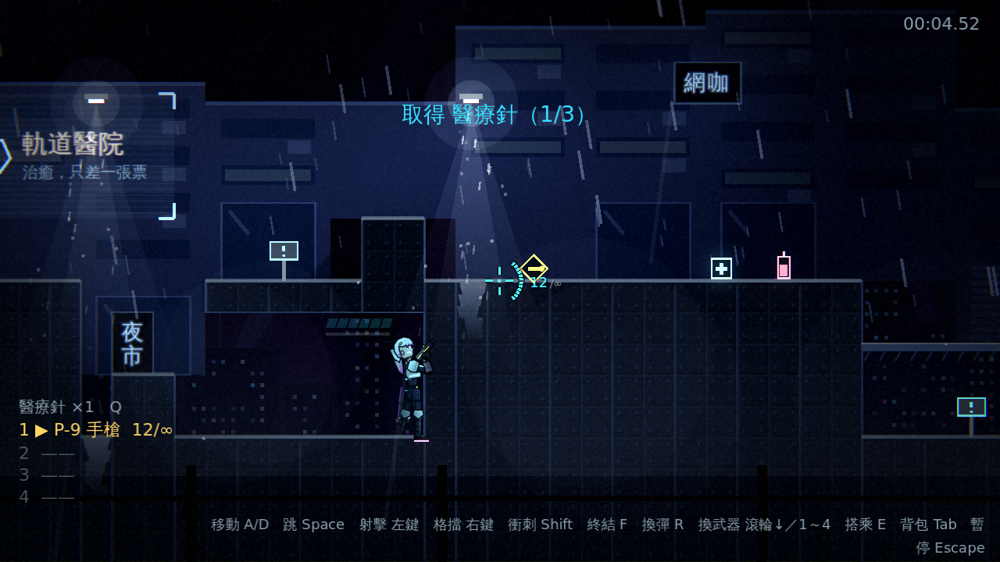
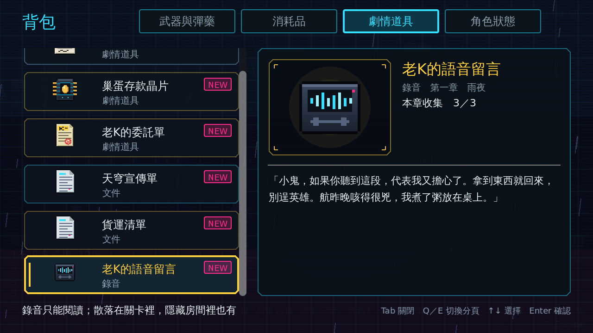

# [NE-31] 加入隱藏房間與背景故事收集

> 狀態：完成

## 內文

### 需求
場景只有一條路，沒有探索的理由。加入隱藏房間與可收集的背景故事（文件與錄音），讓玩家想停下來找。設計見 `design/09-content/DESIGN.md` 第三節。

### 來源
2026-10-02，使用者於開發對話中提出：「讓遊戲內容更豐富」；確認四個方向都要做（第二章／新關卡、新敵人與新頭目、場景互動與探索、成長系統），順序為先光影再內容。

### 驗收條件
- [x] 關卡中有隱藏房間，入口是可破壞的牆面或需要開關開啟（第一章已有一間；第二章的隱藏房間隨 NE-27 製作，開關閘門版本在 NE-30 完成）
- [x] 隱藏房間內有道具、彈藥或背景文件
- [x] 文件與錄音可收集，在背包的劇情道具分頁閱讀
- [x] 每章有固定的收集數量，背包顯示收集進度
- [x] 取得時跳出提示，已取得的內容依本輪進度保留

### 測試流程
1. 找到隱藏房間並取得文件，確認提示
2. 開啟背包，在劇情道具分頁閱讀文件並確認收集進度
3. 重開關卡，確認已取得的內容保留
4. 執行完整測試套件，全部通過

---

# 跟其他票的關係

- Blocks：無
- Blocked by：NE-30
- Related：NE-15、NE-16

---

---

# Commit-1

## 內文

場景現在有想停下來找的東西。文件與錄音（背景故事收集品）是劇情道具的延伸：資料多了種類、所屬章節、全文與撿到時播放的通訊；在關卡 legend 一個字元對應一件，撿起後放進背包的劇情道具分頁閱讀，詳情顯示全文與「本章收集 x／y」，分頁 tooltip 與結算畫面顯示整體進度，撿取時跳出提示並顯示本章進度。已收集的內容跟著本輪進度：重生或重開關卡都保留，已收集的不會再出現，只有開始新的一輪才重置。每章固定數量（第一章 3 件、第二章 6 件，共 9 件新資料）。
隱藏房間的入口是新的「裂縫牆」（可破壞物的一種，外觀像地形、只有裂紋與微弱的青色閃光，靠近有提示），打破後露出裡面的收集品與補給；第一章在屋頂 B 的牆內放了一間，另外兩件收集品放在明處。新增文件與錄音的像素圖示（暫代美術）。
資料驗證：文件與錄音必須有章節與內文，內文超過 220 字（背包放不下）、取得時機不是手動都會被回報。
驗收方式：測試驗證資料與每章數量、撿取提示含進度、重生後保留與不再出現、新一輪重置、裂縫牆擋路與打破後進得去並拿到文件、背包列出與全文與進度與分頁 tooltip；截圖如下。

### 測試結果

| 項目 | 結果 |
|---|---|
| 完整測試套件 | 通過 1251 / 1251 |
| 資料驗證 | 0 錯誤 |
| 執行 log | 無非預期 ERROR |

### 截圖

