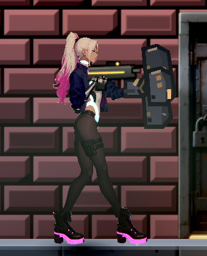

# [NE-320] 格擋改用前臂折疊偏折板

> 狀態：完成

## 內文

### 需求

右鍵格擋用符合遊戲世界觀的機械裝置呈現。站定時雙腳貼地，走或落地時裝置跟著前臂。[格擋設計](../../design/15-combat-feel/GUARD_ARM.md)

### 來源

2026-11-24，使用者指出凜格擋時後腳浮空、發光盾面和場景風格不合，授權重新設計右鍵的演出。

### 驗收條件

- [x] 站定與走停時兩側鞋底貼地。後手的三片偏折板隨方向展開與收起。
- [x] 普通格擋、完美反彈、破防各有回饋。實際角度、時間窗、防禦量、升級與按鍵保持相同效果。
- [x] 兩個面向、上下瞄準、不同槍械、走跳落地皆驗證同一個前臂接點。明暗對照及減少閃光／動態均可辨識。

### 測試流程

按右鍵站定、走停及跳落，兩側重複。用來襲子彈逐次命中格擋、完美窗口與即將破防狀態，再以減少閃光及低震動重拍對照。

---

# 跟其他票的關係

- Blocks：無
- Blocked by：無
- Related：NE-222、NE-239、NE-269

---

# Commit-1

## 內文

用低亮度的折疊偏折板和琥珀燈表達格擋。兩腳的固定位置沿用落腳 IK，移動時保留原步態，格擋規則沿用 Player 的判定。

### 測試結果

- RX 9070 XT Forward+，當鋪實際格擋及暗亮兩種背景。兩腳在同一個地面基準，後手前臂於格擋時撐住裝置。原生子彈碰撞核對一般格擋、完美反彈、破防的防禦量、傷害與回饋。另檢視減少閃光及低震動畫面。
- 先行防禦特效與輸入檢查 671 項通過。正式受影響的 60 組、68,071 項全過。

### 截圖

