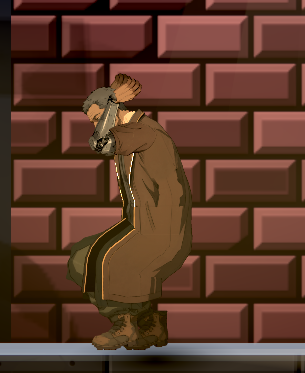

# [NE-322] 修正老 K 護頭與大衣殘影

> 狀態：完成

## 內文

### 需求

老 K 受驚時蹲下護頭。肘腕銜接合理，雙腳踩地。清除抬手時出現在衣身、腰和衣襬的舊袖口與手臂殘影。[角色動作設計](../../design/12-cast-redraw/NPC_PERFORMANCE.md)

### 來源

2026-11-24，使用者附上當鋪接點特寫及衣料上的殘留輪廓，要求修正不合理的肢體。

### 驗收條件

- [x] 雙側接近、蹲伏進入、撐住頭部與安靜後起身皆可觀察。兩手沿前臂自然彎曲。
- [x] 原貼圖的手臂陰影從三件衣料底層移除。底層修正可重建，衣料輪廓和支點與原圖一致。

### 測試流程

各從一側實際觸發三次槍聲，逐格看手腕和頭部，待角色起身後檢查。分別對照衣身、腰和衣襬，重建紋理並以 Forward+ 實景確認。

---

# 跟其他票的關係

- Blocks：無
- Blocked by：無
- Related：NE-250、NE-255

---

# Commit-1

## 內文

校正老 K 抬臂、屈肘與轉腕的關節角度。沿用他的無袖階段圖，局部重建衣身、腰部和衣襬的色彩及法線。

### 測試結果

- RX 9070 XT Forward+，當鋪雙側觸發；兩側收錄的持續取樣期間，最大手腕折角約 54.3°，安靜後回到原姿態。貼圖 alpha 全部相同，三件素材的支點不變。
- 兩次重建與實機採用素材逐像素一致。正式受影響的 53 組、67,493 項全過。

### 截圖

