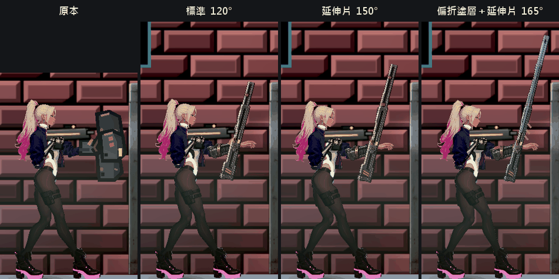

# [NE-324] 重做伸縮偏折板與升級演出

> 狀態：完成

## 內文

### 需求

凜的前臂偏折板改成一條窄長、可分段伸縮的金屬板。改裝後增加實際防禦角度，並解鎖對應的外觀、動作和特效。

### 來源

Stanley，2026-11-24，格擋外觀與升級回饋。

### 驗收條件

- [x] 板身分件在前臂組合，抬起、受撞和收回的動作連續。
- [x] 延伸片擴大可格擋角度，搭配偏折塗層再擴大角度並伸出高階導片。
- [x] 改裝提示顯示實際角度，格擋、完美反彈和破防各有清楚回饋。

### 測試流程

1. 朝左右兩側格擋、放開，再用來襲子彈觸發普通格擋、反彈和破防。
2. 比較未改裝、裝延伸片、再加偏折塗層的外觀和斜向格擋，檢查改裝頁的角度。

---

# 跟其他票的關係

- Blocks：無
- Blocked by：無
- Related：NE-320、NE-269

---

# Commit-1

## 內文

五個部件組成一片窄長金屬板，沿前臂翻轉、伸出、受撞及收回。延伸片把格擋角度從 120° 增加到 150°，搭配偏折塗層可伸出導片並達到 165°。改裝提示按已裝零件顯示角度。

### 測試結果

| 項目 | 結果 |
|---|---|
| 受影響測試 | 66 組、94,642 項檢查全過 |
| 斜向來襲子彈 | 68° 由延伸片擋下，78° 需再搭配偏折塗層，83° 仍能打進 |
| 當鋪原生畫面 | 兩個面向，腕部每次取樣最大移動 2.84 世界像素 |
| 自動輸入與子彈 | 普通格擋、完美反彈、破防皆通過 |
| 分件重建 | 五張貼圖重建兩次，內容一致 |

### 截圖

